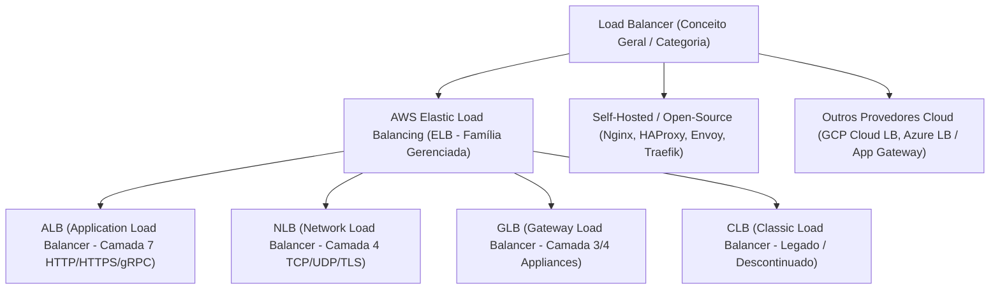
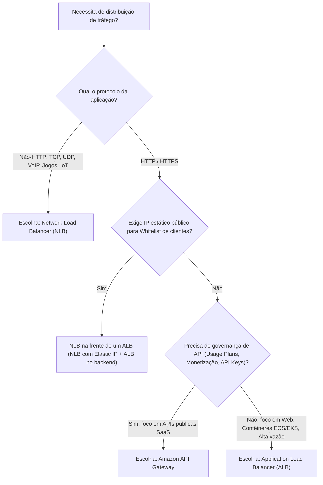

# ⚖️ Elastic Load Balancing (ELB) & Application Load Balancer (ALB)

> **Contexto:** No design de sistemas distribuídos e arquiteturas em nuvem (AWS), o balanceamento de carga é a espinha dorsal para garantir **Alta Disponibilidade (HA)**, **Escalabilidade Horizontal** e **Tolerância a Falhas**. Compreender a distinção entre o conceito genérico de *Load Balancer* e o serviço especializado *Application Load Balancer (ALB)* é essencial para desenhar arquiteturas eficientes e otimizadas em custo e desempenho.

---

## 🧭 Sumário Executivo: Load Balancer vs. ALB

Muitas vezes surge a dúvida: *"Devo usar um Load Balancer ou um ALB?"*. Na verdade, **não se trata de opções excludentes**, mas de uma relação de **categoria geral vs. implementação específica**:



1. **Load Balancer (Balanceador de Carga):** É o conceito arquitetural amplo. Trata-se de qualquer componente (hardware, software ou appliance de rede) que recebe requisições de clientes e as distribui entre dois ou mais servidores/instâncias saudáveis para evitar sobrecarga e garantir disponibilidade.
2. **AWS ELB (Elastic Load Balancing):** É o serviço de balanceamento totalmente gerenciado da AWS, que escala automaticamente para absorver variações de carga.
3. **AWS ALB (Application Load Balancer):** É o tipo mais popular da família ELB, operando na **Camada 7 (Aplicação)** do modelo OSI. Ele toma decisões inteligentes de roteamento baseando-se no conteúdo HTTP/HTTPS (URL, cabeçalhos, método, cookies).

---

## 1. Fundamentos: O que faz um Load Balancer?

Um balanceador de carga atua como um "guarda de trânsito" posicionado entre os clientes externos e seu parque de servidores (backend).

### Principais Responsabilidades
* **Distribuição de Carga:** Impede que um único servidor fique sobrecarregado enquanto outros estão ociosos.
* **Health Checks (Verificação de Saúde):** Monitora periodicamente os nós de destino. Se uma instância falhar, o tráfego é desviado imediatamente para instâncias saudáveis, sem downtime perceptível para o usuário final.
* **Término / Descarregamento de SSL/TLS (SSL Offloading):** O balanceador decifra a criptografia HTTPS, poupando CPU dos servidores de aplicação e centralizando a gestão de certificados.
* **Desacoplamento e Abstração:** Clientes conversam apenas com o DNS/IP do balanceador; a topologia interna de instâncias (IPs privados em subnets privadas) permanece oculta e protegida.
* **Integração com Auto Scaling:** Trabalha em conjunto com Auto Scaling Groups (EC2) ou orquestradores de contêineres (ECS / EKS), registrando e desregistrando nós dinamicamente (*Connection Draining* / *Deregistration Delay*).

---

## 2. A Família AWS Elastic Load Balancing (ELB)

Na AWS, você não instala nem gerencia servidores para fazer o balanceamento; você utiliza o **ELB**, que se divide em 4 tipos:

| Tipo | Camada OSI | Protocolos Suportados | Foco Principal | Latência Típica |
| :--- | :--- | :--- | :--- | :--- |
| **ALB (Application Load Balancer)** | **Camada 7** (Aplicação) | HTTP, HTTPS, HTTP/2, gRPC, WebSockets | Roteamento avançado por conteúdo, microsserviços, contêineres e APIs web | ~10 a 20 ms |
| **NLB (Network Load Balancer)** | **Camada 4** (Transporte) | TCP, UDP, TLS | Altíssimo throughput (milhões de req/s), latência ultrabaixa, IP estático | < 1 ms (Submilissegundos) |
| **GLB (Gateway Load Balancer)** | **Camada 3 e 4** (Rede/Transporte) | Protocolo GENEVE + IP | Inspeção de pacotes, firewalls virtuais de terceiros (Palo Alto, Fortinet) e appliances | Depende do appliance |
| **CLB (Classic Load Balancer)** | Camada 4 e 7 (Híbrido) | HTTP, HTTPS, TCP, SSL | **Legado** da antiga rede EC2-Classic. Não recomendado para novos projetos | ~20 a 30 ms |

---

## 3. Mergulho Profundo: Application Load Balancer (ALB)

O **ALB** é a escolha padrão para tráfego web moderno, APIs RESTful e aplicações baseadas em contêineres (Amazon ECS e EKS).

### 3.1. Arquitetura e Componentes do ALB

```mermaid
flowchart LR
    Client["Clientes / Internet"] -->|HTTPS :443| ALB["Application Load Balancer (ALB)"]
    
    subgraph Listeners & Rules
        L1["Listener 443"] --> R1["Regra: /api/*"]
        L1 --> R2["Regra: /auth/*"]
        L1 --> R3["Regra: static.empresa.com"]
        L1 --> R_Def["Regra Padrão (Default)"]
    end
    
    ALB --> L1
    
    subgraph Target Groups
        TG1["Target Group API (ECS / Fargate)"]
        TG2["Target Group Auth (EC2 Instances)"]
        TG3["Target Group S3 / Lambda"]
        TG_Def["Target Group Web Front"]
    end
    
    R1 --> TG1
    R2 --> TG2
    R3 --> TG3
    R_Def --> TG_Def
```



1. **Listeners:** Processos que escutam requisições em uma porta e protocolo específicos (ex.: porta 80 HTTP, porta 443 HTTPS).
2. **Rules (Regras):** Condições avaliadas sequencialmente por prioridade. Quando a condição é atendida, uma ação é executada (encaminhar, redirecionar ou responder com erro estático).
3. **Target Groups (Grupos de Destino):** Agrupamento lógico dos recursos de backend que receberão as requisições roteadas.
   * **Tipos de alvos aceitos:**
     * `instance`: IDs de instâncias EC2.
     * `ip`: Endereços IP privados (VPC ou On-Premises via Direct Connect/VPN) e tarefas ECS com rede `awsvpc`.
     * `lambda`: Invoca funções AWS Lambda diretamente a partir de requisições HTTP.
     * `alb`: Permite encadear ALBs em arquiteturas complexas.

### 3.2. Capacidades Avançadas do ALB

* **Roteamento Baseado em Conteúdo (Content-Based Routing):**
  * **Path-based:** Roteia `/pagamentos/*` para o microsserviço de pagamentos e `/catalogo/*` para o serviço de produtos.
  * **Host-based:** Roteia `api.empresa.com` para a API e `app.empresa.com` para o frontend.
  * **HTTP Headers / Methods / Query Params:** Roteia com base no cabeçalho `User-Agent`, cookies de sessão, ou métodos HTTP (`POST` vs `GET`).
* **Redirecionamento Nativo e Respostas Fixas:**
  * Redirecionamento automático de HTTP (porta 80) para HTTPS (porta 443) sem consumir instâncias de backend.
  * Retorno de respostas fixas (ex.: `HTTP 403 Forbidden` ou `HTTP 503 Maintenance`) direto no listener.
* **Server Name Indication (SNI):**
  * Suporte a múltiplos certificados SSL/TLS no mesmo ALB/porta 443 através do **AWS Certificate Manager (ACM)**.
* **Autenticação Integrada:**
  * O ALB pode autenticar usuários antes de repassar a requisição, integrando-se nativamente com **Amazon Cognito** ou qualquer provedor de identidade compatível com **OIDC / OAuth 2.0** (Google, Microsoft, Okta).
* **Segurança com AWS WAF:**
  * Integração nativa de um clique com o **AWS WAF (Web Application Firewall)** na camada 7, bloqueando ataques SQLi, XSS e mitigando bots maliciosos antes de atingir os servidores.
* **Suporte a gRPC e WebSockets:**
  * Comunicação bidirecional e streaming contínuo em tempo real.
* **Deregistration Delay (Connection Draining):**
  * Ao remover um nó para deploy ou auto-scaling, o ALB aguarda o término das conexões ativas antes de desconectar o alvo (padrão de 300 segundos, configurável).

---

## 4. Matriz Comparativa: ALB vs. NLB vs. API Gateway

Muitos times ficam na dúvida se devem usar **ALB**, **NLB** ou **Amazon API Gateway**:

| Recurso | ALB (Application Load Balancer) | NLB (Network Load Balancer) | Amazon API Gateway |
| :--- | :--- | :--- | :--- |
| **Camada OSI** | Camada 7 (Aplicação) | Camada 4 (Transporte) | Camada 7 (API Management / Proxy) |
| **Protocolos** | HTTP, HTTPS, HTTP/2, gRPC, WebSockets | TCP, UDP, TLS | REST (HTTP), HTTP APIs, WebSockets |
| **Endereçamento IP** | IPs elásticos dinâmicos (DNS obrigatório) | **IPs Estáticos / Elastic IPs fixos por AZ** | N/A (Endpoint gerenciado com DNS CloudFront) |
| **Performance / Latência** | Baixa latência (~10-20 ms) | **Latência ultrabaixa (< 1 ms)** | Variável (~20-50 ms, com cold start de Lambdas) |
| **Capacidade Máxima** | Escala automaticamente por LCU | **Milhões de conexões/seg sem pré-aquecimento** | Throttling por conta/região (soft limits) |
| **Recursos de API** | Roteamento de tráfego, headers, paths | Apenas portas e protocolos TCP/UDP | Transformação de payload, OpenAPI/Swagger, Rate Limiting por API Key (Usage Plans) |
| **Destinos Típicos** | EC2, ECS Fargate, EKS, Lambda | EC2, EKS (Ingress), Serviços On-Premises, IP privado | Funções Lambda, DynamoDB direto, HTTP backends |
| **Cobrança / FinOps** | Por hora de ALB + LCU (Load Balancer Capacity Units) | Por hora de NLB + NLCU (processamento de bytes/conexões) | Por milhão de requisições invocadas (sem custo fixo ocioso) |

---

## 5. Árvore de Decisão Arquitetural: O que escolher?

Use o fluxograma abaixo para orientar a escolha do balanceador ou gateway no design da solução:



---

## 6. Exemplo Prático com Terraform: Provisionando um ALB Completo

Abaixo está uma estrutura declarativa e pronta para produção usando Terraform, configurando:
1. Application Load Balancer (Internet-facing).
2. Target Group com Health Check rigoroso.
3. Listener HTTPS na porta 443 com certificado ACM.
4. Listener HTTP na porta 80 com **redirecionamento automático 301 para HTTPS**.

```hcl
# 1. Security Group para o ALB
resource "aws_security_group" "alb_sg" {
  name        = "alb-web-sg"
  description = "Permite entrada HTTP e HTTPS da Internet"
  vpc_id      = var.vpc_id

  ingress {
    description = "HTTP da Internet"
    from_port   = 80
    to_port     = 80
    protocol    = "tcp"
    cidr_blocks = ["0.0.0.0/0"]
  }

  ingress {
    description = "HTTPS seguro da Internet"
    from_port   = 443
    to_port     = 443
    protocol    = "tcp"
    cidr_blocks = ["0.0.0.0/0"]
  }

  egress {
    description = "Tráfego de saída para os alvos internos"
    from_port   = 0
    to_port     = 0
    protocol    = "-1"
    cidr_blocks = ["0.0.0.0/0"]
  }

  tags = {
    Environment = "production"
    ManagedBy   = "Terraform"
  }
}

# 2. Application Load Balancer
resource "aws_lb" "main" {
  name               = "main-app-alb"
  internal           = false # Público voltado para internet
  load_balancer_type = "application"
  security_groups    = [aws_security_group.alb_sg.id]
  subnets            = var.public_subnet_ids # Mínimo de 2 AZs distintas

  enable_deletion_protection = true # Protege contra exclusão acidental em Prod
  drop_invalid_header_fields = true # Mitiga riscos de HTTP request smuggling

  tags = {
    Environment = "production"
    Role        = "Application Load Balancer"
  }
}

# 3. Target Group (Alvos da Aplicação)
resource "aws_lb_target_group" "app_tg" {
  name        = "app-production-tg"
  port        = 8080
  protocol    = "HTTP"
  vpc_id      = var.vpc_id
  target_type = "ip" # Ideal para ECS Fargate com rede awsvpc

  deregistration_delay = 30 # Connection draining rápido para deploy ágil

  health_check {
    enabled             = true
    path                = "/health"
    port                = "traffic-port"
    protocol            = "HTTP"
    interval            = 15
    timeout             = 5
    healthy_threshold   = 2
    unhealthy_threshold = 3
    matcher             = "200"
  }
}

# 4. Listener HTTP (Porta 80) - Redirecionamento permanente para HTTPS
resource "aws_lb_listener" "http_redirect" {
  load_balancer_arn = aws_lb.main.arn
  port              = 80
  protocol          = "HTTP"

  default_action {
    type = "redirect"

    redirect {
      port        = "443"
      protocol    = "HTTPS"
      status_code = "HTTP_301"
    }
  }
}

# 5. Listener HTTPS (Porta 443) - Encaminhamento seguro para o Target Group
resource "aws_lb_listener" "https" {
  load_balancer_arn = aws_lb.main.arn
  port              = 443
  protocol          = "HTTPS"
  ssl_policy        = "ELBSecurityPolicy-TLS13-1-2-2021-06" # Apenas TLS 1.2 e 1.3
  certificate_arn   = var.acm_certificate_arn

  default_action {
    type             = "forward"
    target_group_arn = aws_lb_target_group.app_tg.arn
  }
}
```

---

## 7. Boas Práticas de Operação, Segurança e FinOps

### Segurança & Resiliência
1. **Multi-AZ Mandatório:** Um ALB deve sempre ser associado a pelo menos **duas subnets públicas em zonas de disponibilidade (AZs) distintas**. Isso garante resiliência mesmo se uma AZ inteira da AWS falhar.
2. **Security Groups em Camadas:** O Security Group dos servidores de backend (EC2/ECS) **nunca** deve permitir tráfego direto de `0.0.0.0/0`. A porta de aplicação deve permitir entrada **apenas originada do Security Group do ALB**.
3. **Proteção de Camada 7:** Associe uma **Web ACL do AWS WAF** ao ALB para inspecionar payloads maliciosos e configurar rate limiting por IP de clientes abusivos.
4. **Access Logs no S3:** Habilite o envio de Access Logs do ALB para um bucket S3 com ciclo de vida (Glacier) para auditoria e análise forense via Athena.

### FinOps & Dimensionamento (LCU - Load Balancer Capacity Unit)
* O custo do ALB é composto por uma taxa fixa horária (~$0.0225/hora) + consumo de **LCU** ($0.008 por LCU-hora).
* Uma LCU mede a maior das 4 dimensões a cada hora:
  1. Novas conexões por segundo (até 25/s).
  2. Conexões ativas por minuto (até 3.000).
  3. Bytes processados (até 1 GB para EC2/IP targets).
  4. Avaliação de regras (até 1.000 regras processadas por segundo).
* **Dica de Economia:** Para arquivos estáticos pesados (imagens, vídeos, PDFs), **coloque o Amazon CloudFront à frente do ALB**. O CloudFront armazena em cache na borda (*Edge Locations*), reduzindo dramaticamente os bytes processados pelo ALB e economizando custos de LCU e de tráfego de saída (*Data Transfer Out*).
