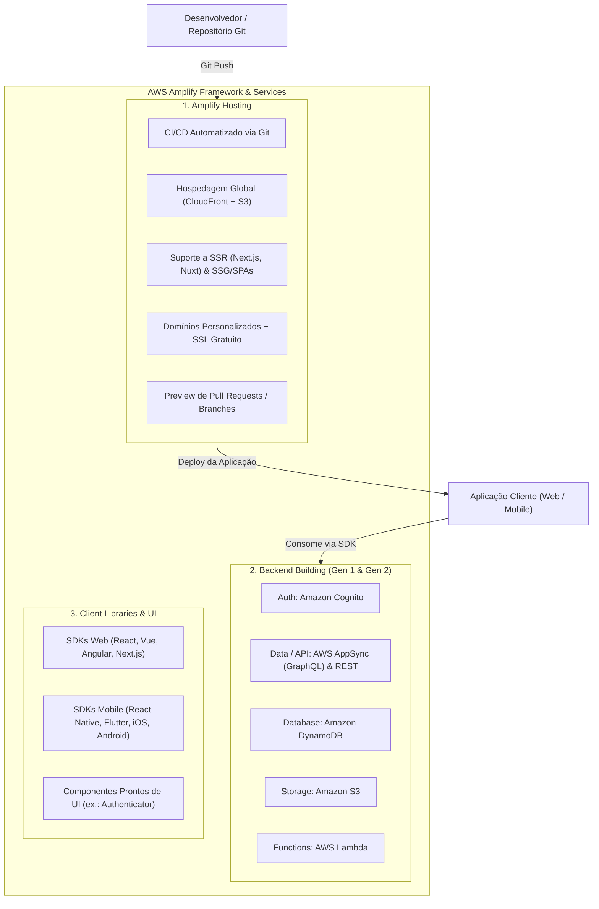

# ⚡ AWS Amplify — Visão Geral, Arquitetura e Guia Prático

O **AWS Amplify** é um conjunto completo de ferramentas, bibliotecas e serviços gerenciados pela AWS projetado para acelerar o desenvolvimento, implantação e hospedagem de aplicações **Web Fullstack** e **Mobile**.

---

## 🧭 O que é o AWS Amplify?

Tradicionalmente, construir uma aplicação moderna na AWS requer conectar manualmente dezenas de serviços: **Amazon S3** (armazenamento e assets estáticos), **Amazon CloudFront** (CDN e borda), **Amazon Cognito** (autenticação de usuários), **AWS AppSync** ou **API Gateway** (APIs GraphQL/REST), **AWS Lambda** (funções serverless) e **Amazon DynamoDB** (banco NoSQL).

O Amplify abstrai essa complexidade atuando em três pilares fundamentais:



---

## 🏛️ Os Três Pilares do Amplify

### 1. Amplify Hosting (Hospedagem e CI/CD)
- **Git-driven CI/CD**: Conecta diretamente a repositórios GitHub, GitLab, Bitbucket ou AWS CodeCommit. A cada `git push`, o Amplify constrói, testa e distribui a aplicação automaticamente.
- **Suporte a SSR (Server-Side Rendering)**: Suporta frameworks modernos com renderização no servidor (como **Next.js** e Nuxt), provisionando computação serverless gerenciada por trás dos panos.
- **Ambientes de Branch e PR Previews**: Cria URLs efêmeras para testar Pull Requests antes do merge em produção.
- **CDN e Segurança**: Distribuição global de baixa latência acelerada por Amazon CloudFront, certificados SSL/TLS gerenciados e proteção por senha para ambientes internos (*staging*).

### 2. Amplify Backend & Gerenciamento de Infraestrutura
- **Amplify Gen 2 (Code-First / TypeScript / CDK)**:
  - A geração mais recente do Amplify adota uma abordagem totalmente *code-first* baseada em **TypeScript** e alimentada pelo **AWS CDK (Cloud Development Kit)**.
  - Permite definir schema de dados, autenticação e regras de autorização via código com autocomplete e checagem de tipos estática (`defineAuth`, `defineData`).
- **Amplify Gen 1 (CLI-based)**:
  - Abordagem clássica orientada ao terminal (`amplify init`, `amplify add auth`, `amplify push`), gerando templates de CloudFormation sob o capô.

### 3. Client Libraries & Componentes UI
- Bibliotecas leves e tipadas para conectar o frontend aos serviços da AWS com poucas linhas de código.
- Inclui componentes visuais prontos e acessíveis (como o fluxo completo de login, cadastro, recuperação de senha e MFA com o componente `<Authenticator />`).

---

## 💡 Analogia Didática: Por que o Amplify Existe?

| Abordagem | Analogia | Prós | Contras |
| :--- | :--- | :--- | :--- |
| **AWS Pura / Manual (Console ou Terraform)** | Comprar tijolos, fiação, canos e construir uma casa do zero. | Controle granular de cada parâmetro de rede, IAM e VPC. | Alta complexidade, lento para lançar novos produtos e requer expertise profunda de AWS. |
| **AWS Amplify** | Casa pré-moldada de alto padrão: já vem com fiação, hidráulica e acabamento integrados pela própria AWS. | Velocidade extrema para ir da ideia à produção (Time-to-Market), melhores práticas pré-configuradas. | Menos flexibilidade se você precisar de configurações de rede muito atípicas ou customizadas. |

---

## ⚖️ Comparativo Arquitetural: Amplify vs S3 + CloudFront Manual

| Critério | AWS Amplify Hosting | S3 + CloudFront Manual |
| :--- | :--- | :--- |
| **Configuração Inicial** | Poucos cliques conectando o Git. | Requer configurar Bucket S3, CloudFront Distribution, OAC, Route53 e ACM manualmente. |
| **Pipeline de CI/CD** | Nativo e automático embutido no serviço. | Necessário criar via GitHub Actions, GitLab CI ou AWS CodePipeline. |
| **Suporte a SSR (Next.js)** | Suporte nativo gerenciado (SSR, ISR, API Routes). | Requer arquitetura complexa com Lambda@Edge ou CloudFront Functions manuais. |
| **Controle de Borda e WAF** | Configurações simplificadas. | Controle cirúrgico total de headers, cache behaviors, WAF rules e OAC restrito. |
| **Custo** | Cobrado por tempo de build, dados transferidos e requisições (muito acessível para startups). | Custo estrito por requisição CloudFront e armazenamento S3. |

---

## 🛠️ Exemplo Conceitual: Amplify Gen 2 (TypeScript Code-First)

No **Amplify Gen 2**, o backend é expresso como código TypeScript integrado ao projeto frontend:

```typescript
// amplify/auth/resource.ts
import { defineAuth } from '@aws-amplify/backend';

export const auth = defineAuth({
  loginWith: {
    email: true,
  },
  userAttributes: {
    preferredUsername: {
      required: true,
      mutable: true,
    },
  },
});
```

```typescript
// amplify/data/resource.ts
import { type ClientSchema, a, defineData } from '@aws-amplify/backend';

const schema = a.schema({
  Todo: a
    .model({
      content: a.string().required(),
      isDone: a.boolean().default(false),
    })
    .authorization((allow) => [allow.owner()]),
});

export type Schema = ClientSchema<typeof schema>;

export const data = defineData({
  schema,
  authorizationModes: {
    defaultAuthorizationMode: 'userPool',
  },
});
```

E no frontend (ex.: React/Next.js):

```tsx
import { generateClient } from 'aws-amplify/data';
import type { Schema } from '@/amplify/data/resource';

const client = generateClient<Schema>();

// Criar item no DynamoDB autenticado com Cognito
await client.models.Todo.create({
  content: 'Estudar CI/CD no Amplify',
});
```

---

## 🎯 Quando Usar e Quando Evitar

### ✅ Quando Usar o AWS Amplify:
1. **Startups, MVPs e Novos Produtos**: Quando a prioridade absoluta é velocidade de entrega (*time-to-market*).
2. **Aplicações Web Modernas (React, Next.js, Vue, Nuxt)**: Para hospedar SPAs ou aplicações com SSR sem gerenciar servidores ou containers.
3. **Equipes Mobile e Frontend**: Que precisam de backend robusto (Autenticação, Banco de Dados, APIs, Storage) sem depender de um time dedicado de DevOps para cada detalhe de infraestrutura.
4. **Projetos que se beneficiam de preview de PRs**: Validação visual de alterações em URLs temporárias isoladas.

### ⚠️ Quando Avaliar Alternativas (ex.: ECS, EKS, Terraform + CDK Tradicional):
1. **Sistemas Legados ou Arquiteturas Monolíticas**: Aplicações com servidores de longa duração baseados em Docker que necessitam de balanceamento de carga clássico (ALB/ECS).
2. **Topologias de Rede Extremamente Rígidas**: Ambientes puramente internos corporativos que não podem se expor ou utilizar recursos gerenciados fora de VPCs customizadas e proxies corporativos.
3. **Regras Avançadas de Borda**: Cenários que demandam inspeções profundas de pacotes, orquestrações complexas de CDN multi-origem ou políticas de segurança proprietárias de grande porte.

---

## 🔗 Referências e Links Úteis
- [Documentação Oficial do AWS Amplify](https://docs.amplify.aws/)
- [Visão Geral de CDN & Borda — Amazon CloudFront](file:///c:/Users/Lucas/Desktop/Github%20Lucas/Workshop-DevOps-na-Nuvem/notes/cloudfront.md)
- [Segurança de Origem — Origin Access Control (OAC)](file:///c:/Users/Lucas/Desktop/Github%20Lucas/Workshop-DevOps-na-Nuvem/notes/oac.md)
- [Índice Geral de Anotações](file:///c:/Users/Lucas/Desktop/Github%20Lucas/Workshop-DevOps-na-Nuvem/notes/notes.md)
