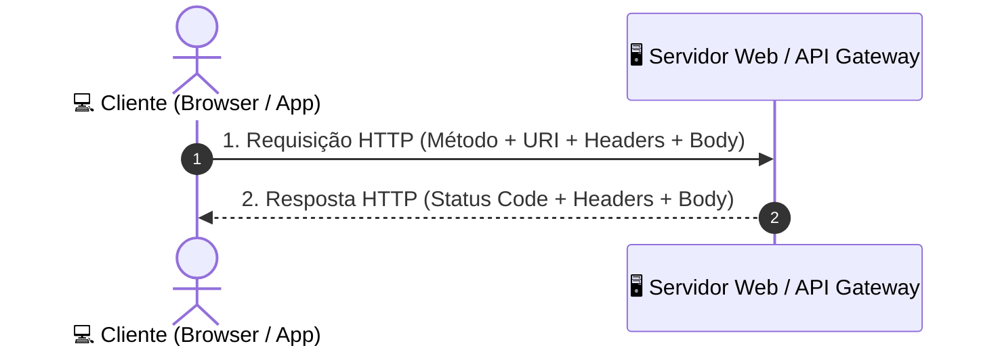
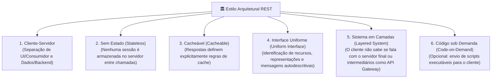
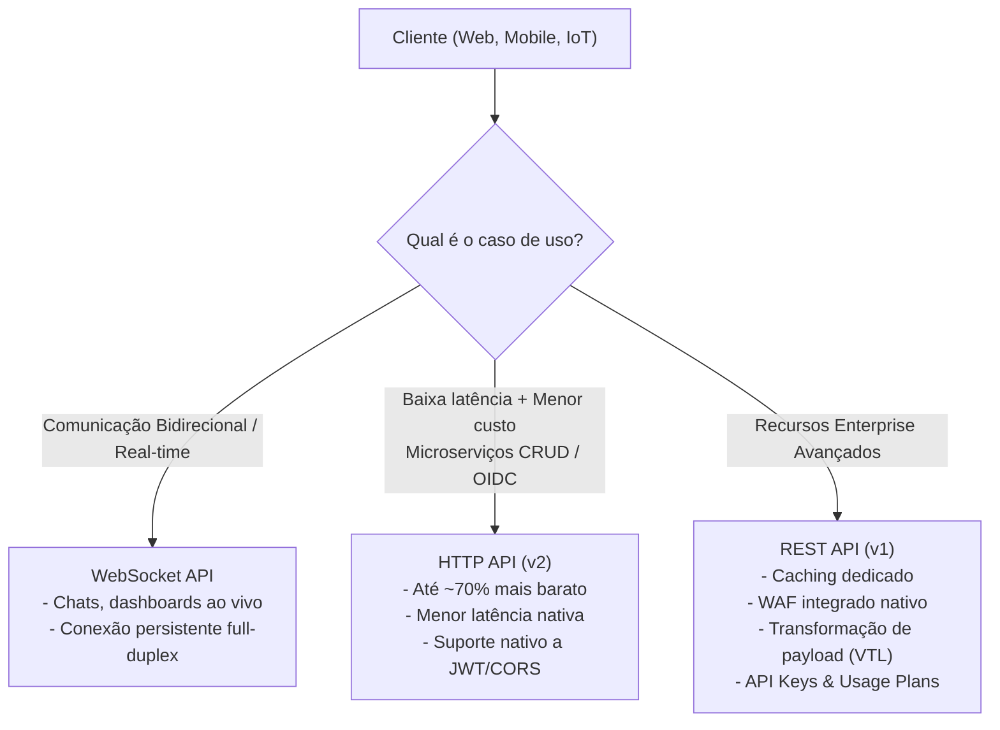
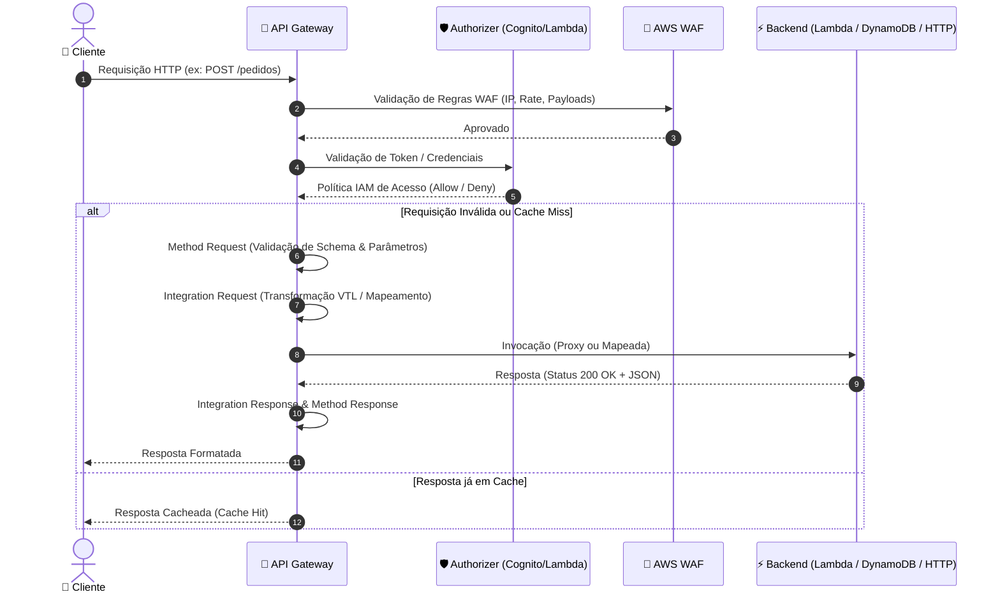

# 🚪 Amazon API Gateway — Porta de Entrada Gerenciada para Microsserviços e Serverless

> **Categoria:** Rede, Integração & Segurança de APIs  
> **Sessão:** Arquitetura Escalável & Resiliente na AWS  
> **Status:** Concluído

---

## 1. O que é o Amazon API Gateway?

O **Amazon API Gateway** é um serviço totalmente gerenciado da AWS que simplifica a criação, publicação, manutenção, monitoramento e proteção de APIs em qualquer escala (REST, HTTP e WebSocket).

Ele atua como a **"porta de entrada" (Front Door)** da infraestrutura de backend, posicionando-se entre os clientes externos (aplicações web, mobile, dispositivos IoT, serviços de terceiros) e os serviços internos (funções AWS Lambda, containers ECS/EKS, instâncias EC2, ou qualquer endpoint HTTP público ou privado).

### Principais Benefícios:
- **Gestão de Tráfego:** *Rate limiting* e *throttling* nativos para proteger sistemas legados e funções Lambda contra picos de tráfego.
- **Autenticação e Autorização:** Suporte integrado a IAM, Amazon Cognito e Lambda Authorizers customizados (JWT / OAuth2).
- **Resiliência e Escala:** Suporta centenas de milhares de chamadas concorrentes sem necessidade de provisionamento de servidores.
- **Integração Direta com Serviços AWS:** Capacidade de gravar diretamente no SQS, Kinesis ou DynamoDB sem necessidade de intermediar com código Lambda (*Direct Service Integration*).

---

## 2. Analogia Didática: A Recepção Central de um Edifício Corporativo

| Elemento do Prédio | Equivalente no API Gateway | Função |
| :--- | :--- | :--- |
| **Portaria / Catraca com Crachá** | **Autenticação / Authorizer** | Verifica quem é você (Cognito/JWT/IAM) antes de permitir a entrada. |
| **Detector de Metais / Guarda** | **AWS WAF & Validação de Schema** | Bloqueia requisições maliciosas (SQL injection, XSS) ou payloads inválidos antes de entrar. |
| **Capacidade Máxima do Elevador** | **Throttling & Rate Limiting** | Garante que o tráfego entre de forma controlada sem derrubar os andares superiores (backend). |
| **Balcão de Informações / Placas** | **Roteamento de Recursos e Métodos** | Direciona cada pedido para o setor correto (`GET /usuarios` $\rightarrow$ Lambda A, `POST /pedidos` $\rightarrow$ SQS). |
| **Folheto de Perguntas Frequentes** | **API Gateway Caching** | Responde perguntas comuns na hora sem precisar ligar para a diretoria (evita bater no backend). |

---

## 3. Fundamentos de Comunicação Web: HTTP, REST e WebSockets

Antes de configurar o API Gateway, é essencial dominar os protocolos e paradigmas de comunicação sobre os quais a web e os microsserviços modernos operam.

---

### 3.1 Requisições e Respostas HTTP

O **HTTP** (*Hypertext Transfer Protocol*) é um protocolo de nível de aplicação (Camada 7) baseado no modelo **Cliente-Servidor** e de natureza **Stateless** (sem estado). Cada par requisição/resposta é independente; o servidor não retém informações sobre requisições anteriores por padrão.



#### A. Anatomia de uma Requisição HTTP
Uma requisição HTTP enviada pela rede é composta por texto formatado em quatro partes essenciais:

```http
POST /v1/pedidos HTTP/1.1
Host: api.empresa.com.br
User-Agent: Mozilla/5.0
Authorization: Bearer eyJhbGciOi...
Content-Type: application/json
Content-Length: 54

{
  "produtoId": "prod-123",
  "quantidade": 2
}
```

1. **Linha de Requisição (*Request Line*):** Contém o **Método/Verbo** (`POST`), o **Caminho do Recurso / URI** (`/v1/pedidos`) e a **Versão do Protocolo** (`HTTP/1.1` ou `HTTP/2`).
2. **Cabeçalhos da Requisição (*Headers*):** Metadados cruciais como `Host` (servidor de destino), `Content-Type` (formato do corpo), `Accept` (formato esperado na resposta) e `Authorization` (credenciais/tokens).
3. **Linha em Branco:** Um caractere delimitador obrigatório (`CRLF` — quebra de linha) que separa os cabeçalhos do corpo.
4. **Corpo da Mensagem (*Body / Payload*):** Dados enviados pelo cliente (comum em `POST`, `PUT`, `PATCH`). Em `GET` e `DELETE`, geralmente é vazio.

#### B. Anatomia de uma Resposta HTTP
```http
HTTP/1.1 201 Created
Date: Sat, 14 Nov 2026 10:30:00 GMT
Content-Type: application/json
Location: /v1/pedidos/ped-987
Content-Length: 68

{
  "id": "ped-987",
  "status": "PROCESSANDO",
  "total": 159.90
}
```

1. **Linha de Status (*Status Line*):** Versão do protocolo (`HTTP/1.1`), **Código de Status Numérico** (`201`) e **Frase Descritiva** (`Created`).
2. **Cabeçalhos da Resposta (*Headers*):** Instruções de cache (`Cache-Control`), tipo de dado (`Content-Type`), cookies (`Set-Cookie`) e CORS (`Access-Control-Allow-Origin`).
3. **Linha em Branco:** Delimitador obrigatório.
4. **Corpo da Resposta (*Body*):** Os dados retornados pelo servidor (geralmente JSON, XML ou binário).

#### C. Métodos/Verbos HTTP: Segurança e Idempotência

| Método | Finalidade Principal | Possui Corpo? | Seguro (*Safe*)? | Idempotente? |
| :--- | :--- | :---: | :---: | :---: |
| **GET** | Consultar ou recuperar dados de um recurso. | Não | ✅ **Sim** | ✅ **Sim** |
| **POST** | Criar um novo recurso subordinado ou disparar ação. | Sim | ❌ Não | ❌ Não |
| **PUT** | Substituir integralmente um recurso (ou criar com ID fixo). | Sim | ❌ Não | ✅ **Sim** |
| **PATCH** | Atualização parcial/atômica de atributos de um recurso. | Sim | ❌ Não | ⚠️ Depende da lógica |
| **DELETE** | Remover um recurso específico por ID. | Opcional | ❌ Não | ✅ **Sim** |
| **OPTIONS** | Consultar quais métodos e origens CORS são permitidos. | Não | ✅ **Sim** | ✅ **Sim** |
| **HEAD** | Idêntico ao GET, mas **sem o corpo** (retorna apenas headers). | Não | ✅ **Sim** | ✅ **Sim** |

> **Conceitos Fundamentais:**
> - **Seguro (*Safe*):** A requisição é puramente de leitura; chamá-la não altera o estado no servidor.
> - **Idempotente (*Idempotent*):** Executar a mesma requisição uma ou dez vezes consecutivas com os mesmos parâmetros resulta no **mesmo estado final** no servidor. Exemplo: `DELETE /itens/5` exclui o item na primeira vez; nas chamadas seguintes o item já não existe, mas o estado do banco permanece inalterado. Já o `POST /pedidos` criaria 10 pedidos duplicados se repetido 10 vezes.

#### D. Categorias de Códigos de Status HTTP (*Status Codes*)

- **1xx (Informativos):** Requisição recebida, processo em andamento.
  - `101 Switching Protocols`: Usado no *handshake* de upgrade do WebSocket.
- **2xx (Sucesso):** Ação compreendida e aceita com êxito.
  - `200 OK`: Sucesso geral (leitura, atualização).
  - `201 Created`: Novo recurso criado (típico de `POST`).
  - `202 Accepted`: Requisição aceita para processamento assíncrono (típico para filas SQS/APIs serverless).
  - `204 No Content`: Sucesso, mas sem corpo na resposta (comum em `DELETE` ou `PUT`).
- **3xx (Redirecionamento):** Ações adicionais necessárias pelo cliente.
  - `301 Moved Permanently`: URL mudou definitivamente para outro endereço.
  - `304 Not Modified`: Conteúdo inalterado em relação ao cache local (usa `ETag` / `If-None-Match`).
- **4xx (Erro do Cliente):** A requisição possui sintaxe incorreta ou permissão inválida.
  - `400 Bad Request`: Payload com formato inválido ou campos ausentes.
  - `401 Unauthorized`: Autenticação ausente ou inválida (falta token/crachá).
  - `403 Forbidden`: Autenticado com sucesso, mas sem permissão para acessar o recurso específico.
  - `404 Not Found`: Recurso ou endpoint inexistente.
  - `405 Method Not Allowed`: Método não suportado na rota (ex: `POST` em endpoint somente leitura).
  - `409 Conflict`: Conflito de estado (ex: tentar cadastrar e-mail já existente).
  - `429 Too Many Requests`: Limite de taxa excedido (*Throttled* pelo API Gateway).
- **5xx (Erro do Servidor):** Falha interna no backend ou indisponibilidade.
  - `500 Internal Server Error`: Erro não tratado no código da aplicação.
  - `502 Bad Gateway`: API Gateway recebeu resposta inválida do Lambda/backend.
  - `503 Service Unavailable`: Servidor sobrecarregado ou em manutenção temporária.
  - `504 Gateway Timeout`: Backend demorou mais que o limite do Gateway (29s) para responder.

---

### 3.2 Arquitetura REST (Representational State Transfer)

Definido em 2000 pelo cientista da computação **Roy Fielding** em sua tese de doutorado, **REST não é um protocolo nem uma biblioteca**, mas sim um **estilo arquitetural** para sistemas hipermídia distribuídos.

Muitas APIs que utilizam JSON sobre HTTP são apenas "HTTP APIs", e não estritamente RESTful. Para ser verdadeiramente REST, a arquitetura deve atender a **6 restrições fundamentais**:



#### As 4 Características da Interface Uniforme
1. **Identificação de Recursos:** Tudo é modelado como um substantivo (*Noun*) identificado por uma URI previsível (ex.: `/usuarios/42`, `/produtos/123/avaliacoes`).
2. **Manipulação de Recursos via Representações:** O cliente não acessa a tabela do banco diretamente; ele manipula uma representação (JSON, XML) via verbos HTTP (`GET`, `PUT`, `DELETE`).
3. **Mensagens Autodescritivas:** Cada mensagem possui metadados suficientes para ser processada (ex.: cabeçalho `Content-Type: application/json` informa ao parser o que fazer).
4. **HATEOAS (*Hypermedia As The Engine Of Application State*):** O servidor inclui links navegáveis na resposta, guiando o cliente sobre quais ações são possíveis a partir daquele estado.

#### Modelo de Maturidade de Richardson
Leonard Richardson dividiu o caminho até uma API verdadeiramente RESTful em 4 níveis:
- **Nível 0 (The Swamp of POX):** Usa HTTP apenas como canal de transporte RPC. Geralmente um único endpoint (ex.: `POST /api`) recebendo comandos no corpo.
- **Nível 1 (Recursos Individuais):** Cria URIs específicas para cada recurso (ex.: `/clientes`, `/pedidos`).
- **Nível 2 (Verbos HTTP & Status Codes):** Usa corretamente `GET` para leitura, `POST` para criação, `DELETE` para remoção e responde com códigos semânticos (`200`, `201`, `404`). *A maioria das APIs do mercado opera neste nível.*
- **Nível 3 (Controles Hipermídia / HATEOAS):** As respostas fornecem links semânticos de navegação dinâmica para os próximos passos possíveis.

---

### 3.3 WebSockets: Comunicação Bidirecional em Tempo Real

O protocolo **WebSocket** (padronizado pela IETF na **RFC 6455**) foi projetado para resolver a principal limitação do HTTP tradicional: **o modelo estritamente orientado a requisição/resposta iniciado pelo cliente**.

#### Por que o HTTP tradicional é ineficiente para Tempo Real?
Historicamente, aplicações que precisavam de dados em tempo real recorriam a técnicas de contorno:
- **Short Polling:** O cliente faz requisições repetidas a cada $X$ segundos (`GET /notificacoes`). Gera overhead massivo de conexões TCP, cabeçalhos repetidos e alto custo de computação, mesmo sem novidades.
- **Long Polling:** O cliente abre uma requisição que o servidor mantém suspensa até haver dados novos. Assim que responde, o cliente imediatamente abre outra requisição. Menos chamadas ociosas, mas ainda sofre com a destruição e recriação constante de conexões.
- **Server-Sent Events (SSE):** Permite que o servidor faça push contínuo de texto via HTTP (`text/event-stream`), mas é **unidirecional** (apenas servidor $\rightarrow$ cliente).

```mermaid
flowchart TD
    subgraph PollingModel["HTTP Short Polling (Ineficiente)"]
        direction TB
        C1["Cliente"] -->|GET /status?| S1["Servidor: Nada novo"]
        C1 -->|GET /status?| S1["Servidor: Nada novo"]
        C1 -->|GET /status?| S1["Servidor: Houve alteração!"]
    end

    subgraph WebSocketModel["WebSocket (Conexão Full-Duplex Persistente)"]
        direction TB
        C2["Cliente"] ===|Canal TCP Aberto & Persistente (Bidirecional)| S2["Servidor"]
        C2 -.->|Envia mensagem a qualquer momento| S2
        S2 -.->|Faz push imediato sem requisição prévia| C2
    end
```

#### Como Funciona o Protocolo WebSocket?
1. **Handshake de Upgrade (sobre HTTP):** O cliente inicia uma requisição HTTP tradicional solicitando a elevação do protocolo:
   ```http
   GET /chat HTTP/1.1
   Host: api.empresa.com.br
   Upgrade: websocket
   Connection: Upgrade
   Sec-WebSocket-Key: dGhlIHNhbXBsZSBub25jZQ==
   Sec-WebSocket-Version: 13
   ```
2. **Resposta 101 Switching Protocols:** Se o servidor suportar WebSocket, ele responde:
   ```http
   HTTP/1.1 101 Switching Protocols
   Upgrade: websocket
   Connection: Upgrade
   Sec-WebSocket-Accept: s3pPLMBiTxaQ9kYGzzhZRbK+xOo=
   ```
3. **Canal Bidirecional Aberto (*Full-Duplex*):** A partir deste ponto, o protocolo HTTP deixa de existir naquela conexão. Estabelece-se um canal TCP puro onde mensagens binárias ou em texto trafegam com um framing minúsculo de apenas **2 a 10 bytes de overhead** por pacote (sem cabeçalhos HTTP gigantescos).

#### WebSockets no Amazon API Gateway (Serverless WebSockets)
Em infraestruturas convencionais, manter 100.000 conexões WebSocket abertas exige clusters dedicados de servidores (Node.js/Socket.io, Go) com gerenciamento complexo de memória de socket e sincronização via Redis Pub/Sub.

O **Amazon API Gateway WebSocket API** abstrai toda essa complexidade de forma **100% serverless**:
- O API Gateway gerencia o estado das conexões TCP persistentes na borda da AWS.
- O seu backend (funções Lambda) é acionado apenas quando **eventos acontecem**:
  - **`$connect`:** Chamado no handshake inicial. Permite validar tokens de autorização e salvar o identificador único da conexão (`connectionId`) em uma tabela do DynamoDB.
  - **`$disconnect`:** Chamado quando o cliente fecha a aba ou perde conexão. Permite limpar o `connectionId` do banco.
  - **`$default` ou Rotas Customizadas:** Chamadas quando o cliente envia dados (ex.: rota `sendMessage`).
- **Push Reverso (Servidor $\rightarrow$ Cliente):** Qualquer serviço de backend pode enviar mensagens para um cliente específico a qualquer momento fazendo uma chamada HTTP POST para o endpoint gerenciado `@connections/{connectionId}` do API Gateway, sem manter nenhum servidor ligado!

---

## 4. Tipos de APIs no API Gateway: REST vs. HTTP vs. WebSocket

A AWS divide o API Gateway em três modalidades com focos e custos distintos:



### Tabela Comparativa Detalhada

| Recurso / Característica | HTTP APIs (v2) | REST APIs (v1) | WebSocket APIs |
| :--- | :--- | :--- | :--- |
| **Protocolos Suportados** | HTTP/1.1, HTTP/2 | HTTP/1.1 | WebSocket (WSS) |
| **Latência Média** | Muito baixa (~10-20 ms) | Média (~30-50 ms) | Quase nula após handshake |
| **Custo Relativo** | **Mais barato** (~$1.00 / milhão) | **Padrão** (~$3.50 / milhão) | $1.00 / M conexões + $0.25 / M msgs |
| **Autorizadores** | JWT (Cognito, Auth0, etc.), Lambda | IAM, Cognito User Pools, Lambda | IAM, Lambda Authorizer |
| **Cache de Resposta** | ❌ Não integrado (use CloudFront) | ✅ Nativo gerenciado | ❌ Não aplicável |
| **Transformação de Dados** | ❌ Apenas repasse (*Pass-through*) | ✅ Sim via VTL (Velocity Templates) | ❌ Não integrado |
| **API Keys & Usage Plans** | ❌ Não suportado | ✅ Suporte completo | ❌ Não suportado |
| **Endpoints Privados (VPC)** | ✅ Via VPC Link para NLB/ALB/CloudMap | ✅ Via VPC Endpoint (PrivateLink) | ❌ Não suportado |

---

## 5. Tipos de Endpoints de Implantação

Ao configurar uma REST API, é fundamental escolher o tipo correto de endpoint:

1. **Edge-Optimized (Otimizado para Borda):**
   - Cria automaticamente uma distribuição gerenciada do **Amazon CloudFront** à frente da API.
   - Ideal para clientes distribuídos geograficamente pelo mundo, reduzindo a latência do handshake TLS na Edge Location mais próxima.
2. **Regional:**
   - O endpoint reside na mesma região AWS dos recursos de backend.
   - Ideal quando os clientes estão na mesma região ou quando você já possui uma distribuição própria do **CloudFront** à frente para consolidar WAF, domínios e cache estático/dinâmico.
3. **Private (Privado):**
   - Acessível exclusivamente dentro de uma Amazon VPC via **VPC Endpoints (AWS PrivateLink)**.
   - Ideal para comunicação estritamente interna entre microsserviços corporativos sem exposição à internet pública.

---

## 6. Ciclo de Vida da Requisição e Arquitetura

O ciclo de uma requisição em uma **REST API** segue um fluxo de 4 estágios bem definidos:



### Os 4 Estágios do API Gateway (REST):
1. **Method Request:** Recebe a requisição original, valida se os cabeçalhos obrigatórios, parâmetros de query e corpo (via JSON Schema) estão corretos antes de gastar recursos de backend.
2. **Integration Request:** Converte o formato do cliente no formato esperado pelo backend (ex.: transformar JSON em parâmetros SOAP/XML ou extrair dados para parâmetros diretos do DynamoDB).
3. **Integration Response:** Recebe a saída do backend e converte códigos de erro/sucesso.
4. **Method Response:** Define os cabeçalhos (CORS) e contratos de resposta enviados ao cliente final.

---

## 7. Integrações: Proxy vs. Non-Proxy (Service Integration)

### 1. Invocação Lambda Proxy (`AWS_PROXY`)
- O API Gateway passa o evento HTTP bruto (headers, body, queryParams, pathParams, context) diretamente para o parâmetro `event` do Lambda.
- O código da função Lambda é responsável por serializar a resposta com `{ statusCode, headers, body }`.
- **Vantagem:** Maior flexibilidade e menor configuração no console AWS.

### 2. Integração Direta de Serviços AWS (*Direct Service Integration*)
- Permite que o API Gateway interaja diretamente com mais de 100 serviços AWS **sem usar nenhuma função Lambda**.
- **Exemplo clássico:** `POST /logs` envia direto para o Amazon SQS ou Kinesis Data Streams; `GET /produtos/{id}` busca direto no Amazon DynamoDB.
- **Vantagens:** 
  - Redução drástica de custo (elimina a execução do Lambda).
  - Menor latência (elimina o *cold start* do Lambda).
  - Menor complexidade operacional de código.

---

## 8. Mecanismos de Proteção e Resiliência

### Throttling & Token Bucket Algorithm
O API Gateway aplica o algoritmo de **Token Bucket** para controle de taxa:
- **Rate (Taxa Estável):** Quantidade contínua de requisições por segundo (RPS) permitidas.
- **Burst (Pico Máximo):** Capacidade de absorver rajadas instantâneas antes de responder com `HTTP 429 Too Many Requests`.
- Pode ser configurado em três níveis:
  1. **Nível de Conta/Região:** Limite global da sua conta AWS (padrão de 10.000 RPS).
  2. **Nível de Stage/Método:** Limite aplicado a rotas específicas (ex.: limitar rotas de checkout pesadas).
  3. **Nível de Cliente (Usage Plans & API Keys):** Limitações específicas para cada cliente com quotas mensais e taxas customizadas por chave `x-api-key`.
     - 👉 *Para o guia completo, arquitetura da tríade, comparativo Throttling vs. Quota e código Terraform, consulte o documento dedicado: [**Usage Plans & API Keys**](usage-plan.md).*

---

## 9. Exemplo Prático com Terraform: HTTP API + Lambda

Snippet conciso e moderno para provisionar uma **HTTP API v2** integrada a um Lambda com integração do tipo proxy:

```hcl
# 1. Definição da HTTP API
resource "aws_apigatewayv2_api" "http_api" {
  name          = "catalogo-service-api"
  protocol_type = "HTTP"

  cors_configuration {
    allow_origins = ["https://meudominio.com.br"]
    allow_methods = ["GET", "POST", "OPTIONS"]
    allow_headers = ["Authorization", "Content-Type"]
    max_age       = 300
  }
}

# 2. Stage padrão com auto-deploy ativo
resource "aws_apigatewayv2_stage" "default_stage" {
  api_id      = aws_apigatewayv2_api.http_api.id
  name        = "$default"
  auto_deploy = true
}

# 3. Integração com a Função Lambda
resource "aws_apigatewayv2_integration" "lambda_integration" {
  api_id                 = aws_apigatewayv2_api.http_api.id
  integration_type       = "AWS_PROXY"
  integration_uri        = aws_lambda_function.catalogo_backend.invoke_arn
  payload_format_version = "2.0"
}

# 4. Rota (ex: GET /produtos)
resource "aws_apigatewayv2_route" "get_produtos" {
  api_id    = aws_apigatewayv2_api.http_api.id
  route_key = "GET /produtos"
  target    = "integrations/${aws_apigatewayv2_integration.lambda_integration.id}"
}

# 5. Permissão para o API Gateway invocar o Lambda
resource "aws_lambda_permission" "apigw_invoke" {
  statement_id  = "AllowExecutionFromAPIGateway"
  action        = "lambda:InvokeFunction"
  function_name = aws_lambda_function.catalogo_backend.function_name
  principal     = "apigateway.amazonaws.com"
  source_arn    = "${aws_apigatewayv2_api.http_api.execution_arn}/*/*"
}
```

---

## 10. Limites Críticos e Boas Práticas

| Parâmetro | Limite / Comportamento | Recomendação Arquitetural |
| :--- | :--- | :--- |
| **Timeout de Execução** | **29 segundos (fixo)** | APIs síncronas não devem processar tarefas longas. Para processos demorados, responda `HTTP 202 Accepted` e envie para SQS/Step Functions. |
| **Payload Máximo** | **10 MB** | Não envie arquivos grandes (vídeos, PDFs) diretamente pelo API Gateway. Utilize URLs pré-assinadas (*Presigned URLs*) do Amazon S3. |
| **HTTP API vs. REST API** | Escolha técnica | Dê preferência para **HTTP API** por padrão para microsserviços modernos, a menos que necessite de recursos específicos (Cache nativo, VTL, WAF legado ou API Keys). |
| **Custom Domain & SSL** | Suporte a ACM | Utilize domínios personalizados (ex.: `api.meudominio.com.br`) mapeados no Route 53 com certificados gratuitos via AWS Certificate Manager (ACM). |
