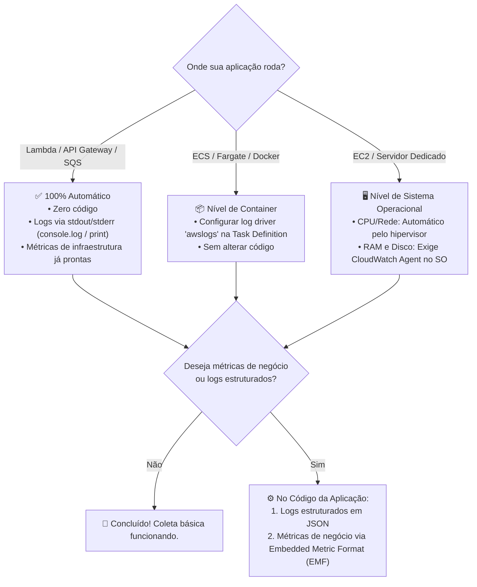

# 📊 Amazon CloudWatch — Observabilidade, Métricas, Logs e Alarmes na AWS

> **Categoria:** Monitoramento, Observabilidade & Governança Operacional  
> **Sessão:** Arquitetura Escalável & Resiliente na AWS  
> **Status:** Concluído

---

## 1. O que é o Amazon CloudWatch?

O **Amazon CloudWatch** é o serviço nativo e gerenciado de **monitoramento e observabilidade** da AWS. Ele coleta, armazena, agrega e analisa dados operacionais em tempo real na forma de **métricas**, **logs** e **eventos**, fornecendo uma visão unificada da integridade, performance e utilização de recursos da infraestrutura e das aplicações.

Com o CloudWatch, equipes de Engenharia e DevOps podem:
- Detectar comportamentos anômalos e gargalos de performance.
- Configurar alarmes que disparam ações automáticas (como *Auto Scaling*, mensagens SNS ou auto-recuperação de instâncias EC2).
- Criar painéis visuais (*Dashboards*) para acompanhamento operacional e executivo.
- Consultar e correlacionar milhões de linhas de log em segundos via **CloudWatch Logs Insights**.

```mermaid
flowchart TD
    subgraph Sources ["📥 Fontes de Telemetria (Data Sources)"]
        AWS_Services["Serviços Nativos AWS\n(Lambda, API Gateway, S3, SQS, RDS)"]
        EC2_VMs["EC2 & On-Premises\n(CloudWatch Agent: RAM, Disco, Syslog)"]
        Apps["Aplicações & Microsserviços\n(Embedded Metric Format - EMF, SDKs)"]
    end

    subgraph CloudWatchCore ["⚙️ Núcleo do Amazon CloudWatch"]
        direction TB
        CW_Logs["📜 CloudWatch Logs\n(Log Groups & Streams, Retenção, Insights)"]
        CW_Metrics["📈 CloudWatch Metrics\n(Namespaces, Dimensões, Alta Resolução)"]
        CW_Alarms["🚨 CloudWatch Alarms\n(Metric Alarms & Composite Alarms)"]
        CW_Dashboards["🖥️ CloudWatch Dashboards\n(Gráficos em tempo real)"]
        CW_Synthetics["🤖 CloudWatch Synthetics\n(Canaries 24/7)"]
    end

    subgraph Actions ["⚡ Destinos & Ações Automáticas"]
        SNS["Amazon SNS\n(Notificação Slack, PagerDuty, E-mail)"]
        ASG["Auto Scaling Group\n(Scale-Out / Scale-In)"]
        EventBridge["Amazon EventBridge / Lambda\n(Remediação Automática)"]
        S3_Archive["Amazon S3 / OpenSearch\n(Arquivamento a frio ou SIEM)"]
    end

    AWS_Services -->|Métricas Nativas (Automático)| CW_Metrics
    AWS_Services -->|Logs de Execução| CW_Logs
    EC2_VMs -->|Logs de SO & Métricas de SO| CW_Logs & CW_Metrics
    Apps -->|Custom Metrics & Logs JSON| CW_Logs & CW_Metrics

    CW_Metrics --> CW_Alarms
    CW_Metrics --> CW_Dashboards
    CW_Logs --> CW_Dashboards
    CW_Synthetics --> CW_Metrics & CW_Alarms

    CW_Alarms -->|Disparo em caso de violação| SNS
    CW_Alarms -->|Gatilho de capacidade| ASG
    CW_Alarms -->|Acionamento de runbook| EventBridge
    CW_Logs -.->|Export / Subscription Filter| S3_Archive
```

---

## 2. Analogia Didática: O Painel e a Central de Monitoramento de um Hospital

| Elemento do Hospital | Equivalente no CloudWatch | Papel no Sistema |
| :--- | :--- | :--- |
| **Monitores cardíacos e de sinais vitais** | **CloudWatch Metrics** | Medem continuamente dados quantitativos em tempo real (frequência cardíaca, pressão = CPU, latência, requisições). |
| **Prontuário e histórico de anotações médicas** | **CloudWatch Logs** | Registram os acontecimentos detalhados de cada momento (sintomas, erros, mensagens textuais de diagnóstico). |
| **Alarme sonoro da UTI** | **CloudWatch Alarms** | Apita imediatamente quando um parâmetro ultrapassa um limite seguro (ex.: batimento < 40 bpm = CPU > 85%). |
| **Painel de TV do posto de enfermagem** | **CloudWatch Dashboards** | Exibe visualmente o status de todos os leitos e pacientes em um único local para rápida tomada de decisão. |
| **Simulação periódica de rotina médica** | **CloudWatch Synthetics (Canaries)** | Testa rotinas preventivas a cada 5 minutos para garantir que o fluxo de atendimento não quebrou. |

---

## 3. Os Três Pilares Centrais do CloudWatch

### 3.1 CloudWatch Metrics (Telemetria Quantitativa)
Métricas são séries temporais de dados numéricos que expressam o estado do sistema.

- **Namespace:** Um contêiner lógico para métricas (ex.: `AWS/EC2`, `AWS/Lambda`, `AWS/ApiGateway` ou customizados como `Ecommerce/Checkout`).
- **Dimensões (*Dimensions*):** Pares chave-valor que qualificam a métrica (ex.: `InstanceId=i-123456`, `FunctionName=process-payment`, `QueueName=orders.fifo`).
- **Resolução de Coleta:**
  - **Padrão (*Standard Resolution*):** Dados consolidados a cada 1 minuto (para métricas customizadas/detalhadas) ou 5 minutos (serviços básicos como EC2 básico).
  - **Alta Resolução (*High-Resolution Metrics*):** Intervalos de 1 segundo, 5 segundos, 10 segundos ou 30 segundos (ideal para alarmes ultrassensíveis).
- **Estatísticas Agregadas:** `Average`, `Sum`, `SampleCount`, `Minimum`, `Maximum` e **Percentis** (`p50`, `p90`, `p95`, `p99`, `p99.9` — fundamentais para análise realista de latência).

> [!TIP]
> **Por que usar Percentis em vez de Média?**  
> A média esconde anomalias graves: se 99 clientes tiverem latência de 10ms e 1 cliente esperar 10.000ms, a média será ~110ms (parece boa), mas o **p99** mostrará os 10.000ms reais que afetaram aquele usuário!

---

### 3.2 CloudWatch Logs (Telemetria Qualitativa e Textual)
Coleta e centraliza registros de logs de qualquer fonte AWS ou externa.

- **Log Event:** O registro individual contendo timestamp e mensagem em texto/JSON.
- **Log Stream:** Sequência de log events provenientes da mesma fonte emissora (ex.: uma instância de contêiner ou uma execução isolada de Lambda).
- **Log Group:** Agrupamento de log streams que compartilham as mesmas configurações de retenção, controle de acesso (IAM) e políticas de monitoramento.
- **Log Retention Policy:** Por padrão, logs são mantidos indefinidamente (*Never Expire*), o que gera custos desnecessários. **Sempre configure retenção** (ex.: 7, 30, 90 ou 365 dias).
- **Subscription Filters:** Encaminham streams de logs em tempo real para **AWS Lambda**, **Amazon Kinesis Data Firehose** ou **OpenSearch**.

#### 🔍 CloudWatch Logs Insights (Consultas SQL-like)
Interface de query interativa para analisar gigabytes de logs em segundos:

```sql
-- Exemplo 1: Encontrar os 20 erros mais frequentes em uma aplicação
fields @timestamp, @message
| filter @message like /(?i)(error|exception|fail)/
| stats count(*) as totalErro by @message
| sort totalErro desc
| limit 20
```

```sql
-- Exemplo 2: Analisar Cold Starts e Duração no AWS Lambda (log nativo REPORT)
filter @type = "REPORT"
| parse @message /Init Duration: (?<initDuration>\d+(\.\d+)?) ms/
| stats count(*) as InvocationCount,
        avg(@duration) as AvgDuration,
        max(@duration) as MaxDuration,
        avg(initDuration) as AvgInitDuration
  by bin(5m)
```

---

### 3.3 CloudWatch Alarms (Detecção & Resposta)
Monitora uma métrica ao longo de períodos pré-definidos e aciona uma ou mais ações dependendo do estado:

- **Estados do Alarme:**
  1. `OK`: Métrica dentro do limite tolerável.
  2. `ALARM`: Métrica ultrapassou o limiar (*threshold*) especificado.
  3. `INSUFFICIENT_DATA`: Não há dados suficientes para determinar o estado.
- **Tipos de Alarme:**
  - **Métrica Simples (*Metric Alarm*):** Monitora uma métrica específica (ex.: `CPUUtilization > 80% por 3 períodos consecutivos de 1 minuto`).
  - **Alarme Composto (*Composite Alarm*):** Combina múltiplos alarmes via lógica booleana (`AND`, `OR`, `NOT`) para reduzir a "fadiga de alertas" (*alert fatigue*).  
    *Exemplo:* Disparar alarme crítico somente se `(CPU > 90% AND LatenciaP99 > 2s) AND NOT EmJanelaManutencao`.
  - **Detecção de Anomalias (*Anomaly Detection*):** Aplica *Machine Learning* para criar uma faixa de normalidade dinâmica, adaptando-se a sazonalidades horárias/diárias.

---

## 4. Recursos Avançados do Ecossistema CloudWatch

| Recurso | Descrição | Caso de Uso Típico |
| :--- | :--- | :--- |
| **CloudWatch Synthetics (Canaries)** | Scripts Node.js/Python (Puppeteer/Selenium) que simulam a navegação do usuário 24/7. | Testar rotas de login e checkout mesmo sem tráfego real. |
| **CloudWatch Agent** | Agente de software instalado em instâncias EC2 ou servidores On-Premise. | Coletar métricas de SO que o hipervisor não vê (RAM utilizada, espaço em disco) e arquivos de log locais. |
| **Embedded Metric Format (EMF)** | Padrão assíncrono para emitir métricas customizadas diretamente nos logs estruturados JSON sem chamadas de API adicionais. | Gerar métricas de negócio de altíssima vazão no Lambda com latência zero e custo reduzido. |
| **CloudWatch Contributor Insights** | Analisa padrões em logs para identificar os "maiores contribuintes" (*top-N talkers*). | Descobrir qual IP está realizando ataque DDoS ou qual `userId` está consumindo 80% das chamadas da API. |
| **CloudWatch Application Signals (APM)** | Rastreamento e visualização automática de Service Level Objectives (SLOs) e SLIs para microsserviços. | Medir conformidade de contratos de SLA (ex.: 99.9% de sucesso). |

---

## 5. Tríade da Observabilidade na AWS: CloudWatch vs. CloudTrail vs. X-Ray

Muitos profissionais confundem o papel dessas três ferramentas. Cada uma responde a uma pergunta fundamental:

| Serviço | Pergunta Respondida | Foco Principal | Tipo de Dado |
| :--- | :--- | :--- | :--- |
| **Amazon CloudWatch** | *"Como o sistema está se comportando?"* | Performance, métricas, saúde operacional e logs de execução. | Métricas, Logs, Alarmes, Gráficos. |
| **AWS CloudTrail** | *"Quem fez o quê, quando e de onde?"* | Auditoria de segurança e governança de chamadas à API da AWS. | Eventos de API e logs de auditoria de identidade. |
| **AWS X-Ray** | *"Onde exatamente está o gargalo ou a falha na requisição distribuída?"* | Rastreamento distribuído fim a fim (*Distributed Tracing*) em microsserviços. | Traces, Spans, Service Map de latência. |

---

## 6. Exemplo Prático com Terraform (IaC)

Abaixo, um exemplo completo e pronto para produção contendo:
1. Um **Log Group** com retenção definida (evita custos eternos).
2. Um tópico **SNS** para alertas.
3. Um **CloudWatch Metric Alarm** monitorando erros 5XX de uma API.
4. Um **CloudWatch Dashboard** com métricas agregadas.

```hcl
terraform {
  required_version = ">= 1.5.0"
  required_providers {
    aws = {
      source  = "hashicorp/aws"
      version = "~> 5.0"
    }
  }
}

# 1. Tópico SNS para receber notificações de alarmes
resource "aws_sns_topic" "alerts" {
  name = "cloudwatch-critical-alerts-topic"
}

resource "aws_sns_topic_subscription" "email_sub" {
  topic_arn = aws_sns_topic.alerts.arn
  protocol  = "email"
  endpoint  = "devops-team@empresa.com"
}

# 2. Log Group do CloudWatch com Retenção configurada (FinOps)
resource "aws_cloudwatch_log_group" "api_logs" {
  name              = "/aws/api/checkout-service"
  retention_in_days = 30 # Nunca deixe como 'Never Expire' em produção!

  tags = {
    Environment = "production"
    Service     = "checkout-service"
  }
}

# 3. Alarme de Métricas para Monitorar Erros 5XX
resource "aws_cloudwatch_metric_alarm" "api_5xx_errors" {
  alarm_name          = "checkout-api-high-5xx-errors"
  comparison_operator = "GreaterThanOrEqualToThreshold"
  evaluation_periods  = 2
  metric_name         = "5XXError"
  namespace           = "AWS/ApiGateway"
  period              = 60 # Janela de 1 minuto
  statistic           = "Sum"
  threshold           = 10
  alarm_description   = "Dispara se houver 10 ou mais erros 5XX em 2 minutos consecutivos na API de Checkout."

  dimensions = {
    ApiName = "CheckoutAPI"
    Stage   = "prod"
  }

  alarm_actions = [aws_sns_topic.alerts.arn]
  ok_actions    = [aws_sns_topic.alerts.arn]
}

# 4. Dashboard Operacional Unificado
resource "aws_cloudwatch_dashboard" "main" {
  dashboard_name = "Checkout-Operations-Dashboard"

  dashboard_body = jsonencode({
    widgets = [
      {
        type   = "metric"
        x      = 0
        y      = 0
        width  = 12
        height = 6
        properties = {
          metrics = [
            ["AWS/ApiGateway", "Count", "ApiName", "CheckoutAPI", { stat = "Sum", label = "Total Requests" }],
            [".", "5XXError", ".", ".", { stat = "Sum", label = "Erros 5XX", color = "#d62728" }],
            [".", "4XXError", ".", ".", { stat = "Sum", label = "Erros 4XX", color = "#ff7f0e" }]
          ]
          period = 60
          region = "us-east-1"
          title  = "API Gateway — Volume de Tráfego & Erros"
          view   = "timeSeries"
        }
      },
      {
        type   = "metric"
        x      = 12
        y      = 0
        width  = 12
        height = 6
        properties = {
          metrics = [
            ["AWS/ApiGateway", "Latency", "ApiName", "CheckoutAPI", { stat = "p95", label = "Latência p95 (ms)", color = "#1f77b4" }],
            ["...", { stat = "p99", label = "Latência p99 (ms)", color = "#9467bd" }]
          ]
          period = 60
          region = "us-east-1"
          title  = "Latência de Resposta (Percentis p95 / p99)"
          view   = "timeSeries"
        }
      }
    ]
  })
}
```

---

## 7. Comandos Essenciais via AWS CLI

```bash
# 1. Listar os Log Groups ordenados por nome
aws logs describe-log-groups --query "logGroups[*].logGroupName" --output table

# 2. Alterar a retenção de um Log Group existente para 14 dias
aws logs put-retention-policy \
  --log-group-name "/aws/lambda/process-order" \
  --retention-in-days 14

# 3. Exibir o status de todos os alarmes em estado 'ALARM'
aws cloudwatch describe-alarms \
  --state-value ALARM \
  --query "MetricAlarms[*].[AlarmName, MetricName, StateUpdatedTimestamp]" \
  --output table

# 4. Publicar uma métrica customizada de negócio (Custom Metric)
aws cloudwatch put-metric-data \
  --namespace "Ecommerce/Vendas" \
  --metric-name "PedidosAprovados" \
  --value 1 \
  --unit "Count" \
  --dimensions Canal="Mobile",Regiao="Sudeste"
```

---

## 8. Boas Práticas & Estratégia FinOps para o CloudWatch

1. **Configurar Retenção Imediata de Logs:**  
   O armazenamento de logs não expira por padrão. Configure de 7 a 30 dias para logs de desenvolvimento/homologação e encaminhe logs que exigem guarda legal (ex.: PCI-DSS, LGPD) para o **Amazon S3 Glacier** via subscription filters ou jobs de export.
2. **Utilizar Embedded Metric Format (EMF):**  
   Em vez de chamar `PutMetricData` via API a cada requisição Lambda (o que aumenta latência e gera custo por chamada de API), gere logs estruturados com a especificação EMF: o CloudWatch extrai as métricas automaticamente em segundo plano.
3. **Priorizar Percentis em Alarmes de Latência:**  
   Nunca baseie seus alarmes de latência crítica em `Average`. Use `p95` ou `p99` para capturar a real experiência do usuário.
4. **Agrupar Alertas com Composite Alarms:**  
   Evite disparar 50 alertas no PagerDuty ao mesmo tempo quando um banco de dados cai. Crie um alarme composto que sintetize o incidente.
5. **Monitorar Métricas de Sistema Operacional com CloudWatch Agent:**  
   Por padrão, o hipervisor do EC2 só enxerga métricas de hipervisor (CPU, I/O de rede e leitura de disco virtual). O uso de **Memória RAM** e **Espaço em Disco** exige a instalação do **CloudWatch Agent**.

---

## 9. Precisa Configurar na Aplicação? (Guia de Decisão Prático)

A resposta para *"preciso configurar algo no código da minha aplicação?"* divide-se em três níveis:



### Resumo Comparativo por Ambiente

| O que você quer monitorar? | Em AWS Lambda / Serverless | Em Containers (ECS / Fargate) | Em EC2 / Servidor Tradicional |
| :--- | :--- | :--- | :--- |
| **Erros e Logs gerais** | **Automático:** basta usar `console.log()` ou `print()`. O runtime envia ao CloudWatch Logs. | **Infraestrutura:** configurar o driver `awslogs` no Task Definition. | **No SO:** instalar o CloudWatch Agent para ler arquivos de log (`/var/log/app.log`). |
| **Uso de CPU e Rede** | **Automático:** métricas gerenciadas de invocação e duração. | **Automático:** métricas nativas do ECS / Container Insights. | **Automático:** coletadas diretamente pelo hipervisor da AWS. |
| **Memória RAM e Disco** | Gerenciado pela AWS (métrica `MemorySize` e `MaxMemoryUsed`). | Ativar **Container Insights** no cluster ECS/EKS. | **Requer CloudWatch Agent:** o hipervisor não acessa a memória interna da VM por segurança. |
| **Métricas de Negócio** *(ex: Pedidos/s)* | **Recomendado:** Imprimir no stdout via **EMF (Embedded Metric Format)**. | **EMF** ou chamar o AWS SDK (`PutMetricData`). | **EMF** ou chamar o AWS SDK (`PutMetricData`). |

---

### Exemplo no Código: Como emitir Métricas e Logs sem adicionar Latência (EMF)

Em vez de importar o AWS SDK e fazer chamadas de rede lentas para a API do CloudWatch, basta imprimir JSON estruturado seguindo o padrão **AWS Embedded Metric Format (EMF)**:

#### Em Node.js / TypeScript:
```typescript
export async function handler(event: any) {
  const orderId = event.orderId;
  const amount = event.amount;

  // 1. Log estruturado em JSON (o Logs Insights indexa cada campo automaticamente)
  console.log(JSON.stringify({
    level: "INFO",
    message: "Processamento de pedido concluído",
    orderId,
    amount
  }));

  // 2. Métrica Customizada via EMF (gera gráfico no CloudWatch sem chamar API!)
  console.log(JSON.stringify({
    _aws: {
      Timestamp: Date.now(),
      CloudWatchMetrics: [
        {
          Namespace: "Ecommerce/Vendas",
          Dimensions: [["Ambiente"]],
          Metrics: [
            { Name: "ValorTotalVendas", Unit: "None" },
            { Name: "PedidosAprovados", Unit: "Count" }
          ]
        }
      ]
    },
    Ambiente: "Producao",
    ValorTotalVendas: amount,
    PedidosAprovados: 1
  }));

  return { statusCode: 200, body: "OK" };
}
```

