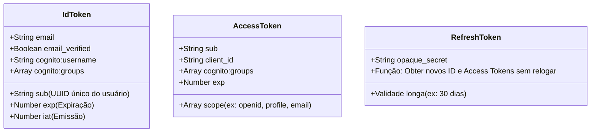
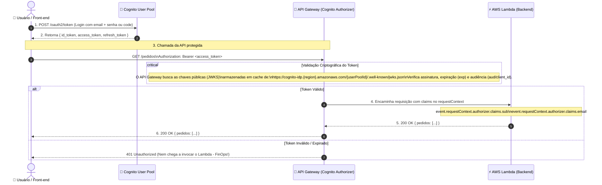

# 🔑 Amazon Cognito — Gerenciamento de Identidade, Autenticação e Autorização em Escala

> **Categoria:** Segurança, Identidade & Gestão de Acessos (IAM / Auth)  
> **Sessão:** Arquitetura Escalável & Resiliente na AWS  
> **Status:** Concluído

---

## 1. O que é o Amazon Cognito?

O **Amazon Cognito** é um serviço totalmente gerenciado de **CIAM** (*Customer Identity and Access Management*) da AWS que oferece controle de cadastro (*sign-up*), login (*sign-in*), controle de acessos e federação de identidades para aplicações web, mobile e APIs em escala de milhões de usuários.

Ele elimina a complexidade e os riscos de segurança associados ao desenvolvimento de sistemas próprios de autenticação (como armazenar senhas em banco, hash/salt, envio de e-mails de confirmação, recuperação de senha, MFA e rotação de tokens).

### Os Dois Pilares Fundamentais:
1. **User Pools (Diretório de Usuários / Autenticação):**
   - É o repositório de identidades (*Identity Provider - IdP*).
   - Gerencia cadastro, login, verificação de e-mail/SMS, MFA, recuperação de conta e emissão de tokens **JWT** (*JSON Web Tokens*: `id_token`, `access_token` e `refresh_token`).
   - Suporta federação social (Google, Apple, Facebook, Amazon) e corporativa (SAML 2.0 / OIDC como Azure AD/Entra ID, Okta).
2. **Identity Pools / Federated Identities (Autorização & Acesso AWS):**
   - Troca a identidade do usuário (autenticado via User Pool, Google, Facebook ou até usuários anônimos/convidados) por **credenciais temporárias da AWS** (via AWS STS - *Security Token Service*).
   - Permite que o front-end acesse recursos AWS diretamente (ex.: upload direto no S3 ou leitura em tabela DynamoDB com políticas refinadas por usuário) sem passar por um backend intermediário.

```mermaid
flowchart TD
    subgraph ClientApp ["💻 Cliente (Web / Mobile / SPA)"]
        User["Usuário Final"]
    end

    subgraph CognitoService ["🔑 Amazon Cognito"]
        direction TB
        UP["🧑‍💻 User Pool\n(Quem é você? - Autenticação)\nCadastros, Senhas, MFA, IdP\nRetorna Tokens JWT"]
        IP["🎫 Identity Pool\n(O que você pode acessar na AWS? - Autorização)\nTroca JWT por Credenciais STS"]
    end

    subgraph BackendTargets ["🛡️ Backend & APIs"]
        APIGW["Amazon API Gateway\n(Cognito Authorizer valida JWT)"]
        Lambda["AWS Lambda"]
    end

    subgraph DirectAWSAccess ["📦 Recursos AWS Diretos"]
        S3["Amazon S3\n(Upload privado: s3://bucket/users/{sub}/*)"]
        DDB["Amazon DynamoDB"]
    end

    User -->|1. Sign-up / Login| UP
    UP -->>|2. Retorna JWT (ID + Access + Refresh)| User
    
    %% Caminho Tradicional de API
    User -->|3a. Requisição HTTP + Bearer Token| APIGW
    APIGW -->|Valida JWT localmente via JWKS| APIGW
    APIGW -->|Repassa Claims| Lambda

    %% Caminho Direto AWS
    User -->|3b. Envia JWT para trocar por Credenciais| IP
    IP -->>|4b. Retorna Access Key, Secret & Session Token temporários| User
    User -->|5b. Acessa AWS com IAM Policy restrita| S3
    User -->|5b. Acessa AWS com IAM Policy restrita| DDB
```

---

## 2. Analogia Didática: O Clube Exclusivo e a Pulseira de Acesso

| Elemento do Clube | Equivalente no Cognito | Função Técnica |
| :--- | :--- | :--- |
| **Ficha de Cadastro & Recepção do Clube** | **Cognito User Pool** | Onde você se cadastra, apresenta documento, define senha e prova que é você. |
| **Cartão de Membro / Crachá Digital** | **Tokens JWT (`id_token`, `access_token`)** | Prova emitida pelo clube contendo seu nome, nível de sócio e data de validade. |
| **Portaria dos Lounges e Restaurantes** | **API Gateway + Cognito Authorizer** | O garçom ou recepcionista olha seu crachá e libera o acesso aos serviços internos. |
| **Guichê de Retirada de Pulseiras / Chaves** | **Cognito Identity Pool** | Onde você apresenta seu crachá de membro e recebe uma chave temporária para abrir um armário específico. |
| **Armário com Chave Temporária** | **Acesso Direto ao Amazon S3 / DynamoDB** | Uso de credenciais temporárias do IAM (STS) para acessar apenas o seu espaço reservado. |

---

## 3. User Pools vs. Identity Pools: Comparativo Definitivo

| Característica | User Pools | Identity Pools (Federated Identities) |
| :--- | :--- | :--- |
| **Pergunta Central** | *"Quem é você?"* (Autenticação) | *"O que você tem permissão de tocar na AWS?"* (Autorização IAM) |
| **Papel Principal** | Diretório de contas e emissor de tokens de identidade. | Corretor de credenciais (*Token Broker*) para o IAM. |
| **O que Entrega?** | Tokens JWT (`id_token`, `access_token`, `refresh_token`). | Credenciais temporárias AWS IAM (`AccessKeyId`, `SecretAccessKey`, `SessionToken`). |
| **Padrões Apoiados** | OAuth 2.0, OpenID Connect (OIDC), SAML 2.0. | AssumeRoleWithWebIdentity (AWS STS). |
| **Acesso Anônimo / Guest** | Não (usuário precisa ter credencial cadastrada). | Sim (suporta gerar credenciais restritas para convidados). |
| **Consumidor Típico** | Amazon API Gateway, AWS AppSync, ALB, microsserviços. | AWS SDK no cliente (Android, iOS, React/Amplify, Unity). |

---

## 4. Anatomia dos Tokens JWT Emitidos pelo User Pool

Quando o usuário se autentica com sucesso, o Cognito User Pool emite **três tokens**:



1. **ID Token (`id_token`):**
   - Contém **declarações de identidade** (*identity claims*) sobre o usuário autenticado (`sub`, `email`, `given_name`, atributos customizados).
   - Utilizado pelo **front-end** para renderizar a interface (ex.: exibir nome, foto, perfil do usuário).
2. **Access Token (`access_token`):**
   - Contém escopos (*scopes*), permissões e grupos (`cognito:groups`).
   - Utilizado para **autorizar chamadas em APIs** (enviado no cabeçalho `Authorization: Bearer <token>`).
   - **Nota de Segurança:** O API Gateway HTTP API valida `access_token` por padrão em rotas protegidas por escopos OAuth2. O REST API aceita tanto `id_token` quanto `access_token`.
3. **Refresh Token (`refresh_token`):**
   - Token opaco de longa duração (padrão de 30 dias, configurável).
   - Usado silenciosamente pelo SDK em segundo plano para renovar o `id_token` e o `access_token` expirados sem exigir que o usuário digite a senha novamente.

---

## 5. Integração com API Gateway: Como Funciona o Cognito Authorizer

A arquitetura mais consagrada no ecossistema Serverless combina **Amazon CloudFront + S3 (SPA)** com **API Gateway + Cognito + Lambda**:



### Por que isso é uma enorme vitória arquitetural e de FinOps?
- **Zero Custo de Computação para Requisições Inválidas:** Tokens forjados, adulterados ou expirados são descartados pelo próprio API Gateway no nível da infraestrutura gerenciada. **O Lambda não é invocado**, economizando execuções e tempo de processamento.
- **Validação Local por Assinatura (JWKS):** O API Gateway não faz uma chamada de rede ao Cognito para cada requisição recebida; ele baixa o conjunto de chaves públicas (*JSON Web Key Set - JWKS*) e valida a assinatura criptográfica RS256 localmente em memória cache.

---

## 6. Recursos Avançados e Recursos de Segurança

### 6.1 Hosted UI (Interface Gerenciada pela AWS)
O Cognito disponibiliza uma página pronta de login, cadastro e recuperação de senha hospedada pela própria AWS com domínio customizado (`auth.meudominio.com.br`), facilitando integrações OAuth2 / OIDC padrão sem a necessidade de desenhar telas de login no front-end desde o primeiro dia.

### 6.2 Lambda Triggers (Extensibilidade Serverless no Ciclo de Vida da Autenticação)
Você pode anexar funções AWS Lambda em fases cruciais do fluxo do Cognito:
- **Pre Sign-up:** Validar se o domínio do e-mail corporativo é permitido (ex.: rejeitar emails `@gmail.com` em um app B2B corporativo).
- **Post Confirmation:** Inserir automaticamente o novo usuário cadastrado em uma tabela do DynamoDB ou disparar mensagem de boas-vindas no SQS.
- **Pre Token Generation:** Injetar *claims* personalizadas ou papéis dinâmicos dentro do token JWT gerado antes que ele seja entregue ao cliente.
- **Custom Authentication Challenge:** Criar fluxos de autenticação sem senha (*passwordless* via link mágico, WhatsApp ou biometria WebAuthn/Passkeys).

### 6.3 Recursos de Segurança Proativa
- **MFA Nativo:** Suporte a SMS, e-mail e aplicativos autenticadores TOTP (Google Authenticator, 1Password, Authy).
- **Advanced Security Features (ASF):**
  - **Detecção de Credenciais Comprometidas:** Compara senhas escolhidas com bases mundiais de senhas vazadas em vazamentos de dados.
  - **Autenticação Baseada em Risco (*Adaptive Authentication*):** Analisa o IP, geolocalização e dispositivo do usuário; se detectar um login anômalo, exige verificação adicional (MFA) ou bloqueia a sessão.
- **Proteção com AWS WAF:** É possível associar uma Web ACL do AWS WAF diretamente ao User Pool para barrar ataques de força bruta, bots e *credential stuffing*.

---

## 7. Exemplo Completo em Terraform (IaC)

Abaixo está uma estrutura completa e pronta para produção provisionando um **User Pool**, um **User Pool Client**, um **Domínio** e a integração direta como **Authorizer no API Gateway**:

```hcl
# 1. Criação do User Pool
resource "aws_cognito_user_pool" "pool" {
  name                     = "workshop-usuarios-pool"
  username_attributes      = ["email"]
  auto_verified_attributes = ["email"]

  # Política rigorosa de senhas
  password_policy {
    minimum_length                   = 10
    require_lowercase                = true
    require_numbers                  = true
    require_symbols                  = true
    require_uppercase                = true
    temporary_password_validity_days = 7
  }

  # Configuração de MFA (Opcional ou Obrigatório)
  mfa_configuration = "OPTIONAL"
  software_token_mfa_configuration {
    enabled = true
  }

  # Atributos do esquema do usuário
  schema {
    attribute_data_type      = "String"
    name                     = "email"
    required                 = true
    mutable                  = true

    string_attribute_constraints {
      min_length = 5
      max_length = 100
    }
  }

  account_recovery_setting {
    recovery_mechanism {
      name     = "verified_email"
      priority = 1
    }
  }

  tags = {
    Environment = "production"
    Workshop    = "devops-na-nuvem"
  }
}

# 2. Cliente de Aplicação (App Client para Web SPA / Mobile)
resource "aws_cognito_user_pool_client" "client" {
  name         = "workshop-web-client"
  user_pool_id = aws_cognito_user_pool.pool.id

  # Aplicações públicas (SPAs React/Vue ou Mobile) NÃO devem ter client secret exposto!
  generate_secret = false

  # Fluxos de Autenticação Permitidos
  explicit_auth_flows = [
    "ALLOW_USER_PASSWORD_AUTH",
    "ALLOW_REFRESH_TOKEN_AUTH",
    "ALLOW_USER_SRP_AUTH" # Seguro contra espionagem de rede (Secure Remote Password)
  ]

  # Prazos de Validade dos Tokens (FinOps & Segurança)
  access_token_validity  = 60 # 60 minutos
  id_token_validity      = 60 # 60 minutos
  refresh_token_validity = 30 # 30 dias
  token_validity_units {
    access_token  = "minutes"
    id_token      = "minutes"
    refresh_token = "days"
  }

  prevent_user_existence_errors = "ENABLED" # Evita enumeração de contas por atacantes
}

# 3. Domínio para a Hosted UI do Cognito
resource "aws_cognito_user_pool_domain" "main" {
  domain       = "workshop-devops-auth-${random_id.suffix.hex}"
  user_pool_id = aws_cognito_user_pool.pool.id
}

resource "random_id" "suffix" {
  byte_length = 4
}

# 4. Autorizador Nativo no API Gateway (REST API)
resource "aws_api_gateway_authorizer" "cognito_auth" {
  name          = "CognitoAuthorizer"
  rest_api_id   = var.api_gateway_id
  type          = "COGNITO_USER_POOLS"
  provider_arns = [aws_cognito_user_pool.pool.arn]
}
```

---

## 8. Boas Práticas & Lições Aprendidas

1. **Nunca use `generate_secret = true` em Single-Page Apps (React, Angular, Vue) ou Mobile:** O código do front-end é público. O *Client Secret* só deve ser gerado para backends seguros (*Server-to-Server / Machine-to-Machine*).
2. **Habilite `PreventUserExistenceErrors`:** Se um usuário tentar logar ou recuperar a senha com um e-mail inexistente, retorne sempre uma mensagem genérica (*"Usuário ou senha incorretos"*). Isso previne ataques de **Enumeração de Usuários**.
3. **Prefira `access_token` para autorização de APIs:** O `access_token` é o portador oficial dos escopos (*scopes*) e permissões OAuth2. Reserve o `id_token` exclusivamente para consumo visual da aplicação cliente (nome do usuário, avatar, e-mail).
4. **Alinhe os Tokens à sua Estratégia de Segurança:** Mantenha a validade de `access_token` baixa (15 a 60 minutos) e utilize o `refresh_token` para renovação transparente. Se um `access_token` for interceptado, o risco é mitigado pela expiração rápida.
5. **Use AWS WAF à frente do User Pool:** Em eventos de alta visibilidade (como lançamentos e Black Friday), proteja os endpoints de autenticação contra bots com rate-limiting específico por IP para mitigar ataques de força bruta.
