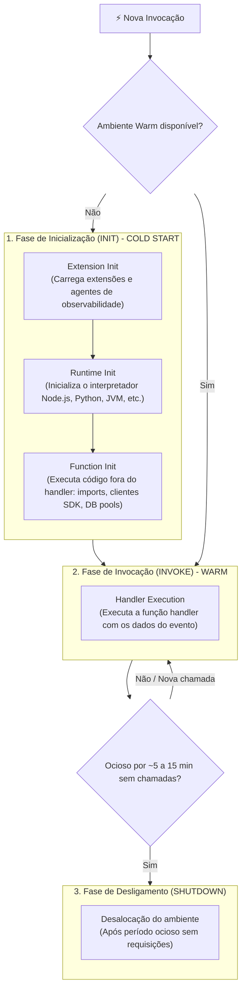
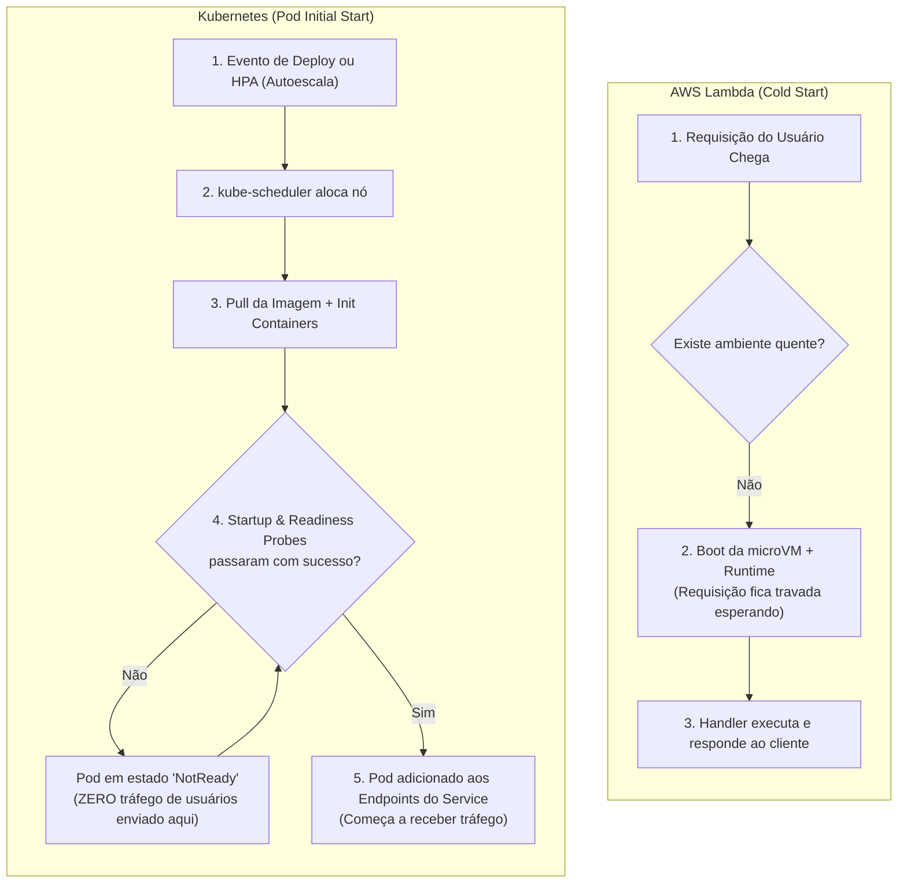

# ❄️ Cold Start em Arquiteturas Serverless (AWS Lambda)

> **Categoria:** Computação Serverless & FaaS (*Function as a Service*)  
> **Sessão:** Performance, Latência & Otimização de Arquiteturas Serverless  
> **Status:** Concluído  

---

## 1. O que é o Cold Start?

No paradigma **Serverless** (especificamente no modelo **FaaS** — *Function as a Service*), a infraestrutura subjacente não fica ligada consumindo recursos continuamente quando não há demanda. Em vez disso, o provedor de nuvem (como a AWS no **AWS Lambda**) instancia o ambiente de computação sob demanda no momento em que um evento ou requisição é disparado.

- **Cold Start (Início a Frio):** É o atraso ou latência adicional introduzido na **primeira requisição** (ou após um evento de autoescala), decorrente do tempo que a plataforma leva para provisionar os recursos de hardware/virtualização, baixar o código, carregar o runtime da linguagem e executar a inicialização estática antes de invocar a lógica de negócio.
- **Warm Start (Início a Quente):** Ocorre quando uma requisição subsequente chega a um ambiente de execução que já foi inicializado e permanece ativo (em espera). A requisição pula a etapa de inicialização e é enviada diretamente ao manipulador de eventos (`handler()`), com latência de poucos milissegundos.

---

## 2. Anatomia do Ciclo de Vida da Execução

Por baixo dos panos, o AWS Lambda executa cada função dentro de uma microVM segura e isolada gerenciada pelo **Firecracker** (tecnologia *open-source* em Rust desenvolvida pela AWS).

O ciclo de vida completo divide-se em três fases fundamentais:



### Detalhamento das Etapas do Cold Start

| Etapa | O que acontece por baixo dos panos? | Responsável |
| :--- | :--- | :--- |
| **Download do Código / Imagem** | Download do arquivo `.zip` (via S3) ou camadas de imagem OCI (via ECR) para a máquina host. | AWS |
| **Criação da MicroVM (Firecracker)** | Alocação de namespace, cgroups e boot do kernel da microVM (~frações de milissegundo). | AWS |
| **Inicialização do Runtime** | Boot do runtime da linguagem escolhida (ex.: V8 no Node.js, CPython no Python, HotSpot JVM no Java). | Provedor / Runtime |
| **Código Estático / Global** | Execução de todo o código localizado **fora do método `handler()`** (carregamento de módulos, conexões a bancos, leitura de variáveis de ambiente). | **Desenvolvedor** |

---

## 3. Fatores Críticos que Influenciam o Tempo de Cold Start

O impacto do Cold Start pode variar de **poucas dezenas de milissegundos** até **mais de 10 segundos**, dependendo das seguintes variáveis:

### 1. Escolha da Linguagem e Runtime
- **Runtimes Compilados / Nativos (Rust, Go, C++):** Menor pegada de memória e tempo de boot praticamente instantâneo (Cold Start tipicamente < 50ms - 100ms).
- **Runtimes Dinâmicos / Interpretados (Node.js, Python):** Desempenho intermediário muito rápido (Cold Start entre 150ms e 400ms).
- **Runtimes Gerenciados com JVM / CLR (Java, C# / .NET):** Inicialmente sofrem com o tempo de subida da máquina virtual, carregamento de classes pesadas (*classloading*) e compilação JIT (Cold Starts podendo chegar a 2s - 8s sem otimizações).

### 2. Tamanho do Pacote e Dependências (*Bundle Size*)
Quanto mais dependências ou bibliotecas gigantescas você importar no projeto (ex.: AWS SDK v2 completo em vez de submodulares do SDK v3), mais tempo o runtime gastará fazendo I/O e *parsing* do código antes da primeira invocação.

### 3. Memória Alocada (e vCPU Proporcional)
O AWS Lambda aloca capacidade de CPU proporcionalmente à quantidade de memória RAM configurada:
- Uma função com **128 MB** tem uma fração modesta de CPU e inicializará dependências lentamente.
- Uma função com **1.769 MB** recebe 1 vCPU integral dedicada, acelerando de forma drástica a fase de `INIT` e reduzindo o Cold Start pela metade ou mais.

### 4. Anexação a VPCs (*Virtual Private Cloud*)
- **Histórico (Antes de 2019):** Criar uma interface de rede elástica (ENI) dedicada a cada nova réplica de container adicionava de 10 a 30 segundos ao Cold Start.
- **Hoje (AWS Hyperplane):** A AWS utiliza túneis de rede compartilhados via NAT/Hyperplane. A ENI é provisionada antecipadamente a nível de conta/sub-rede, reduzindo o impacto de rede no Cold Start para valores insignificantes (dezenas de milissegundos).

---

## 4. Quando o Cold Start é um Problema?

| Cenário de Uso | Impacto do Cold Start | Severidade |
| :--- | :--- | :--- |
| **APIs Síncronas Voltadas ao Usuário (API Gateway + Lambda)** | Crítico. Um usuário final ou checkout de e-commerce esperando 2 a 5 segundos percebe lentidão severa (*SLA degradado no percentil p99*). | 🔴 Alta |
| **Picos de Tráfego Abruptos (*Flash Sales / Black Friday*)** | Crítico. Uma rajada súbita exige que o Lambda escale horizontalmente dezenas ou centenas de novas instâncias simultâneas, fazendo com que centenas de requisições sofram Cold Start ao mesmo tempo (*Thundering Herd*). | 🔴 Alta |
| **Processamento Assíncrono (Filas SQS, SNS, S3 Events)** | Desprezível. Se uma mensagem de fila ou evento de redimensionamento de imagem demorar 500ms adicionais para processar, o usuário final não é impactado. | 🟢 Baixa |
| **Cron Jobs / Tarefas Agendadas (EventBridge Scheduler)** | Irrelevante. Execuções pontuais de manutenção, relatórios ou backups não têm restrição de latência interativa imediata. | 🟢 Baixa |

---

## 5. Estratégias e Técnicas de Mitigação

### 1. Boas Práticas de Código e Inicialização Preguiçosa (*Lazy Loading*)
- Instancie clientes de conexão (banco de dados, AWS SDK, Redis) **fora** do `handler`, permitindo que fiquem abertos e sejam reutilizados em todos os *Warm Starts*.
- Importe apenas os módulos necessários (use modularização e *Tree Shaking* com Webpack, esbuild ou Rollup).
- Se uma dependência pesada só é usada em um caminho condicional raro, adote carregamento sob demanda (*dynamic import / lazy load*) dentro do bloco condicional.

### 2. Provisioned Concurrency (Concorrência Provisionada)
Recurso nativo do AWS Lambda que mantém uma quantidade pré-determinada de ambientes de execução permanentemente inicializados e prontos para responder em milissegundos.
- **Vantagem:** Elimina completamente o Cold Start para a cota reservada.
- **Trade-off:** Não há custo zero quando ocioso; você paga uma taxa horária pela capacidade provisionada mantida em espera.
- **Recomendação:** Utilizar em rotas críticas com políticas de *Application Auto Scaling* (ex.: aumentar a concorrência provisionada durante o horário comercial ou campanhas de marketing).

### 3. AWS Lambda SnapStart (Especialmente para Java)
Para funções Java (Java 11, 17 e 21), a AWS introduziu o **SnapStart**:
1. A função é inicializada durante a publicação da versão.
2. A AWS tira um *snapshot* da memória e do estado da microVM Firecracker e o persiste em cache criptografado de baixíssima latência.
3. Quando a função é invocada, a microVM é restaurada a partir do snapshot em vez de executar o boot do zero, reduzindo o tempo de Cold Start de segundos para menos de **200 milissegundos**.

### 4. Arquiteturas ARM64 (AWS Graviton2)
Executar funções na arquitetura `arm64` (processadores AWS Graviton) geralmente oferece melhor custo-benefício (até 20% mais barato) e tempos de compilação/inicialização ligeiramente superiores em vários runtimes modernos.

### 5. O Mito dos "Warmers / Pings Periódicos"
Muitos desenvolvedores adotam lambdas agendadas no EventBridge para disparar um "ping" a cada 5 minutos na função para "mantê-la acordada".
> ⚠️ **Atenção Técnica:** Esse padrão mantém apenas **uma única instância** aquecida. Se chegarem 10 requisições simultâneas, 1 será *Warm* e 9 sofrerão *Cold Start* inevitavelmente. Não utilize esse artifício como substituto para arquitetura adequada ou *Provisioned Concurrency*.

---

## 6. Padrões de Código: Anti-Padrão vs. Padrão Recomendado

### Exemplo em TypeScript / Node.js (AWS SDK v3)

#### ❌ Anti-Padrão: Inicialização dentro do Handler
```typescript
import { DynamoDBClient } from "@aws-sdk/client-dynamodb";
import { DynamoDBDocumentClient, PutCommand } from "@aws-sdk/lib-dynamodb";

export const handler = async (event: any) => {
  // ❌ ERRO: Cria uma nova conexão e reconstrói o cliente a cada invocação!
  // Degrada a latência mesmo em execuções "Warm" e esgota sockets/pools.
  const rawClient = new DynamoDBClient({ region: "us-east-1" });
  const docClient = DynamoDBDocumentClient.from(rawClient);

  await docClient.send(new PutCommand({
    TableName: "Pedidos",
    Item: { id: event.id, valor: event.valor }
  }));

  return { statusCode: 200, body: "OK" };
};
```

#### ✅ Padrão Otimizado: Inicialização no Escopo Global
```typescript
import { DynamoDBClient } from "@aws-sdk/client-dynamodb";
import { DynamoDBDocumentClient, PutCommand } from "@aws-sdk/lib-dynamodb";

// ✅ CORRETO: Executado uma única vez durante a fase de INIT (Cold Start).
// Permanece em memória e é reutilizado instantaneamente em todos os Warm Starts.
const rawClient = new DynamoDBClient({
  region: "us-east-1",
  maxAttempts: 3
});
const docClient = DynamoDBDocumentClient.from(rawClient);

export const handler = async (event: any) => {
  // O Handler executa diretamente a lógica de negócio com latência mínima
  await docClient.send(new PutCommand({
    TableName: "Pedidos",
    Item: { id: event.id, valor: event.valor }
  }));

  return { statusCode: 200, body: "OK" };
};
```

---

## 7. Matriz de Decisão Arquitetural: Como combater o Cold Start

```mermaid
flowchart TD
    Start["Problema de latência identificado no Lambda?"] --> CheckType{"A invocação é síncrona\n(ex: API REST / WebApp)?"}
    
    CheckType -->|Não (SQS, SNS, S3, Eventos)| Accept["✅ Aceitável: Não gaste orçamento com otimizações complexas."]
    
    CheckType -->|Sim| CheckRuntime{"Qual o runtime utilizado?"}
    
    CheckRuntime -->|Java| SnapStart["🚀 Habilitar AWS Lambda SnapStart"]
    CheckRuntime -->|Node.js / Python / Go / Rust| OptimizeCode["📦 Reduzir Bundle (Tree shaking, esbuild)\ne alocar mais RAM (>= 1024MB)"]
    
    SnapStart --> LatencyAcceptable{"Latência p99 atende o SLA?"}
    OptimizeCode --> LatencyAcceptable
    
    LatencyAcceptable -->|Sim| Done["Pronto!"]
    LatencyAcceptable -->|Não (SLA ultrarrígido / Checkout)| Provisioned["⚡ Configurar Provisioned Concurrency com Auto Scaling"]
```

---

## 8. Cold Start (Serverless / Lambda) vs. Initial Start (Kubernetes / Pods)

Uma dúvida comum em arquitetura é: **"A inicialização de um Pod no Kubernetes é a mesma coisa que um Cold Start no Lambda?"**

Embora ambos envolvam o tempo necessário para colocar uma aplicação em execução do zero, a **mecânica operacional**, a **relação com a requisição do usuário** e o **roteamento de rede** são fundamentalmente distintos.



### Tabela Comparativa Detalhada

| Critério | Cold Start (Serverless / AWS Lambda) | Initial Start (Kubernetes Pod Lifecycle) |
| :--- | :--- | :--- |
| **Gatilho de Criação** | **Reativo e síncrono:** Uma requisição direta do usuário ou evento sem réplica livre dispara a criação. | **Proativo ou por métricas:** Deploy manual, reinício do processo ou regra de autoescala do **HPA** (*Horizontal Pod Autoscaler*) baseada em CPU/Memória/Métricas customizadas. |
| **Impacto no Usuário Final** | **Direto:** O cliente fica com a conexão HTTP aberta aguardando a microVM e o runtime inicializarem para receber a resposta. | **Indireto (Protegido por Probes):** O tráfego do usuário **não** é enviado ao Pod novo até que a `readinessProbe` retorne sucesso. O tráfego continua sendo atendido pelos Pods antigos/existentes. |
| **Mecanismo de Proteção** | Não há probe nativa; a primeira requisição "paga a conta" da inicialização (`INIT phase`). | Uso de **`startupProbe`** e **`readinessProbe`** para isolar o tráfego até a aplicação estar 100% pronta. |
| **Tempo Típico de Subida** | **Milissegundos a poucos segundos** (geralmente entre 50ms e 2s em microVMs Firecracker). | **Segundos a minutos** (download de imagem Docker, montagem de volumes, checagens de probes e, se faltar capacidade no cluster, o provisionamento de novas instâncias EC2 pelo *Cluster Autoscaler* / *Karpenter*). |
| **Ciclo de Vida (*Scale to Zero*)** | **Nativo:** Escala automaticamente para zero por padrão quando inativo. | **Persistente (*Long-running*):** Mantém sempre o número mínimo de réplicas configurado (`replicas: N`), a menos que se use frameworks serverless como **Knative** ou **KEDA**. |

### O Ponto de Encontro: Quando o Kubernetes tem "Cold Start"?
Se o Kubernetes for configurado com **Knative Serving** ou **KEDA** com capacidade de escalar réplicas para zero (`minReplicas: 0`), uma requisição recebida pelo *Knative Queue-Proxy* ou *Ingress Controller* ficará em espera (*buffering*) até que o Pod seja agendado, passe pelo `Initial Start` e fique `Ready`. Nesse cenário específico, o *Initial Start* do Kubernetes se comporta exatamente como um **Cold Start** (com impacto de latência ainda mais severo se a imagem do container for pesada).

---

### Cold Start vs. Initial Start vs. Health Check: São a mesma coisa?

**Não, são conceitos distintos** que atuam em momentos e propósitos diferentes da arquitetura:

| Conceito | O que é? | Papel na Arquitetura | Pergunta que responde |
| :--- | :--- | :--- | :--- |
| **Cold Start** | O **atraso/fenômeno de latência** percebido na primeira requisição em ambientes que escalam a zero (*Serverless*). | Fenômeno de desempenho e custo do paradigma FaaS. | *"Por que a primeira requisição demorou 1 segundo e as seguintes levaram 10ms?"* |
| **Initial Start** | O **processo físico de inicialização** de um container/processo (boot do OS, carregar JVM/Node, subir framework e banco). | Fase de bootstrapping da aplicação (*Container Lifecycle*). | *"O processo da aplicação já terminou de subir e carregar as dependências?"* |
| **Health Check** | O **mecanismo contínuo de monitoramento** (sondas HTTP/TCP) que orquestradores e Load Balancers usam para testar a aplicação. | Governança de tráfego, autorrecuperação (*self-healing*) e proteção contra indisponibilidade. | *"A aplicação está saudável e pronta para receber tráfego agora, ou devo reiniciar/isolar o container?"* |

#### Como os três se relacionam na prática?
1. O **Initial Start** é a etapa de inicialização técnica de qualquer processo.
2. No Serverless, o tempo desse *Initial Start* pago diretamente pelo usuário que disparou a chamada vira o **Cold Start**.
3. No Kubernetes ou Load Balancers (ALB), o **Health Check** (especificamente `startupProbe` e `readinessProbe`) observa o final do *Initial Start* para só liberar o tráfego quando tudo estiver verde, impedindo que os usuários recebam erros `502 Bad Gateway` ou sofram lentidão.

---

## 9. Conexões com Outros Tópicos do Workshop

- [**AWS Lambda — Visão Geral & Computação Serverless**](lambda.md): Fundamentos, modelos de invocação e limites operacionais.
- [**Amazon API Gateway**](api-gateway.md): Como o API Gateway lida com timeouts e retries diante de Cold Starts de backend.
- [**Amazon SQS**](sqs.md): Desacoplamento assíncrono para absorver picos de tráfego sem expor o usuário final à latência de inicialização.
- [**Arquitetura Escalável e Resiliente**](arquitetura-escalavel-resiliente-aws.md): Padrões de tolerância a falhas e estratégias para eventos de alta demanda (*Black Friday*).
