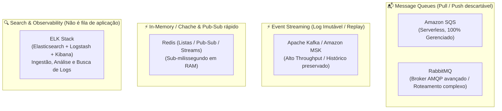
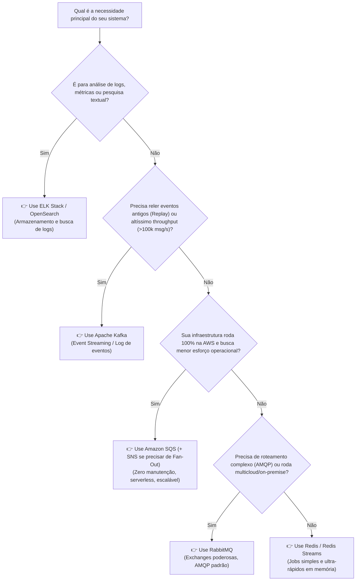

# ⚖️ Comparativo de Tecnologias: Amazon SQS vs. RabbitMQ vs. Apache Kafka vs. Redis vs. ELK Stack

> **Categoria:** Arquitetura de Software, Mensageria, Streaming & Observabilidade  
> **Sessão:** Integração de Sistemas & Engenharia de Dados  
> **Status:** Concluído

---

## 1. Esclarecimento Inicial: Filas vs. Streams vs. Observabilidade (O Papel do ELK)

Antes de comparar protocolos e ferramentas, é essencial esclarecer um ponto conceitual comum em discussões técnicas:

- **Amazon SQS e RabbitMQ** são **Sistemas de Mensageria / Filas (*Message Brokers*)**. O foco central é entregar mensagens a consumidores para processamento de tarefas pontuais; uma vez processada com sucesso, a mensagem é **removida da fila**.
- **Apache Kafka** é uma **Plataforma de Streaming / Log Distribuído de Eventos (*Event Streaming Platform*)**. As mensagens permanecem armazenadas em disco (imutáveis) por um período de tempo (retenção) e podem ser relidas (*replay*) por múltiplos sistemas de forma independente.
- **ELK Stack (Elasticsearch, Logstash/Beats, Kibana)** **NÃO é um sistema de filas de mensagens de aplicação**. Trata-se de uma suíte de **indexação de texto completo, agregação de logs e observabilidade**. 
  - *Por que existe essa confusão?* No pipeline clássico do ELK, o **Logstash** ou **Filebeat** frequentemente utilizam um *broker* intermediário (como **Kafka**, **Redis** ou **RabbitMQ**) como amortecedor (*buffer*) temporário antes de gravar no Elasticsearch, para evitar que uma avalanche de logs derrube os nós do cluster de busca.

---

## 2. Visão Geral das Tecnologias



---

## 3. Matriz Comparativa Completa

| Critério | **Amazon SQS** | **RabbitMQ** | **Apache Kafka** | **Redis (Listas/Streams)** | **ELK Stack (Logstash/Elastic)** |
| :--- | :--- | :--- | :--- | :--- | :--- |
| **Categoria Real** | Fila de Mensagens (*Message Queue*) | *Message Broker* Avançado (AMQP) | Plataforma de Streaming de Eventos | Estrutura de dados em memória (*Cache/Broker*) | Observabilidade, Busca & Ingestão de Logs |
| **Gerenciamento / Infra** | **100% Serverless** (sem servidores, patches ou clustering) | Requer provisionamento (EC2, K8s ou AWS Amazon MQ) | Requer provisionamento de clusters/brokers (ou AWS MSK) | Instância gerenciada (AWS ElastiCache) ou auto-hospedado | Cluster próprio ou Elastic Cloud / OpenSearch Service |
| **Modelo de Consumo** | **Pull** (Worker busca com Long/Short Polling) | **Push** (Broker entrega via conexões abertas) | **Pull via Consumer Groups** (Consumidor controla o offset) | **Push ou Pull** (`BLPOP`, `XREADGROUP`) | **Pipeline de Ingestão** (Beats/Logstash envia para Elasticsearch) |
| **Roteamento de Mensagens** | Simples (Ponto a Ponto ou Fan-Out com Amazon SNS) | **Extremamente flexível** (Direct, Topic, Fanout, Headers Exchanges) | Baseado em **Tópicos e Partições** (chave de partição) | Simples por chaves/canais ou Streams | Filtros, parsers (Grok) e transformações de log |
| **Persistência / Retenção** | De 1 minuto até 14 dias (apagada após consumo) | Apagada após confirmação (*ACK*); suporte a TTL e *dead-letter* | Retenção configurável por tempo (dias, meses) ou tamanho (**Permite Replay**) | Em memória com persistência opcional (RDB/AOF); efêmero se a RAM lotar | Armazenamento permanente em índices invertidos para consulta |
| **Throughput / Latência** | Quase ilimitado (Standard); latência em dezenas de ms | Médio-Alto (~10k a 100k msg/s); latência baixa (< 10ms) | **Massivo** (> 1M msg/s); latência sub-10ms | **Ultra rápido** (Centenas de milhares msg/s); latência **< 1ms** | Focado em taxa de ingestão de logs e velocidade de query |
| **Complexidade Operacional** | **Zero** (basta criar a fila via API/Terraform) | **Média/Alta** (gestão de conexões, memória de nós, clusters) | **Alta** (gestão de partições, brokers, ZooKeeper/KRaft) | **Baixa a Média** (gestão de memória RAM máxima) | **Alta** (gestão de *shards*, nós de dados, nós de master) |

---

## 4. Análise Detalhada por Ferramenta

### 4.1 Amazon SQS (Simple Queue Service)
- **Quando usar:**
  - Aplicações nativas em nuvem AWS (*cloud-native*) e microsserviços modernos.
  - Quando a equipe não quer gerenciar servidores, clusters, discos ou atualizações de sistema operacional.
  - Padrões de *Queue-Based Load Leveling* (absorver picos da Black Friday) e desacoplamento assíncrono.
- **Vantagens:** Escalabilidade infinita transparente, cobrança estrita por volume de requisições, integração nativa direta com IAM, Lambda, SNS e CloudWatch.
- **Limitações:** Tamanho máximo de mensagem de 256 KB (requer S3 para *extended client*), não suporta padrões complexos de roteamento sem o SNS (*Topic exchange*).

---

### 4.2 RabbitMQ
- **Quando usar:**
  - Aplicações corporativas com regras sofisticadas de roteamento de mensagens (ex.: enviar para filas diferentes com base em *headers*, *topics* ou *wildcards* com chave de roteamento).
  - Sistemas que necessitam do protocolo **AMQP 0-9-1**, MQTT ou STOMP.
  - Ambientes híbridos ou *multicloud* (executa em qualquer Docker/Kubernetes sem lock-in de provedor).
- **Vantagens:** O motor de roteamento via *Exchanges* é o mais poderoso do mercado; suporte a priorização de mensagens na fila.
- **Limitações:** Requer gerenciar a infraestrutura (CPU, memória e clustering). Se as filas crescerem demais descontroladamente, pode consumir toda a RAM da máquina e sofrer degradação de performance.

---

### 4.3 Apache Kafka
- **Quando usar:**
  - Arquiteturas orientadas a eventos em larga escala (*Event-Driven Architecture* e *Event Sourcing*).
  - Processamento em tempo real de grandes volumes de telemetria, cliques, métricas de IoT e auditoria contábil.
  - Cenários onde **múltiplos sistemas precisam ler o mesmo evento em momentos diferentes** (graças ao modelo de *replay* baseado em *offset*).
- **Vantagens:** Throughput estúpido de milhões de eventos por segundo, ordenação estrita garantida dentro da partição, retenção durável em disco.
- **Limitações:** Curva de aprendizado íngreme, custos operacionais consideráveis se não dimensionado corretamente, complexidade para tarefas simples de fila ponto a ponto.

---

### 4.4 Redis (Listas, Pub/Sub e Streams)
- **Quando usar:**
  - Fila rápida de background jobs simples (ex.: Sidekiq no Ruby, BullMQ no Node.js, Celery no Python).
  - Necessidade de latência extrema (sub-milissegundo).
  - Notificações de chat em tempo real via Pub/Sub efêmero.
- **Vantagens:** Extremamente simples de configurar, já costuma estar presente na infraestrutura como cache, velocidade absurda.
- **Limitações:** Memória RAM é finita e cara; se o cluster reiniciar sem persistência adequada ou se a memória estourar (*OOM*), mensagens podem ser perdidas.

---

### 4.5 O Papel do ELK Stack nesse Cenário
- **O que faz:** O **Elasticsearch** armazena e indexa documentos JSON para permitir pesquisas textuais ultra-rápidas; o **Logstash** extrai, transforma e carrega logs de diversas fontes; o **Kibana** cria dashboards visuais.
- **Relação com filas:** 
  ```mermaid
  flowchart LR
      Apps["Aplicações (EC2 / ECS / Lambdas)"] -->|Logs| Filebeat["Beats / Filebeat"]
      Filebeat -->|Buffer temporário| SQS_or_Kafka["📬 SQS / Kafka / Redis\n(Proteção contra sobrecarga de logs)"]
      SQS_or_Kafka -->|Leitura contínua| Logstash["⚙️ Logstash\n(Parse & Filtros)"]
      Logstash -->|Indexação| ES[("🔍 Elasticsearch")]
      ES -->|Visualização| Kibana["📊 Kibana"]
  ```
- **Conclusão:** O ELK não substitui o SQS ou RabbitMQ na lógica de negócio de sua aplicação (ex.: processar um pedido de compra). O ELK é o **destino** dos logs e métricas gerados por esses processos.

---

## 5. Guia Rápido de Decisão ("Qual devo escolher?")


