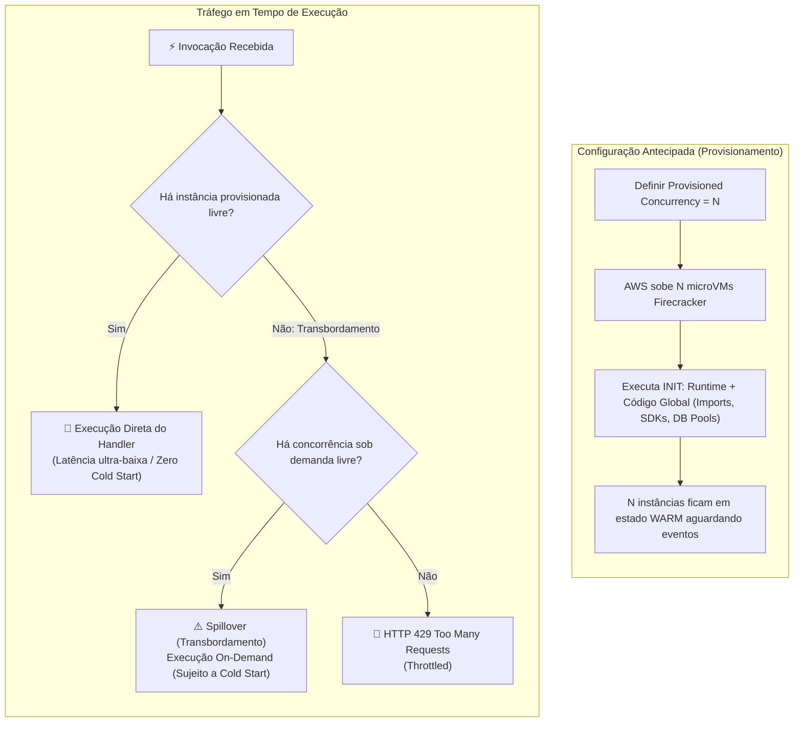
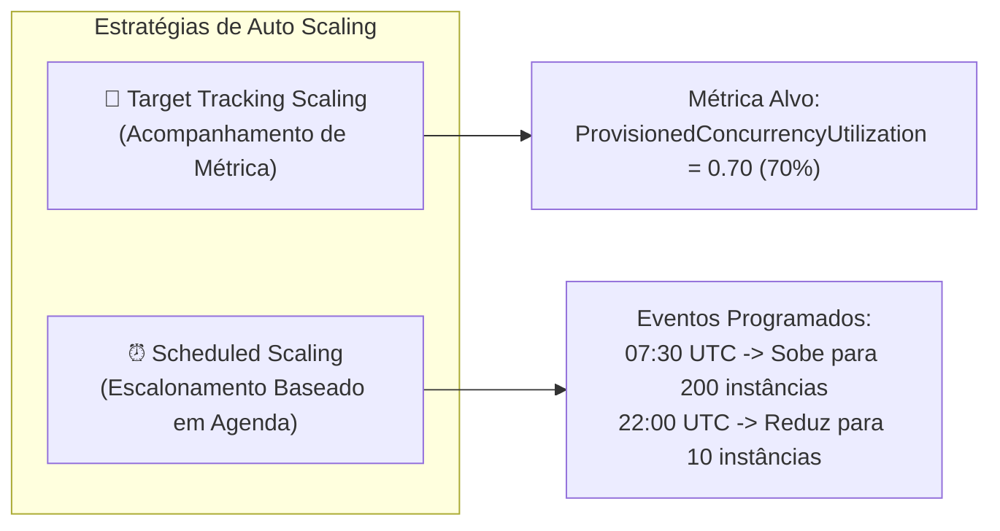
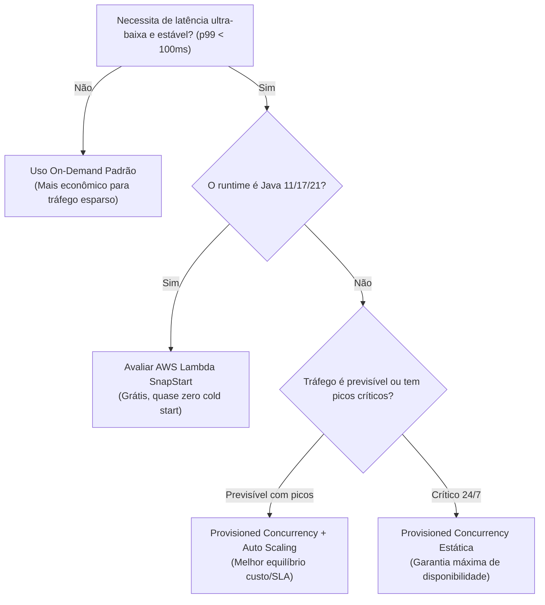

# ⚡ Concorrência Provisionada no AWS Lambda (Provisioned Concurrency)

> **Categoria:** Computação Serverless & FaaS (*Function as a Service*)  
> **Sessão:** Performance, SLA/SLO de Latência & FinOps em Serverless  
> **Status:** Concluído  

---

## 1. O que é Concorrência Provisionada?

A **Concorrência Provisionada (*Provisioned Concurrency*)** é um recurso do **AWS Lambda** projetado para eliminar completamente a latência de inicialização a frio (**Cold Start**), mantendo um número pré-configurado de ambientes de execução (microVMs Firecracker) **inicializados, aquecidos e prontos para responder imediatamente** a qualquer requisição.

No modelo tradicional sob demanda (*On-Demand*), quando uma função Lambda recebe uma rajada de tráfego ou uma primeira requisição após inatividade, a AWS precisa baixar o código, instanciar a microVM, inicializar o runtime da linguagem e executar o código global/estático (fase de `INIT`).

Com a **Concorrência Provisionada**:
- A fase de **`INIT` (Extension Init, Runtime Init e Function Init)** é executada **antecipadamente**.
- Quando a invocação chega, ela pula a inicialização e vai **diretamente para a fase de `INVOKE` (execução do handler)**.
- O tempo de resposta atinge consistência em **dois dígitos de milissegundos**, atendendo a requisitos rigorosos de SLA (*Service Level Agreement*) e SLO (*Service Level Objective*).

---

## 2. A Tríade da Concorrência no AWS Lambda

Um dos pontos de maior confusão em arquitetura serverless é a distinção entre os três modos de concorrência. A tabela abaixo desmistifica cada um:

| Característica | Concorrência Não Reservada (*Unreserved*) | Concorrência Reservada (*Reserved Concurrency*) | Concorrência Provisionada (*Provisioned Concurrency*) |
| :--- | :--- | :--- | :--- |
| **Definição** | Pool compartilhado padrão da conta na região (padrão de 1.000). | Reserva uma fatia fixa do pool da conta exclusivamente para uma função. | Pré-aquece instâncias de execução para atender chamadas instantaneamente. |
| **Garante capacidade?** | Não (concorre com todas as outras funções da conta). | **Sim** (garante que nenhuma outra função consuma essa cota). | **Sim** (garante capacidade dedicada e ativa). |
| **Limita teto (*Throttle*)?** | Não diretamente (apenas pelo teto regional da conta). | **Sim** (atua como cota máxima; requisições acima são descartadas com HTTP 429). | Não limita o teto por padrão (o excesso transborda para On-Demand). |
| **Elimina Cold Start?** | ❌ Não | ❌ **Não** (as instâncias ainda são criadas sob demanda na primeira chamada). |  **Sim** (ambientes mantidos aquecidos 24/7 ou via Auto Scaling). |
| **Aplicável a `$LATEST`?** | Sim | Sim | ❌ **Não** (exige versão numerada ou *Alias* publicado). |
| **Custo adicional?** | Apenas tempo de execução. | Gratuito (alocação de cota). | **Sim** (paga pelo tempo de provisionamento + tempo de execução). |

> ⚠️ **Pegadinha Clássica de Certificação e Arquitetura:**  
> Configurar **Reserved Concurrency** **NÃO** remove o Cold Start! Ela apenas reserva quota para que outras funções não consumam sua capacidade. Para zerar o Cold Start, a solução é **Provisioned Concurrency**.

---

## 3. Ciclo de Vida e Fluxo de Invocação



### O Fenômeno de Transbordamento (*Spillover*)
Se você configurar **100 instâncias provisionadas** e receber **130 requisições simultâneas**:
1. As **100 primeiras requisições** são atendidas instantaneamente pelas instâncias pré-aquecidas (`ProvisionedConcurrencyInvocations`).
2. As **30 requisições excedentes** transbordam (*spillover*) para a concorrência padrão sob demanda (`ProvisionedConcurrencySpilloverInvocations`), sendo inicializadas com Cold Start normal.
3. Se a conta ou a função tiver limites de concorrência esgotados, as requisições recebem `TooManyRequestsException` (HTTP 429).

---

## 4. Escalonamento Automático (Application Auto Scaling)

Manter uma quantidade estática de concorrência provisionada 24 horas por dia pode gerar custos desnecessários em momentos de baixo tráfego (ex.: madrugadas). A AWS permite integrar a Concorrência Provisionada com o **Application Auto Scaling** utilizando duas estratégias principais:



### 1. Target Tracking Scaling (Rastreamento de Alvo)
- Monitora a métrica `ProvisionedConcurrencyUtilization` (proporção de instâncias ativas versus alocadas).
- Exemplo: Definir a utilização alvo em `0.70` (70%). Se o tráfego aumentar e a utilização ultrapassar 70%, o Auto Scaling adiciona novas instâncias provisionadas dinamicamente. Se cair, reduz gradualmente.

### 2. Scheduled Scaling (Escalonamento por Horário)
- Ideal para padrões de negócio previsíveis (ex.: abertura de mercado financeiro, início de turno comercial ou grandes eventos promocionais como Live Commerce e Black Friday).
- Permite subir a capacidade antes mesmo do primeiro usuário acessar a plataforma.

---

## 5. Implementação Prática com Terraform

A Concorrência Provisionada **não pode ser vinculada diretamente ao ponteiro mutável `$LATEST`**. É obrigatório publicar uma **versão estática** ou criar um **Alias** apontando para uma versão.

```hcl
# 1. Função Lambda com publicação de versões habilitada
resource "aws_lambda_function" "checkout_api" {
  function_name    = "checkout-service-prod"
  role             = aws_iam_role.lambda_exec.arn
  handler          = "index.handler"
  runtime          = "nodejs20.x"
  filename         = "build/function.zip"
  source_code_hash = filebase64sha256("build/function.zip")

  publish = true # Obrigatório para gerar versões imutáveis

  environment {
    variables = {
      NODE_ENV = "production"
    }
  }
}

# 2. Criação de um Alias estável (ex.: 'live' ou 'prod')
resource "aws_lambda_alias" "checkout_live" {
  name             = "live"
  description      = "Alias de produção com Provisioned Concurrency"
  function_name    = aws_lambda_function.checkout_api.function_name
  function_version = aws_lambda_function.checkout_api.version
}

# 3. Configuração de Concorrência Provisionada Fixa
resource "aws_lambda_provisioned_concurrency_config" "checkout_pc" {
  function_name                     = aws_lambda_function.checkout_api.function_name
  qualifier                         = aws_lambda_alias.checkout_live.name
  provisioned_concurrent_executions = 50
}

# 4. (Opcional Avançado) Integração com Application Auto Scaling
resource "aws_appautoscaling_target" "lambda_target" {
  max_capacity       = 200
  min_capacity       = 10
  resource_id        = "function:${aws_lambda_function.checkout_api.function_name}:${aws_lambda_alias.checkout_live.name}"
  scalable_dimension = "lambda:function:ProvisionedConcurrentExecutions"
  service_namespace  = "lambda"

  depends_on = [aws_lambda_provisioned_concurrency_config.checkout_pc]
}

# Política de Target Tracking (mantém utilização em 70%)
resource "aws_appautoscaling_policy" "lambda_tracking_policy" {
  name               = "LambdaProvisionedConcurrencyUtilization"
  policy_type        = "TargetTrackingScaling"
  resource_id        = aws_appautoscaling_target.lambda_target.resource_id
  scalable_dimension = aws_appautoscaling_target.lambda_target.scalable_dimension
  service_namespace  = aws_appautoscaling_target.lambda_target.service_namespace

  target_tracking_scaling_policy_configuration {
    target_value = 0.7 # 70% de utilização

    predefined_metric_specification {
      predefined_metric_type = "LambdaProvisionedConcurrencyUtilization"
    }
  }
}
```

---

## 6. Comandos Essenciais via AWS CLI

### Alocar Concorrência Provisionada
```bash
aws lambda put-provisioned-concurrency-config \
    --function-name checkout-service-prod \
    --qualifier live \
    --provisioned-concurrent-executions 50
```

### Consultar o Status da Alocação
O provisionamento leva de alguns segundos a poucos minutos para inicializar todas as instâncias:
```bash
aws lambda get-provisioned-concurrency-config \
    --function-name checkout-service-prod \
    --qualifier live
```
*Saída com status `IN_PROGRESS`, `READY` ou `FAILED`.*

### Remover Concorrência Provisionada
```bash
aws lambda delete-provisioned-concurrency-config \
    --function-name checkout-service-prod \
    --qualifier live
```

---

## 7. Observabilidade e Métricas no Amazon CloudWatch

Para monitorar a saúde e dimensionar a concorrência provisionada, acompanhe as seguintes métricas no namespace `AWS/Lambda`:

| Métrica | O que mede? | Alerta Recomendado |
| :--- | :--- | :--- |
| **`ProvisionedConcurrentExecutions`** | Número de instâncias provisionadas que estão atualmente processando um evento. | Dimensionamento de capacidade. |
| **`ProvisionedConcurrencyInvocations`** | Volume de requisições atendidas com sucesso pelas instâncias pré-aquecidas. | Validar que o tráfego está caindo no pool correto. |
| **`ProvisionedConcurrencySpilloverInvocations`** | Requisições que excederam o pool provisionado e foram para On-Demand. | 🚨 Se for > 0 frequentemente, aumentar a capacidade provisionada ou ajustar o Auto Scaling. |
| **`ProvisionedConcurrencyUtilization`** | Fração da capacidade provisionada em uso (`Executions / Allocated`). | Base para o Target Tracking Scaling (alvo em 0.65 - 0.75). |

---

## 8. Análise Econômica (FinOps): Custo vs. Benefício

A precificação do AWS Lambda com Concorrência Provisionada divide-se em duas parcelas:

1. **Preço de Concorrência Provisionada (Capacidade Alocada):** Cobrado pela quantidade de concorrência configurada e pela memória alocada por segundo decorrido, **esteja a função executando requisições ou ociosa**.
2. **Preço de Requisição e Duração (Execução):** Cobrado por requisição invocada e pelo tempo de execução da CPU/memória. A taxa por GB-segundo de execução sob Concorrência Provisionada tem um **desconto aproximado de 15% a 20%** em relação à taxa sob demanda comum.

### Comparativo Arquitetural: Quando Usar?



| Critério | Sob Demanda (*On-Demand*) | Concorrência Provisionada (*Provisioned*) | Lambda SnapStart (Java) |
| :--- | :--- | :--- | :--- |
| **Custo Ocioso** | **Zero** ($0,00) | Cobrança contínua pelo pool alocado | **Zero** ($0,00) |
| **Latência p99** | Variável (sujeito a picos de Cold Start) | **Ultra-baixa e determinística** | Quase idêntica a warm start |
| **Runtimes Suportados** | Todos | Todos | Java (11, 17, 21), expansões futuras |
| **Complexidade de CI/CD** | Mínima (`$LATEST` ou versões) | Requer publicação de Versão + Alias | Requer publicação de Versão |

---

## 9. Boas Práticas e Recomendações de Engenharia

1. **Otimize o código global/estático (`INIT`):** Mesmo com provisionamento antecipado, se o bloco `INIT` demorar 30 segundos conectando a serviços externos com timeout, a inicialização das instâncias provisionadas pode falhar (`FAILED`).
2. **Conexões de Banco de Dados:** Instâncias provisionadas abrem conexões estáticas na fase de boot. Certifique-se de que o banco de dados relacional suporte o número de conexões (utilize **AWS RDS Proxy** para multiplexação).
3. **Use Aliases com Deploys Canary:** Integre o **AWS CodeDeploy** com ponderação de tráfego (*Canary 10% / 15 min*). O provisionamento antecipado das novas instâncias garante transição suave sem nenhum cold start durante o deploy.
4. **Evite sobreprovisionamento contínuo:** Combine sempre com **Application Auto Scaling** em ambientes de produção para desligar capacidade ociosa fora do expediente comercial.
