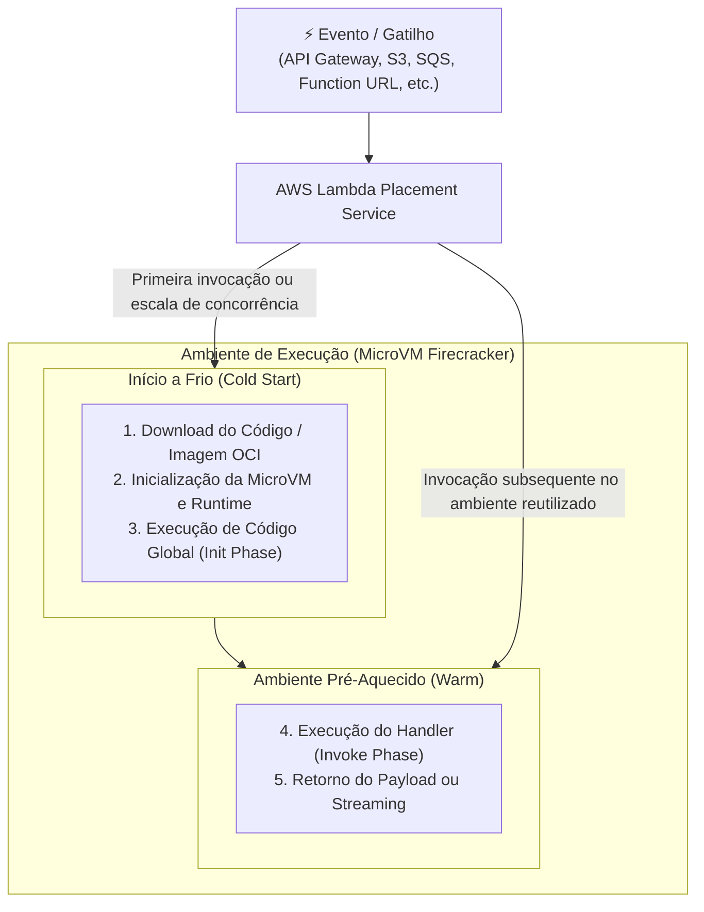
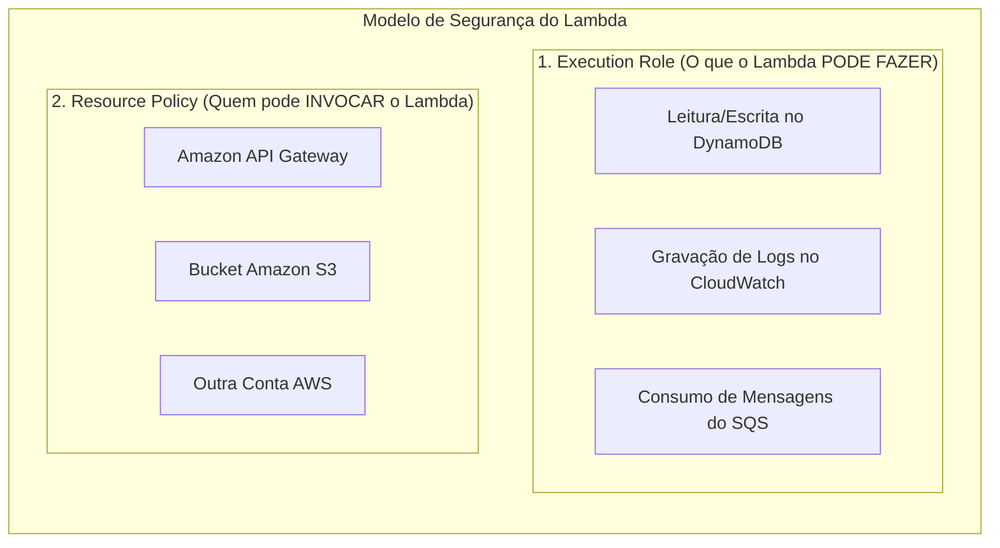

# ⚡ AWS Lambda — Computação Serverless Orientada a Eventos

> **Categoria:** Computação Serverless & FaaS (*Function as a Service*)  
> **Sessão:** Arquitetura Escalável & Resiliente na AWS  
> **Status:** Concluído & Atualizado com Recursos Modernos

---

## 1. O que é o AWS Lambda?

O **AWS Lambda** é um serviço de computação *serverless* pioneiro no modelo **FaaS** (*Function as a Service*), lançado pela AWS no re:Invent de 2014. Ele permite executar código sem provisionar, configurar ou gerenciar servidores, clusters de máquinas virtuais ou orquestradores de containers.

No modelo FaaS do Lambda:
- O desenvolvedor fornece apenas o código-fonte (em linguagens como Python, Node.js, Java, Go, Rust, .NET) ou uma imagem de container no padrão OCI.
- O código é executado exclusivamente em resposta a **eventos** (*event-driven*).
- A infraestrutura escala automaticamente de zero para dezenas de milhares de instâncias concorrentes em segundos.
- O modelo de faturamento é estritamente orientado ao consumo real: cobra-se pela quantidade de requisições e pela duração de execução em blocos de **1 milissegundo**, ponderados pela quantidade de memória alocada. Quando ocioso, o custo é **zero absoluto**.

---

## 2. Origem do Nome: De onde vem o termo "Lambda"?

1. **Cálculo Lambda ($\lambda$-calculus):**
   Criado na década de 1930 pelo matemático e lógico Alonzo Church, é um sistema formal que expressa computação por meio de abstração e aplicação de funções anônimas puras. Trata-se da pedra fundamental da **programação funcional**.
2. **Expressões Lambda na Programação:**
   Linguagens de ponta (Python, JavaScript/TypeScript, Java, C#, C++, Rust) chamam de *expressões lambda* funções anônimas, concisas e autocontidas, que recebem entradas e geram saídas sem acumular estado interno.
3. **Na Nuvem da AWS:**
   A AWS escolheu o nome para representar unidades atômicas de lógica computacional rodando na nuvem sob demanda, sem acoplamento a um servidor permanente.

---

## 3. Analogia Didática: EC2 vs. Containers vs. Lambda

| Aspecto | Amazon EC2 *(IaaS)* | Containers / ECS / EKS *(CaaS)* | AWS Lambda *(FaaS / Serverless)* |
| :--- | :--- | :--- | :--- |
| **Analogia de Transporte** | **Carro próprio na garagem:** Você cuida de seguro, IPVA, gasolina, pneus e revisões. Mesmo parado na garagem, gera custos fixos diários. | **Aluguel de van/ônibus com motorista:** Menos manutenção manual, mas você ainda gerencia rotas, lotação e dimensionamento da frota. | **Carro de aplicativo (Uber/99):** Você só pede o carro quando precisa ir de A para B. Não se preocupa com mecânica; desce no destino e paga só pelo trajeto rodado. |
| **Nível de Gestão** | Alto (OS, patches, AMI, auto scaling groups, capacidade). | Médio (orquestrador, sizing de nós/Fargate, Dockerfile). | Nulo em infraestrutura (foco 100% na lógica de negócio). |
| **Tempo de Escala** | Minutos (boot de instâncias EC2). | Segundos a minutos (pull de imagem e agendamento de pods). | **Milissegundos** (inicialização de microVMs sob demanda). |
| **Cobrança Ociosa** | Sim (paga por hora/segundo ligada). | Sim (se houver nós EC2 ou tasks Fargate ativas). | **Não (custo zero quando não há requisições).** |

---

## 4. Arquitetura Subjacente: Firecracker & Ciclo de Vida

O AWS Lambda utiliza a tecnologia **Firecracker**, um Virtual Machine Monitor (VMM) de código aberto desenvolvido pela AWS em Rust, baseado no Linux KVM (*Kernel-based Virtual Machine*). O Firecracker permite criar microVMs com isolamento de segurança em nível de hardware em menos de **5 milissegundos** e com pegada de memória mínima (< 5 MB de overhead por microVM).



### Cold Start vs. Warm Start
- **Cold Start (Início a Frio):** Ocorre quando uma requisição chega e não há microVM ociosa disponível. A AWS aloca recursos, faz o download do artefato, sobe a microVM, inicializa o runtime e executa as declarações globais antes de chamar a função `handler()`.
  > 📖 *Guia detalhado com benchmarks e mitigação avançada: [**Cold Start em Serverless**](cold-start.md).*
- **Warm Start (Início a Quente):** O ambiente já inicializado é mantido em espera (*warm*) por alguns minutos. Chamadas seguintes reutilizam o mesmo processo e memória, executando o `handler()` com latência de poucos milissegundos.

---

## 5. Modelos de Invocação de Eventos

O Lambda processa eventos sob três arquiteturas fundamentais:

```mermaid
flowchart LR
    subgraph Sync["1. Invocação Síncrona"]
        direction TB
        C1["API Gateway / ALB / SDK"] -->|Aguarda resposta direta| L1["Lambda"]
    end
    
    subgraph Async["2. Invocação Assíncrona"]
        direction TB
        C2["S3 / SNS / EventBridge"] -->|Fila interna AWS (2 retries)| L2["Lambda"]
        L2 -.->|Destinations / DLQ| D2["SQS / SNS / EventBridge"]
    end
    
    subgraph ESM["3. Event Source Mapping (Polling)"]
        direction TB
        C3["SQS / DynamoDB Streams / Kinesis"] -->|Lambda lê lotes (Batch)| L3["Lambda"]
    end
```

### 1. Invocação Síncrona (*Request/Response*)
- O chamador mantém a conexão aberta e aguarda o término da função para receber a resposta HTTP/JSON.
- Exemplos: Amazon API Gateway, Application Load Balancer (ALB), Lambda Function URLs, chamadas diretas com `InvocationType = RequestResponse`.
- Em caso de erro 5xx, o tratamento e retentativa cabem ao cliente chamador.

### 2. Invocação Assíncrona (*Event*)
- O serviço emissor envia o evento e recebe confirmação imediata (código HTTP 202 Accepted). O Lambda coloca o evento em uma fila interna gerenciada pela AWS.
- O Lambda tenta executar o evento até 3 vezes (1 execução original + 2 retentativas com recuo exponencial).
- **Destinations & DLQ:** Suporte nativo a direcionar eventos processados com sucesso ou falha para SQS, SNS, EventBridge ou outra função Lambda sem escrever código de tratamento.

### 3. Mapeamento de Origem de Eventos (*Event Source Mapping - ESM*)
- O Lambda gerencia um processo interno de leitura (*pollers*) sobre serviços de streaming ou filas (SQS, Amazon Kinesis Data Streams, DynamoDB Streams, Apache Kafka / Amazon MSK, DocumentDB).
- Agrupa registros em lotes (*batches*) e repassa o lote para uma única invocação do Lambda, otimizando custo e taxa de transferência (*throughput*).

---

## 6. Recursos Modernos e Atualizações Essenciais

### 6.1. Lambda Function URLs (Endpoints HTTP Nativos)
Elimina a necessidade obrigatória de criar um API Gateway ou ALB para cenários onde você só precisa de um endpoint HTTP(S) público ou protegido:
- URLs HTTPS dedicadas e geradas automaticamente (`https://<url-id>.lambda-url.<region>.on.aws`).
- Suporte a autenticação via **AWS IAM** (`AWS_IAM`) ou acesso totalmente público (`NONE`).
- Suporte nativo a **CORS** configurável diretamente nas propriedades da função.
- Ideal para webhooks (ex.: Stripe, GitHub, Slack), micro-endpoints internos e pipelines de ingestão.

### 6.2. Lambda Response Streaming
Permite que funções Lambda enviem payloads parciais para o cliente em tempo real via *chunked transfer encoding*, em vez de aguardar a geração completa da resposta:
- **Redução drástica do TTFB (*Time-To-First-Byte*):** Essencial para aplicações web dinâmicas, renderização SSR e interfaces de Inteligência Artificial generativa (streaming de tokens LLM).
- **Superação do limite tradicional de payload:** Requisições normais no Lambda/API Gateway limitam o payload a **6 MB**. Com Response Streaming via Function URL, é possível transmitir respostas de até **20 MB** de forma contínua.

### 6.3. AWS Lambda SnapStart
Tecnologia que acelera o Cold Start em até **90%** sem alterar o código de negócio:
- Durante o deploy da versão da função, a AWS inicializa a microVM, executa todo o código de inicialização global e salva um **snapshot criptografado da memória e do estado do microkernel** no Amazon S3/cache dedicado.
- Quando a primeira requisição chega, em vez de passar pelo boot tradicional da VM e JVM/Runtime, o Lambda restaura o snapshot em dezenas de milissegundos.
- Originalmente lançado para Java (onde o Cold Start era notório devido ao carregamento de classes), o suporte foi expandido para Python e .NET.

### 6.4. Processadores AWS Graviton (Arquitetura ARM64)
- Funções Lambda podem ser executadas tanto em chips x86_64 quanto em processadores **AWS Graviton (arquitetura arm64)**.
- Oferece até **34% de melhor relação preço/performance** e consome cerca de 20% menos por milissegundo de execução comparado a x86_64.
- Para linguagens interpretadas (Python, Node.js) ou compiladas para bytecode (Java, .NET), a migração costuma exigir apenas a alteração de uma flag na configuração (`architectures = ["arm64"]`).

### 6.5. Empacotamento via Container Images (OCI até 10 GB)
- Permite empacotar funções Lambda utilizando imagens Docker/OCI hospedadas no Amazon ECR.
- Suporta imagens de até **10 GB** de tamanho (contra o limite de 250 MB descompactados de pacotes ZIP).
- Indispensável para pipelines de Machine Learning, ciência de dados com dependências volumosas (TensorFlow, PyTorch, RDKit, Pandas) e binários customizados.

### 6.6. Conectividade de Rede VPC Moderna (Hyperplane ENIs)
- Historicamente (antes de 2019), anexar o Lambda a uma VPC privada adicionava de 10 a 30 segundos ao Cold Start pela criação síncrona de Elastic Network Interfaces (ENIs).
- Na arquitetura atual, a AWS utiliza **Hyperplane ENIs**: interfaces de rede compartilhadas e pré-alocadas em cada subnet da VPC. A microVM se conecta a esses túneis em menos de 10 milissegundos, sem esgotar o pool de IPs privados da VPC.

### 6.7. Recursos Avançados de Event Source Mapping (ESM)
- **Critérios de Filtragem de Eventos (*Event Filtering*):** Filtra mensagens diretamente na origem do ESM (SQS, Kinesis, DynamoDB) antes de invocar a função, reduzindo drasticamente custos com invocações desnecessárias.
- **Report Batch Item Failures:** Ao consumir filas SQS em lote (ex.: lote de 10 mensagens), se apenas 1 mensagem falhar, o Lambda sinaliza apenas o ID daquela mensagem com falha, evitando que as outras 9 sejam reprocessadas indevidamente.
- **Controle de Janela (*Batching Window*):** Permite acumular mensagens por até 300 segundos para processar grandes lotes econômicos.

---

## 7. Limites Operacionais e Cotas (Hard vs. Soft Limits)

| Parâmetro | Limite Padrão | Tipo de Limite | Observações Técnicas |
| :--- | :--- | :--- | :--- |
| **Timeout de Execução** | **15 minutos** (900 seg) | *Hard Limit* (inviolável) | Não prorrogável; processos longos devem usar AWS Step Functions, ECS ou Batch. |
| **Memória Alocada** | **128 MB a 10.240 MB (10 GB)** | Configurável | Ajustável em incrementos de 1 MB. CPU escala linearmente com a memória. |
| **vCPU Disponível** | 1 vCPU a cada **1.769 MB** | Proporcional | Com 10 GB de RAM, a função tem acesso a até 6 vCPUs dedicadas. |
| **Armazenamento Efêmero (`/tmp`)** | **512 MB até 10.240 MB (10 GB)** | Configurável | Útil para descompactar arquivos, processar PDFs e staging temporário. |
| **Payload de Invocação (Síncrono)** | **6 MB** | *Hard Limit* | Para payloads maiores, use S3 com Presigned URLs ou Function URL com Streaming (até 20 MB). |
| **Payload de Invocação (Assíncrono)** | **256 KB** | *Hard Limit* | Eventos maiores devem trafegar ponteiros com a referência no S3 (Claim Check Pattern). |
| **Tamanho do Pacote (ZIP)** | **50 MB** compactado / **250 MB** descompactado | *Hard Limit* | Ultrapassou 250 MB? Utilize imagens de container OCI (até 10 GB). |
| **Concorrência por Região** | **1.000 instâncias** simultâneas | *Soft Limit* | Expansível solicitando aumento de cota via Service Quotas no AWS Console. |

---

## 8. Segurança, Governança & IAM

A segurança no Lambda opera no modelo de responsabilidade compartilhada:



1. **Execution Role (`aws_iam_role`):** Identidade que o código do Lambda assume em tempo de execução para acessar outros serviços AWS (ler do S3, gravar no DynamoDB, enviar logs ao CloudWatch).
2. **Resource-Based Policy (`aws_lambda_permission`):** Regra anexada à própria função que autoriza recursos externos (API Gateway, S3, EventBridge) a dispararem a função.
3. **Variáveis de Ambiente Criptografadas:** Podem ser protegidas por chaves gerenciadas de KMS (*Key Management Service*) para garantir sigilo de parâmetros operacionais.

---

## 9. Implementação de Referência com Terraform (IaC)

Abaixo está o código Terraform completo e modularizado para provisionar uma função Lambda em arquitetura **Graviton (arm64)** com Function URL pública habilitada e logs estruturados no CloudWatch:

```hcl
terraform {
  required_version = ">= 1.5.0"
  required_providers {
    aws = {
      source  = "hashicorp/aws"
      version = "~> 5.0"
    }
    archive = {
      source  = "hashicorp/archive"
      version = "~> 2.4"
    }
  }
}

# 1. Empacotamento automático do código da função
data "archive_file" "lambda_zip" {
  type        = "zip"
  output_path = "${path.module}/lambda_payload.zip"

  source {
    content  = <<EOF
import json
import os

def handler(event, context):
    print("Processando evento:", json.dumps(event))
    return {
        "statusCode": 200,
        "headers": {"Content-Type": "application/json"},
        "body": json.dumps({
            "message": "Execução com sucesso via AWS Lambda!",
            "environment": os.environ.get("ENVIRONMENT", "dev")
        })
    }
EOF
    filename = "index.py"
  }
}

# 2. IAM Role de Execução (Princípio do Menor Privilégio)
resource "aws_iam_role" "lambda_exec_role" {
  name = "lambda-workshop-devops-role"

  assume_role_policy = jsonencode({
    Version = "2012-10-17"
    Statement = [
      {
        Action    = "sts:AssumeRole"
        Effect    = "Allow"
        Principal = { Service = "lambda.amazonaws.com" }
      }
    ]
  })
}

# Anexo de permissões de escrita de logs no CloudWatch
resource "aws_iam_role_policy_attachment" "lambda_basic_logs" {
  role       = aws_iam_role.lambda_exec_role.name
  policy_arn = "arn:aws:iam::aws:policy/service-role/AWSLambdaBasicExecutionRole"
}

# 3. Definição da Função Lambda (Arquitetura Graviton arm64)
resource "aws_lambda_function" "workshop_function" {
  function_name    = "worker-geracao-carga-serverless"
  role             = aws_iam_role.lambda_exec_role.arn
  handler          = "index.handler"
  runtime          = "python3.12"
  architectures    = ["arm64"]   # FinOps: Graviton para melhor price-performance
  memory_size      = 512         # vCPU proporcional ajustada
  timeout          = 30          # Timeout seguro para chamadas web

  filename         = data.archive_file.lambda_zip.output_path
  source_code_hash = data.archive_file.lambda_zip.output_base64sha256

  environment {
    variables = {
      ENVIRONMENT = "production"
      LOG_LEVEL   = "INFO"
    }
  }
}

# 4. Lambda Function URL (Endpoint HTTP nativo com CORS habilitado)
resource "aws_lambda_function_url" "function_url" {
  function_name      = aws_lambda_function.workshop_function.function_name
  authorization_type = "NONE" # Pública (Webhooks / Testes)

  cors {
    allow_credentials = false
    allow_origins     = ["*"]
    allow_methods     = ["GET", "POST"]
    allow_headers     = ["date", "keep-alive", "content-type"]
    max_age           = 86400
  }
}

# Permissão para que qualquer origem pública invoque a Function URL
resource "aws_lambda_permission" "allow_public_function_url" {
  statement_id           = "FunctionURLAllowPublicAccess"
  action                 = "lambda:InvokeFunctionUrl"
  function_name          = aws_lambda_function.workshop_function.function_name
  principal              = "*"
  function_url_auth_type = "NONE"
}

output "endpoint_url" {
  description = "URL HTTPS pública gerada nativamente pelo Lambda"
  value       = aws_lambda_function_url.function_url.function_url
}
```

---

## 10. Matriz Comparativa: Lambda vs. ECS Fargate vs. EC2

| Critério de Decisão | AWS Lambda | AWS ECS com Fargate | Amazon EC2 |
| :--- | :--- | :--- | :--- |
| **Tempo Máximo por Tarefa** | Até 15 minutos | Ilimitado | Ilimitado |
| **Padrão de Tráfego Ideal** | Esporádico, intermitente, orientado a eventos ou altamente elástico com picos imprevisíveis. | Tráfego constante, sustentado e serviços de longa duração (daemon, web servers tradicionais). | Cargas de trabalho legadas, bancos autogerenciados ou requerimentos específicos de kernel/SO. |
| **Tempo de Inicialização** | Milissegundos a poucos segundos. | Dezenas de segundos a poucos minutos. | Minutos. |
| **Gestão Operacional** | Zero gerenciamento de OS ou orquestrador. | Zero gerenciamento de nós; gerencia definições de tarefas e containers. | Gestão total de SO, patches, monitoramento de instâncias e ASG. |
| **Ponto de Inflexão FinOps** | Extremamente barato para tráfego variável; pode se tornar mais caro se executar a 100% de CPU 24/7 ininterruptamente. | Mais custo-eficiente para cargas contínuas e previsíveis com alta taxa de utilização. | Menor custo unitário contínuo com Instâncias Reservadas / Savings Plans para workloads flatline. |

---

## 11. Conexão com o Workshop (Slide 17/30: Geração de Carga)

Na arquitetura de geração de carga serverless documentada neste workshop:
1. O tráfego do usuário é recebido via CloudFront e enfileirado no **Amazon SQS FIFO** para nivelamento de carga (*Load Leveling*).
2. O **AWS Lambda** atua como o motor de processamento elástico através do **Event Source Mapping**:
   - Lê as mensagens do SQS em lotes (*batch size* configurado).
   - Processa os votos ou incrementos de dados.
   - Atualiza a tabela do **DynamoDB** utilizando a técnica de *Sharded Counters* para evitar hot partitions.
   - Caso um lote falhe, o Lambda utiliza `ReportBatchItemFailures` para devolver apenas a mensagem com erro para a fila, protegendo a integridade e garantindo escala resiliente para centenas de milhares de requisições por segundo.