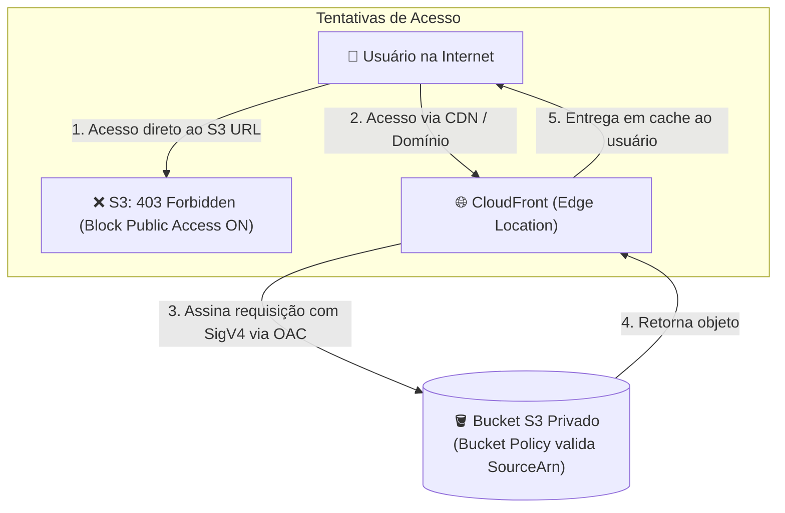

# 🛡️ OAC — Origin Access Control (Amazon CloudFront & S3)

> **Categoria:** Segurança, Redes & IAM  
> **Serviços Envolvidos:** Amazon CloudFront & Amazon S3  
> **Status:** Documentado

---

## 1. O que é o Origin Access Control (OAC)?

O **Origin Access Control (OAC)** é o mecanismo moderno da AWS para restringir o acesso a buckets do Amazon S3, garantindo que os objetos sejam acessíveis **exclusivamente** através de distribuições autorizadas do Amazon CloudFront.

Com o OAC:
- O bucket S3 permanece **100% privado** (com a diretiva *Block Public Access* ativada).
- Usuários e bots na internet são incapazes de burlar o CloudFront ou acessar URLs diretas do S3 (`https://meu-bucket.s3.amazonaws.com/...`).
- Todo o tráfego obrigatoriamente passa pelas regras de cache, certificados SSL/TLS, AWS WAF e proteções DDoS na borda.

---

## 2. OAC vs. OAI (Origin Access Identity): Por que migrar?

O OAC substituiu o antigo **OAI (Origin Access Identity)** lançado originalmente pela AWS. A tabela abaixo compara as melhorias:

| Capacidade | OAI (Legado) | OAC (Moderno / Recomendado) |
| :--- | :---: | :---: |
| **Criptografia SSE-KMS** | ❌ Não suportado | ✅ **Suportado nativamente** (chaves KMS gerenciadas pelo cliente) |
| **Regiões AWS Suportadas** | Limitado (apenas regiões padrão) | ✅ **Todas as regiões globais** (incluindo regiões *opt-in*) |
| **Métodos HTTP Suportados** | Apenas `GET` e `HEAD` | ✅ `GET`, `HEAD`, **`PUT`**, **`POST`**, **`PATCH`** e **`DELETE`** |
| **Protocolo de Assinatura** | SigV2 / SigV4 parcial | ✅ **AWS Signature Version 4 (SigV4)** completo |
| **Segurança e Granularidade** | Baseado em identidade de serviço legada | ✅ Baseado em **Service Principal** (`cloudfront.amazonaws.com`) + `SourceArn` da distribuição |

---

## 3. Diagrama de Funcionamento



---

## 4. Passo a Passo de Configuração

### Passo 1: Criar o OAC no CloudFront
No console da AWS ou via código (Terraform/CloudFormation):
- **Origem:** Amazon S3
- **Signing behavior:** *Sign requests (recommended)*
- **Signing protocol:** *SigV4*

### Passo 2: Associar o OAC à Origem do S3 na Distribuição
No CloudFront, ao configurar a origem que aponta para o S3:
- Selecione **Origin access:** *Origin access control settings (recommended)*.
- Selecione o perfil OAC criado no Passo 1.

### Passo 3: Aplicar a Política de Bucket (Bucket Policy) no S3
O bucket deve conter uma política concedendo `s3:GetObject` ao principal `cloudfront.amazonaws.com`, com a condição estrita de `SourceArn` correspondente à sua distribuição CloudFront.

```json
{
  "Version": "2012-10-17",
  "Statement": [
    {
      "Sid": "AllowCloudFrontServicePrincipalReadOnly",
      "Effect": "Allow",
      "Principal": {
        "Service": "cloudfront.amazonaws.com"
      },
      "Action": "s3:GetObject",
      "Resource": "arn:aws:s3:::NOME-DO-SEU-BUCKET/*",
      "Condition": {
        "StringEquals": {
          "AWS:SourceArn": "arn:aws:cloudfront::SUA-CONTA-AWS:distribution/ID-DA-DISTRIBUICAO"
        }
      }
    }
  ]
}
```

> [!IMPORTANT]
> **Prevenção do problema do "Deputado Confuso" (*Confused Deputy*):**  
> A cláusula `"Condition": { "StringEquals": { "AWS:SourceArn": "..." } }` é fundamental. Ela impede que outra pessoa com uma distribuição CloudFront em outra conta acesse o seu bucket.

---

## 5. Exemplo de Implementação com Terraform

```hcl
# 1. Bucket S3 Privado
resource "aws_s3_bucket" "frontend" {
  bucket = "meu-app-frontend-blackfriday"
}

resource "aws_s3_bucket_public_access_block" "frontend" {
  bucket                  = aws_s3_bucket.frontend.id
  block_public_acls       = true
  block_public_policy     = true
  ignore_public_acls      = true
  restrict_public_buckets = true
}

# 2. Origin Access Control (OAC)
resource "aws_cloudfront_origin_access_control" "oac" {
  name                              = "s3-frontend-oac"
  description                       = "OAC para o bucket frontend"
  origin_access_control_origin_type = "s3"
  signing_behavior                  = "always"
  signing_protocol                  = "sigv4"
}

# 3. Distribuição CloudFront
resource "aws_cloudfront_distribution" "cdn" {
  enabled             = true
  default_root_object = "index.html"

  origin {
    domain_name              = aws_s3_bucket.frontend.bucket_regional_domain_name
    origin_id                = "S3-Frontend"
    origin_access_control_id = aws_cloudfront_origin_access_control.oac.id
  }

  default_cache_behavior {
    target_origin_id       = "S3-Frontend"
    viewer_protocol_policy = "redirect-to-https"
    allowed_methods        = ["GET", "HEAD"]
    cached_methods         = ["GET", "HEAD"]

    forwarded_values {
      query_string = false
      cookies { forward = "none" }
    }
  }

  restrictions {
    geo_restriction { restriction_type = "none" }
  }

  viewer_certificate {
    cloudfront_default_certificate = true
  }
}

# 4. Bucket Policy autorizando o CloudFront via OAC
resource "aws_s3_bucket_policy" "frontend_policy" {
  bucket = aws_s3_bucket.frontend.id

  policy = jsonencode({
    Version = "2012-10-17"
    Statement = [
      {
        Sid       = "AllowCloudFrontServicePrincipalReadOnly"
        Effect    = "Allow"
        Principal = {
          Service = "cloudfront.amazonaws.com"
        }
        Action   = "s3:GetObject"
        Resource = "${aws_s3_bucket.frontend.arn}/*"
        Condition = {
          StringEquals = {
            "AWS:SourceArn" = aws_cloudfront_distribution.cdn.arn
          }
        }
      }
    ]
  })
}
```

---

## 6. Resumo das Boas Práticas
1. **Nunca deixe o bucket S3 público** se ele estiver atrás de uma CDN. Ative todas as 4 opções de *Block Public Access*.
2. **Utilize sempre o OAC em vez do OAI** em novos projetos.
3. **Use `AWS:SourceArn` específico** na Bucket Policy para restringir à distribuição exata.
4. **Se utilizar KMS:** adicione permissões na chave KMS para o serviço `cloudfront.amazonaws.com` poder descriptografar (`kms:Decrypt`) durante o repasse dos arquivos.
