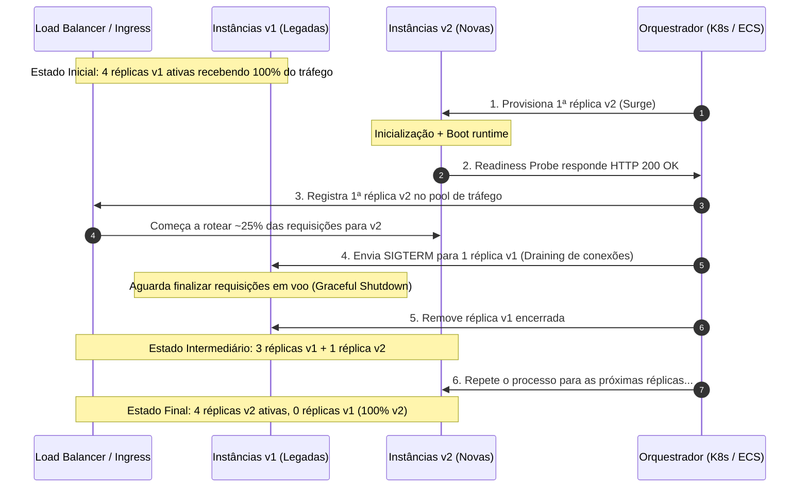
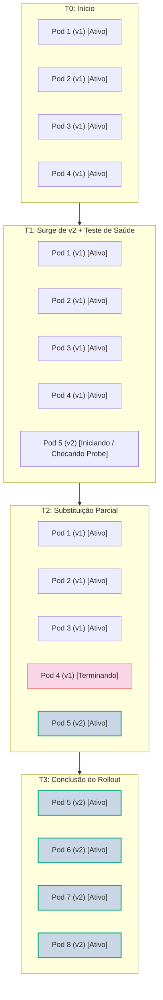
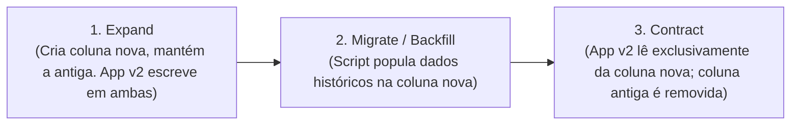

# 🔄 Rolling Update (Atualização Contínua)

> **Categoria:** Estratégias de Implantação (*Deployment Strategies*) & DevOps  
> **Sessão:** Ciclo de Vida de Aplicações, Orquestração de Containers e Alta Disponibilidade  
> **Status:** Concluído  

---

## 1. O que é Rolling Update?

O **Rolling Update** (ou atualização contínua/rolante) é um padrão de implantação de software no qual uma nova versão de uma aplicação substitui gradualmente a versão anterior, instância por instância (ou pod por pod), sem interromper a disponibilidade do serviço para os usuários finais (**Zero Downtime Deployment**).

Em vez de derrubar todas as instâncias antigas de uma vez ou criar uma infraestrutura paralela duplicada completa, o orquestrador (ex.: Kubernetes, AWS ECS, Docker Swarm ou Auto Scaling Groups da AWS) executa uma transição incremental:
1. Inicia um ou mais containers/servidores da **nova versão (v2)**;
2. Aguarda que passem nas verificações de integridade (*health checks* / *readiness probes*);
3. Direciona tráfego para as novas instâncias saudáveis;
4. Descomissiona gradualmente instâncias da **versão antiga (v1)** com encerramento gracioso (*graceful shutdown*);
5. Repete o ciclo até que 100% da frota esteja executando a nova versão.

---

## 2. Analogia Didática: A Troca de Pneus em Movimento

Imagine um caminhão de carga de 8 eixos transportando mercadorias em uma rodovia (o tráfego contínuo de usuários):

- **Abordagem Recreate (Downtime Total):** O caminhão para completamente no acostamento, descarrega, desliga o motor, desparafusa todas as rodas antigas, coloca as novas e depois retoma a viagem. Os clientes esperam parados na estrada até o serviço voltar.
- **Abordagem Blue/Green (Custo Dobrado):** Contrata-se um segundo caminhão idêntico, coloca-se os pneus novos nele, e em uma fração de segundo toda a carga e motoristas pulam para o novo caminhão. Seguro e rápido, mas exige pagar por dois caminhões inteiros.
- **Abordagem Rolling Update (Eficiente & Incremental):** Com o caminhão rodando (ou em paradas programadas por eixo), levanta-se um eixo por vez, substitui-se o pneu por um novo, testa-se a aderência e desce-se o eixo de volta. O caminhão nunca para de andar e não é necessário comprar um segundo caminhão.

---

## 3. Anatomia e Ciclo de Execução do Rolling Update

O diagrama abaixo ilustra o comportamento de um cluster com 4 réplicas durante a evolução temporal de um Rolling Update:



### Visualização do Estado da Frota ao Longo do Tempo



---

## 4. Parâmetros Críticos de Configuração

### 4.1 No Kubernetes (`Deployment.spec.strategy.rollingUpdate`)

O Kubernetes controla a velocidade e a tolerância a falhas da implantação por meio de dois parâmetros determinantes:

| Parâmetro | O que significa? | Valor Típico | Impacto se mal configurado |
| :--- | :--- | :--- | :--- |
| **`maxSurge`** | Quantos pods adicionais podem ser criados **além do número desejado de réplicas** durante a atualização. Pode ser número absoluto (ex.: `2`) ou percentual (ex.: `25%`). | `25%` ou `1` | Se muito alto, consome excesso de CPU/Memória dos nós do cluster. Se `0`, não há capacidade extra temporária. |
| **`maxUnavailable`** | Quantos pods podem ficar **indisponíveis** (abaixo do número desejado) durante o processo de atualização. Também pode ser absoluto ou percentual. | `0` (Zero Downtime estrito) ou `25%` | Se `maxUnavailable > 0`, a capacidade total de atendimento cai temporariamente durante o pico de tráfego. |

> 💡 **Padrão Ouro para Zero Downtime no Kubernetes:**
> - `maxSurge: 25%` (ou `1` para deployments pequenos)
> - `maxUnavailable: 0` (garante que a capacidade contratada nunca sofra degradação)

### 4.2 No AWS ECS (`deploymentConfiguration`)

No Amazon Elastic Container Service (ECS), o controle equivalente é feito via:

| Parâmetro | Significado | Exemplo para 4 tarefas |
| :--- | :--- | :--- |
| **`minimumHealthyPercent`** | Limite inferior de tarefas saudáveis que devem permanecer em execução durante o deploy. | `100%` (garante 4 tarefas ativas a todo momento, sem perda de capacidade). |
| **`maximumPercent`** | Limite superior de tarefas simultâneas (versão antiga + versão nova) durante o deploy. | `200%` (permite subir até 8 tarefas simultâneas, acelerando o rollout). |

---

## 5. O Grande Desafio: Coexistência de Versões (v1 + v2)

O Rolling Update introduz um período transitório inevitável: **instâncias da versão legada (v1) e da nova versão (v2) coexistem e atendem requisições em paralelo**.

Isso exige rigor em dois pilares essenciais:

### 5.1 Compatibilidade Retroativa de Contratos e APIs (*Backward & Forward Compatibility*)
- **Nunca renomeie ou remova campos de APIs em uma única etapa.** Se a v2 esperar um campo que a v1 não enviava, ou se a v2 parar de responder um campo que um cliente ainda consome de réplicas v1, haverá quebra de serviço.
- Aplique a regra de ouro: **tolerância na leitura, estrita na escrita**. Campos novos devem ser opcionais na v2 até que todos os clientes e servidores estejam alinhados.

### 5.2 Migração de Banco de Dados: O Padrão Expand/Contract (Parallel Run)
Executar `ALTER TABLE DROP COLUMN` ou renomear colunas durante um Rolling Update resultará em falhas imediatas (`500 Internal Server Error`) nas instâncias v1 que ainda estão consultando o esquema legado.

A abordagem correta divide as mudanças de schema em fases:



---

## 6. Comparativo: Rolling Update vs Outras Estratégias

| Critério | Rolling Update | Blue/Green | Canary | Recreate |
| :--- | :--- | :--- | :--- | :--- |
| **Downtime** | Zero | Zero | Zero | **Existente** (minutos/segundos) |
| **Custo de Infraestrutura** | Baixo (+10% a 25% temporário) | **Alto** (duplica 100% da frota) | Baixo a Médio | **Mínimo** (sem sobreposição) |
| **Velocidade de Rollback** | Moderada (requer novo rollout reverso) | **Instantânea** (chaveamento de DNS/LB) | Rápida (cancela o tráfego canário) | Lenta (reinstalação) |
| **Blast Radius (Raio de Impacto)** | Médio (falhas afetam usuários progressivamente) | Baixo (testável antes do switch) | **Mínimo** (apenas 1% a 5% dos usuários) | Alto (afeta 100% dos usuários) |
| **Complexidade de Configuração** | Baixa a Média (padrão em K8s/ECS) | Alta (balanceadores e infra paralela) | Alta (Service Mesh, APM ou Ingress avançado) | Muito Baixa |
| **Coexistência v1/v2?** | **Sim** (durante o deploy) | Não (switch atômico) | **Sim** (proposital) | Não |

---

## 7. Exemplos Práticos de Implementação

### 7.1 Manifesto Kubernetes (`deployment.yaml`)

```yaml
apiVersion: apps/v1
kind: Deployment
metadata:
  name: payment-service
  labels:
    app: payment-service
spec:
  replicas: 4
  revisionHistoryLimit: 5 # Mantém histórico para rollback rápido
  strategy:
    type: RollingUpdate
    rollingUpdate:
      maxSurge: 1           # Sobe no máximo 1 pod além das 4 réplicas
      maxUnavailable: 0     # Nunca permite menos que 4 pods saudáveis atendendo
  selector:
    matchLabels:
      app: payment-service
  template:
    metadata:
      labels:
        app: payment-service
        version: "v2.1.0"
    spec:
      terminationGracePeriodSeconds: 30 # Tempo para conexões ativas finalizarem
      containers:
      - name: payment-api
        image: 123456789012.dkr.ecr.us-east-1.amazonaws.com/payment:v2.1.0
        ports:
        - containerPort: 8080
        # CRUCIAL: Sem Readiness Probe, o K8s considera o pod pronto ANTES da inicialização real!
        readinessProbe:
          httpGet:
            path: /health/ready
            port: 8080
          initialDelaySeconds: 5
          periodSeconds: 5
          successThreshold: 1
          failureThreshold: 3
        livenessProbe:
          httpGet:
            path: /health/live
            port: 8080
          initialDelaySeconds: 15
          periodSeconds: 10
        lifecycle:
          preStop:
            exec:
              # Dá tempo ao Ingress/Service remover o IP do endpoint antes de fechar o socket
              command: ["/bin/sh", "-c", "sleep 5"]
```

### 7.2 AWS ECS Service (Snippet Terraform)

```hcl
resource "aws_ecs_service" "api_service" {
  name            = "order-api"
  cluster         = aws_ecs_cluster.production.id
  task_definition = aws_ecs_task_definition.api_v2.arn
  desired_count   = 4
  launch_type     = "FARGATE"

  deployment_maximum_percent         = 200 # Permite até 8 tasks durante o deploy
  deployment_minimum_healthy_percent = 100 # Garante no mínimo 4 tasks saudáveis

  deployment_circuit_breaker {
    enable   = true # Rollback automático se as novas tasks falharem nos health checks
    rollback = true
  }

  load_balancer {
    target_group_arn = aws_lb_target_group.api.arn
    container_name   = "order-api"
    container_port   = 8080
  }
}
```

---

## 8. Boas Práticas e Checklist para Produção

- [x] **Configurar Readiness Probes rigorosos:** O orquestrador só deve considerar o novo container apto após verificar dependências críticas (ex.: conexão com banco estabelecida, cache aquecido).
- [x] **Garantir Graceful Shutdown (Tratamento de `SIGTERM`):**
  - A aplicação deve capturar o sinal `SIGTERM`;
  - Interromper o recebimento de novas conexões HTTP;
  - Aguardar a conclusão das requisições em voo com timeout definido;
  - Fechar pools de banco de dados e buffers de logs ordenadamente.
- [x] **Ajustar `preStop` hook e Deregistration Delay:**
  - No Kubernetes, configure um comando `sleep 5` a `10` no `preStop` para evitar perda de pacotes enquanto o `kube-proxy` e os ingress controllers atualizam a tabela de rotas.
  - No AWS Application Load Balancer (ALB), ajuste o `deregistration_delay.timeout_seconds` do Target Group (geralmente entre 15s e 30s) para drenar conexões antigas com segurança.
- [x] **Habilitar Deployment Circuit Breaker:** Em plataformas gerenciadas (como AWS ECS ou Argo Rollouts), ative o rollback automático caso a nova versão apresente falha consecutiva nos health checks.
- [x] **Monitorar Métricas de Erro e Latência:** Mantenha alertas em tempo real sobre taxa de erros 5xx e latência p95/p99 durante a janela de execução da esteira de deploy.
