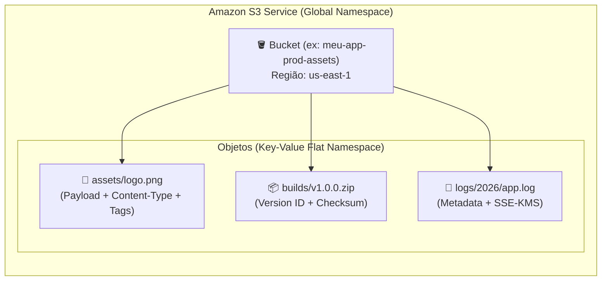
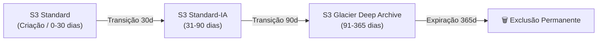

# 🪣 Amazon S3 (Simple Storage Service) — Visão Geral & Boas Práticas

> **Categoria:** Armazenamento de Objetos (*Object Storage*), Persistência & Camada de Dados  
> **Sessão:** Workshop DevOps na Nuvem — Fundamentos & Arquitetura Escalável  
> **Status:** Concluído  

---

## 1. O que é o Amazon S3?

O **Amazon S3 (Simple Storage Service)** é um serviço de armazenamento de objetos (*Object Storage*) gerenciado pela AWS, desenhado para oferecer escalabilidade praticamente infinita, alta disponibilidade, segurança e uma durabilidade projetada de **99,999999999% (11 noves)**.

Diferente de sistemas de arquivos tradicionais ou discos virtuais anexados a servidores, o S3 armazena os dados como **objetos independentes**, acessíveis nativamente via protocolos web (HTTP/HTTPS e REST APIs).

---

## 2. Diferença Fundamental: Objeto vs. Bloco vs. Arquivo

| Característica | **Amazon S3** (Objeto) | **Amazon EBS** (Bloco) | **Amazon EFS** (Arquivo) |
| :--- | :--- | :--- | :--- |
| **Paradigma** | Objeto (Chave, Valor, Metadados) | Volumes brutos de blocos formatáveis | Sistema de arquivos hierárquico POSIX |
| **Acesso** | Via API / HTTP / SDK / AWS CLI | Anexado a instâncias EC2 (`/dev/xvdf`) | Montado via NFS em centenas de instâncias/containers |
| **Estrutura** | Espaço plano (*flat*), delimitado por prefixos | Blocos de bytes estruturados pelo OS | Diretórios e arquivos aninhados |
| **Escalabilidade** | Ilimitada e automática | Até 64 TB por volume | Elástica e automática |
| **Casos de Uso** | Data lakes, backups, assets estáticos, logs, artefatos de build | Discos de boot de SO, bancos de dados relacionais | CMS (WordPress), compartilhamento de arquivos multi-instância |

---

## 3. Conceitos Fundamentais



1. **Bucket:**
   - Contêiner lógico de nível superior onde os objetos são guardados.
   - O nome do bucket é **globalmente único** em toda a AWS e segue regras de DNS (`bucket-name.s3.amazonaws.com`).
   - Cada bucket é criado em uma **Região AWS específica** escolhida por você (garantindo soberania de dados e baixa latência).

2. **Objeto:**
   - A unidade fundamental de dado armazenada no S3.
   - O tamanho de um objeto individual pode variar de **0 bytes até 5 TB**.
   - Uploads acima de 5 GB exigem obrigatoriamente a API de **Multipart Upload** (recomendado para qualquer arquivo > 100 MB para tolerância a falhas e paralelismo).

3. **Key (Chave) e Prefixos:**
   - O identificador textual único de um objeto dentro do bucket.
   - Não há pastas reais no S3: a string `images/2026/banner.png` é apenas uma chave plana cujo prefixo é interpretado visualmente pelos consoles como diretório.

4. **Metadados & Tags:**
   - **Metadados de Sistema:** Como `Content-Type`, `Content-Encoding`, `Cache-Control`.
   - **Metadados de Usuário:** Pares chave-valor personalizados que iniciam com o prefixo `x-amz-meta-`.
   - **Tags:** Pares chave-valor para categorização de custos e políticas de ciclo de vida.

---

## 4. Classes de Armazenamento (Storage Classes & FinOps)

O S3 oferece diferentes camadas para otimizar custos com base na frequência de acesso e tempo de retenção:

| Classe | Frequência de Acesso | Tempo Mínimo Cobrado | Latência de Acesso | Custo de Armazenamento | Taxa de Recuperação |
| :--- | :--- | :--- | :--- | :--- | :--- |
| **S3 Standard** | Alta (diária) | Nenhum | Milissegundos | Padrão | Nenhuma |
| **S3 Intelligent-Tiering** | Variável / Desconhecida | Nenhum (30 dias por tier) | Milissegundos | Padrão + taxa de monitoramento | Nenhuma |
| **S3 Standard-IA** | Baixa (poucas vezes ao mês) | 30 dias | Milissegundos | ~40% menor que Standard | Sim (por GB) |
| **S3 One Zone-IA** | Baixa (dados reproduzíveis) | 30 dias | Milissegundos (única AZ) | ~20% menor que Standard-IA | Sim (por GB) |
| **S3 Glacier Instant Retrieval** | Rara (arquivos trimestrais) | 90 dias | Milissegundos | ~68% menor que Standard | Sim (por GB) |
| **S3 Glacier Flexible Retrieval** | Arquivo (backups semestrais) | 90 dias | Minutos a horas | ~80% menor que Standard | Sim (por GB) |
| **S3 Glacier Deep Archive** | Conformidade legal (anos) | 180 dias | 12 a 48 horas | ~95% menor que Standard | Sim (por GB) |
| **S3 Express One Zone** | Extrema concorrência (IA/ML) | Nenhum | Dígito único de ms (10x mais rápido) | Maior por GB (alta performance) | Nenhuma |

> 💡 **Dica de FinOps:** Use **S3 Intelligent-Tiering** como padrão para dados com padrões de acesso dinâmicos ou desconhecidos. O serviço move automaticamente objetos entre camadas de acesso frequente, infrequente e arquivo sem taxa de recuperação.

---

## 5. Gerenciamento de Ciclo de Vida (Lifecycle Rules)

As políticas de ciclo de vida automatizam a transição entre classes e o descarte de dados:



- **Transição de Classes:** Reduz custos automaticamente à medida que os dados envelhecem.
- **Expiração:** Remove objetos obsoletos ou versões antigas não correntes.
- **Abort Incomplete Multipart Uploads:** Regra essencial para excluir partes de uploads incompletos após 7 dias, evitando cobranças fantasmas.

---

## 6. Segurança e Governança no S3

### A. Bloqueio de Acesso Público (S3 Block Public Access)
Recurso ativado por padrão em nível de conta e bucket para impedir que permissões acidentais tornem dados públicos na internet.

### B. Políticas de Acesso
- **Bucket Policies:** Políticas baseadas em recursos (JSON) aplicadas diretamente ao bucket (ex: obrigar HTTPS ou restringir acesso ao CloudFront via OAC).
- **IAM Policies:** Permissões anexadas a usuários, grupos ou roles de computação (EC2, ECS, Lambda).

### C. Criptografia em Repouso e em Trânsito
1. **Em Trânsito:** Obrigue conexões HTTPS aplicando a condição `aws:SecureTransport: "false"` com efeito `Deny` na Bucket Policy.
2. **Em Repouso:**
   - **SSE-S3:** Criptografia padrão gerenciada pela AWS com chaves AES-256 (sem custo adicional).
   - **SSE-KMS:** Criptografia com AWS Key Management Service, permitindo auditoria detalhada via CloudTrail e controle de rotação.
   - **SSE-C:** Criptografia com chaves fornecidas pelo próprio cliente.
   - **DSSE-KMS:** Criptografia dupla para conformidade rigorosa.

---

## 7. Recursos Avançados para Práticas DevOps

### Versionamento & Proteção contra Exclusão
- **Bucket Versioning:** Preserva múltiplas versões de um mesmo objeto. Caso um arquivo seja sobrescrito ou deletado, um marcador de exclusão (*delete marker*) é inserido, permitindo restauração imediata.
- **MFA Delete:** Exige autenticação multi-fator de chave física/token para deletar versões permanentemente.
- **Object Lock (WORM):** Garante que arquivos não possam ser excluídos ou alterados durante um período determinado (*Write Once, Read Many*), ideal para compliance e defesa contra ransomware.

### Notificações de Eventos (Event-Driven Architecture)
O S3 pode disparar eventos assíncronos quando objetos são criados, deletados ou restaurados:
- **Destinos:** AWS Lambda, Amazon SQS, Amazon SNS e Amazon EventBridge.
- **Casos de uso:** Redimensionamento de imagens automático, indexação em banco de dados, escaneamento de antivírus em uploads e pipelines de ETL.

---

## 8. Exemplo Prático: Bucket Seguro com Terraform

```hcl
resource "aws_s3_bucket" "app_storage" {
  bucket = "workshop-devops-app-data-123456"

  tags = {
    Environment = "production"
    Project     = "Workshop-DevOps-na-Nuvem"
  }
}

# 1. Habilitar Versionamento
resource "aws_s3_bucket_versioning" "versioning" {
  bucket = aws_s3_bucket.app_storage.id

  versioning_configuration {
    status = "Enabled"
  }
}

# 2. Bloquear todo acesso público
resource "aws_s3_bucket_public_access_block" "bpa" {
  bucket = aws_s3_bucket.app_storage.id

  block_public_acls       = true
  block_public_policy     = true
  ignore_public_acls      = true
  restrict_public_buckets = true
}

# 3. Criptografia padrão obrigatória (SSE-S3)
resource "aws_s3_bucket_server_side_encryption_configuration" "sse" {
  bucket = aws_s3_bucket.app_storage.id

  rule {
    apply_server_side_encryption_by_default {
      sse_algorithm = "AES256"
    }
  }
}

# 4. Regra de Ciclo de Vida: abortar uploads órfãos
resource "aws_s3_bucket_lifecycle_configuration" "lifecycle" {
  bucket = aws_s3_bucket.app_storage.id

  rule {
    id     = "abort-incomplete-multipart-uploads"
    status = "Enabled"

    abort_incomplete_multipart_upload {
      days_after_initiation = 7
    }
  }
}
```

---

## 9. Referências Cruzadas
- [Origin Access Control (OAC) — Proteção CloudFront + S3](oac.md)
- [Amazon CloudFront — Visão Geral & Conceito](cloudfront.md)
- [Índice Geral de Anotações](notes.md)
