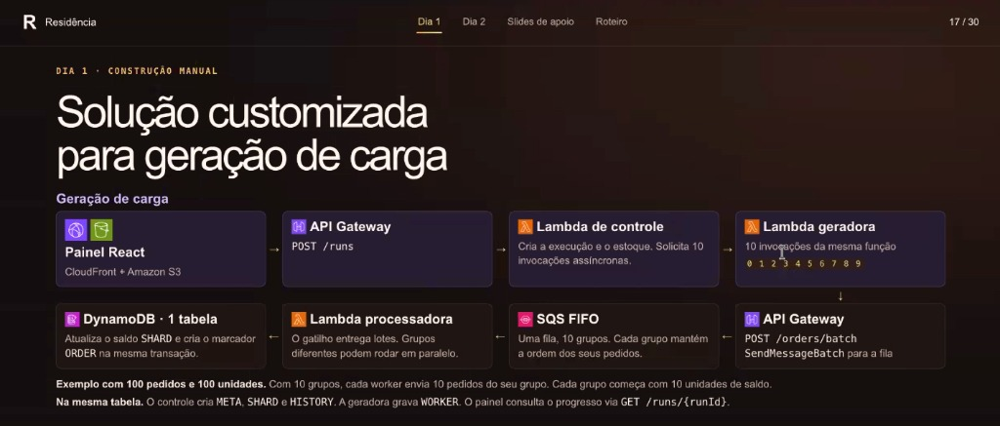

# ⚡ Solução Customizada para Geração de Carga (Serverless)

> **Referência:** Slide 17/30 do Workshop DevOps na Nuvem — Construção Manual  
> **Repositório Base:** [kenerry-serain/dvn-workshop-nov-26](https://github.com/kenerry-serain/dvn-workshop-nov-26)  
> **Status:** Documentado

---

## 1. Visão Geral e Objetivo
Esta solução simula um cenário extremo de **alta concorrência de pedidos** (Black Friday) com o objetivo de testar e validar o comportamento de consistência atômica de estoque sem sofrer com gargalos de I/O e *hot partitions* no banco de dados.

A arquitetura foi desenhada para ser 100% serverless, desacoplada, paralela e de baixo custo de execução.

---

## 2. Diagrama de Arquitetura do Slide

### Fluxo Integrado de Mensagens & Processamento

```mermaid
flowchart LR
    A["🖥️ Painel React<br/>(CloudFront + S3)"] -->|POST /runs| B["🌐 API Gateway"]
    B --> C["⚡ Lambda de Controle<br/>(Cria execução e estoque)"]
    C -->|Invocações assíncronas x10| D["⚡ Lambda Geradora<br/>(Workers 0 a 9)"]
    D -->|POST /orders/batch| E["🌐 API Gateway"]
    E -->|SendMessageBatch| F["📬 SQS FIFO<br/>(1 fila, 10 MessageGroupIds)"]
    F -->|Lotes por grupo| G["⚡ Lambda Processadora<br/>(Execução em paralelo)"]
    G -->|Transação Atômica| H[("🗄️ DynamoDB (1 Tabela)<br/>SHARD (saldo) + ORDER")]
```

---

## 3. Detalhamento dos Componentes

1. **Painel React (Hospedado em S3 + CloudFront):**
   - Interface web estática e responsiva.
   - Dispara a execução via `POST /runs` informando quantidade de pedidos e configuração de estoque.
   - Faz polling do status em tempo real via `GET /runs/{runId}` para apresentar métricas e gráficos ao operador.
2. **API Gateway:**
   - Atua como porta de entrada HTTP segura e escalável para dois endpoints principais:
     - `/runs`: Gestão de ciclos de testes.
     - `/orders/batch`: Recepção de pacotes de pedidos gerados pelos workers.
3. **Lambda de Controle:**
   - Cria o registro mestre de execução (`META`) no DynamoDB.
   - Distribui e inicializa as quotas de saldo entre múltiplos shards (`SHARD`).
   - Registra o evento no histórico (`HISTORY`).
   - Dispara 10 invocações concorrentes assíncronas (`InvocationType: Event`) da **Lambda Geradora**, parametrizando cada worker de 0 a 9.
4. **Lambda Geradora (Workers 0 a 9):**
   - 10 execuções rodando simultaneamente em paralelo.
   - Cada worker registra seu heartbeat/progresso (`WORKER`) no DynamoDB.
   - Gera as cargas de pedidos em lote e dispara requisições HTTP `POST /orders/batch` no API Gateway, marcando cada lote com seu respectivo grupo.
5. **Amazon SQS FIFO:**
   - Uma fila única configurada como FIFO (*First-In-First-Out*).
   - Divide as mensagens em **10 MessageGroupIds** distintos (um para cada shard).
   - **Garantia:** Mantém a ordem estrita de processamento dentro do mesmo `MessageGroupId`, enquanto processa os 10 grupos concorrentemente entre si sem bloqueios.
6. **Lambda Processadora:**
   - Integrada à fila SQS FIFO via Event Source Mapping (ESM).
   - Consome lotes de mensagens por grupo e processa até 10 execuções paralelas simultâneas.
   - Executa as transações atômicas de débito de estoque no banco de dados.
7. **Amazon DynamoDB (Single-Table Design):**
   - Centraliza todas as entidades da carga em uma única tabela física.
   - Executa `TransactWriteItems` para garantir atomicidade: subtrai o saldo da partição com checagem de condição (`saldo >= quantidade`) e insere o registro do pedido (`ORDER`).

---

## 4. Conceito Chave: *Sharded Counters* (Contadores Particionados)
- **Problema:** Se 1 milhão de requisições tentarem decrementar o mesmo registro de estoque em uma tabela relacional ou NoSQL em segundos, ocorre colisão extrema de escrita (*write contention* / *hot partition*), gerando erros de throttling ou bloqueios de lock (deadlock).
- **Solução:** O estoque é dividido em $N$ partições (ex.: 10 shards com 10 unidades cada para um total de 100 itens). Cada grupo de workers/processadores debita apenas de seu shard correspondente, permitindo escalabilidade horizontal com consistência estrita.

---

## 5. Modelo de Dados — Single-Table Design

| Prefixo da Chave | Finalidade | Atributos Principais |
| :--- | :--- | :--- |
| `META` | Metadados gerais da rodada | `runId`, `totalOrders`, `totalUnits`, `status`, `createdAt` |
| `SHARD` | Saldo particionado de estoque | `shardId` (0 a 9), `saldo`, `version` |
| `WORKER` | Telemetria de cada gerador | `workerId`, `processedCount`, `lastHeartbeat` |
| `ORDER` | Confirmação de pedido gravado | `orderId`, `shardId`, `quantidade`, `timestamp` |
| `HISTORY` | Linha do tempo de eventos | `runId`, `timestamp`, `eventDescription` |
