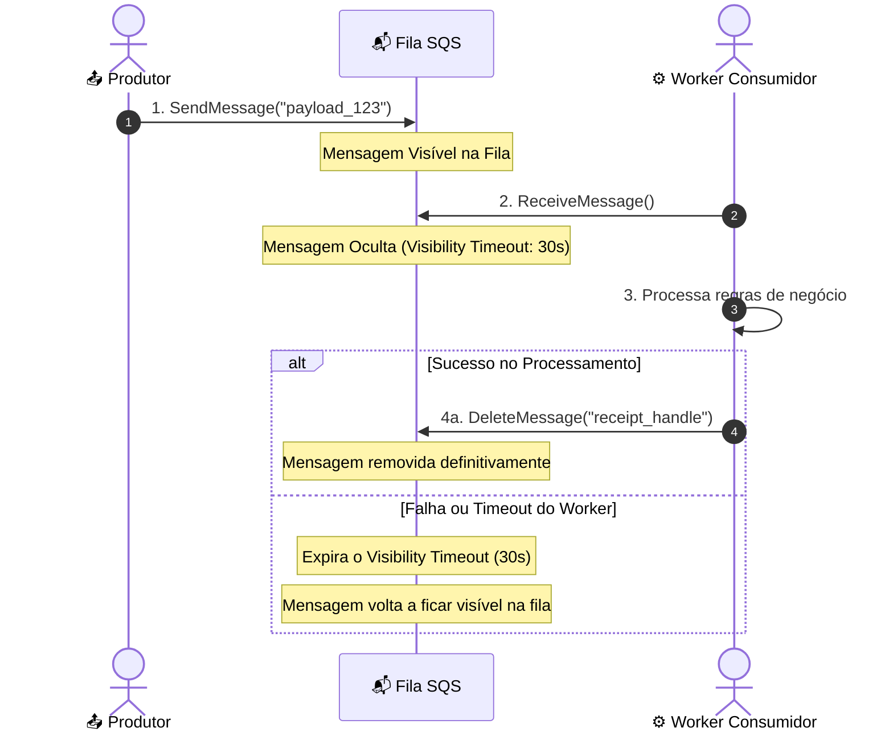
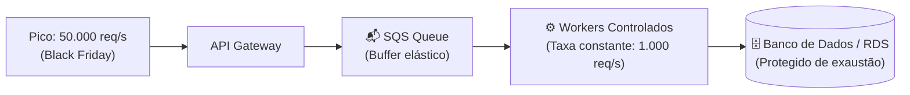
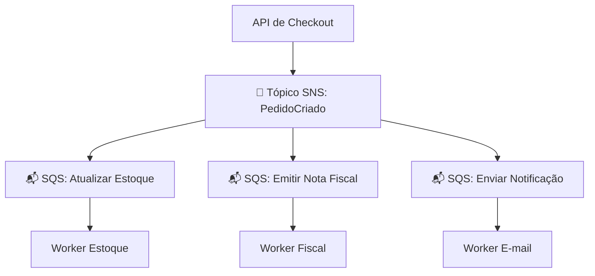
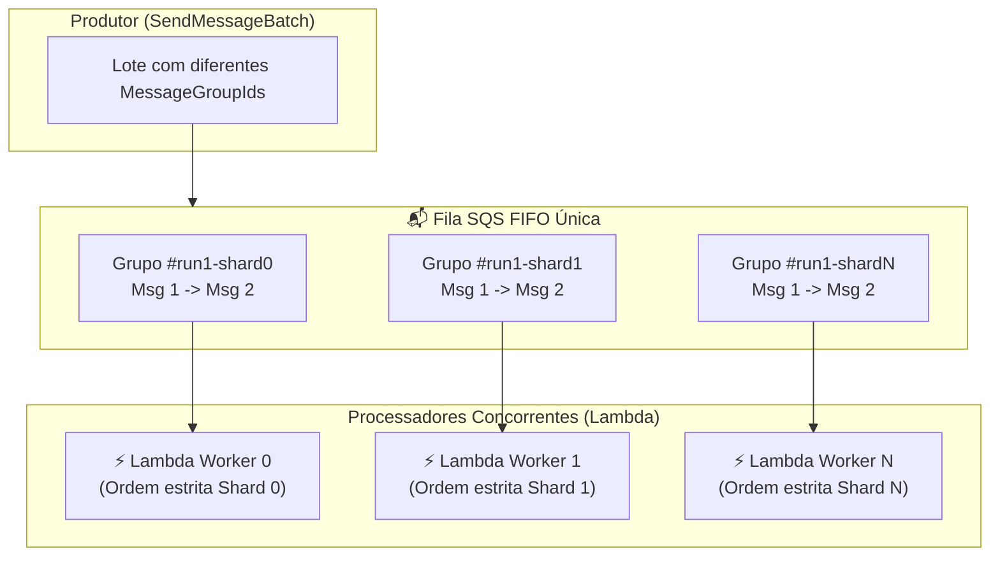

# 📬 Amazon SQS — Simple Queue Service

> **Categoria:** Mensageria, Integração Assíncrona & Desacoplamento  
> **Sessão:** Arquitetura Escalável & Resiliente na AWS  
> **Status:** Concluído

---

## 1. O que é o Amazon SQS?

O **Amazon SQS** (*Simple Queue Service*) é o primeiro serviço lançado comercialmente pela AWS (2004) e continua sendo a espinha dorsal de arquiteturas orientadas a eventos e microsserviços modernos.

Trata-se de um serviço de **filas de mensagens totalmente gerenciado**, altamente escalável e distribuído, projetado para **desacoplar** e integrar componentes de software que operam de forma assíncrona.

Com o SQS, uma aplicação produtora (*Producer*) pode enviar mensagens para uma fila sem se preocupar se o consumidor (*Consumer*) está disponível, lento ou temporariamente fora do ar. As mensagens são armazenadas de forma segura e durável em múltiplas zonas de disponibilidade (Multi-AZ) até serem processadas e excluídas.

```mermaid
flowchart LR
    subgraph Producers ["📤 Produtores (Producers)"]
        API["API Gateway / Lambda"]
        Web["Aplicação Web (EC2 / ECS)"]
    end

    subgraph Queue ["📬 Fila SQS Gerenciada (Multi-AZ)"]
        direction TB
        M1["Mensagem 1"]
        M2["Mensagem 2"]
        M3["Mensagem 3"]
        DLQ["💀 Dead Letter Queue (DLQ)\n(Mensagens com falha repetida)"]
    end

    subgraph Consumers ["📥 Consumidores (Consumers)"]
        Worker1["Worker Lambda"]
        Worker2["Worker Container (ECS)"]
        Worker3["Worker EC2 / On-Premise"]
    end

    API -->|1. SendMessage| Queue
    Web -->|1. SendMessage| Queue

    Queue -->|2. ReceiveMessage (Poll)| Worker1
    Queue -->|2. ReceiveMessage (Poll)| Worker2
    Queue -->|2. ReceiveMessage (Poll)| Worker3

    Worker1 -.->|3. DeleteMessage (Sucesso)| Queue
    Worker2 -.->|Falhas repetidas excedendo maxReceiveCount| DLQ
```

---

## 2. Analogia Didática: A Esteira de Pedidos de uma Cozinha Industrial

| Elemento da Cozinha | Equivalente no SQS | Papel no Sistema |
| :--- | :--- | :--- |
| **Garçom anotando pedidos** | **Produtor (Producer / API)** | Recebe a solicitação do cliente em alta velocidade e coloca o pedido na esteira. |
| **Bandeja / Esteira de Pedidos** | **Fila SQS (Queue)** | Retém e organiza os pedidos de forma resiliente, absorvendo picos repentinos sem perder nada. |
| **Cozinheiros pegando pedidos** | **Consumidores (Workers / Lambdas)** | Retiram um pedido da esteira, preparam o prato e descartam a comanda quando pronto. |
| **Tempo de Preparo Prometido** | **Visibility Timeout** | Enquanto um cozinheiro prepara o prato, outros cozinheiros não enxergam aquele pedido na esteira. |
| **Prato Rejeitado / Ingrediente Estragado** | **Dead Letter Queue (DLQ)** | Pedido com problema que falhou várias vezes vai para a mesa do gerente analisar. |

---

## 3. Tipos de Fila: Standard vs. FIFO

A AWS oferece dois tipos de filas SQS, projetadas para atender diferentes requisitos de vazão, ordenação e duplicação:

| Característica | Fila Padrão (*Standard Queue*) | Fila FIFO (*First-In, First-Out*) |
| :--- | :--- | :--- |
| **Ordem de Entrega** | **Melhor esforço (*Best-effort ordering*):** As mensagens podem ocasionalmente ser entregues fora de ordem. | **Ordem Estrita Garantida:** A ordem de envio é exatamente preservada (`First-In, First-Out`). |
| **Garantia de Entrega** | **Ao menos uma vez (*At-least-once delivery*):** Ocasionalmente pode haver mensagens duplicadas. | **Exatamente uma vez (*Exactly-once processing*):** Duplicações automáticas são eliminadas. |
| **Throughput (Vazão)** | **Ilimitado:** Suporta dezenas de milhares de mensagens por segundo sem configuração extra. | **Até 300 msg/s** (ou **3.000 msg/s com batch** de 10) por padrão; até 70.000 msg/s com *High Throughput Mode*. |
| **Identificador Obrigatório** | Nome livre (ex.: `pedidos-processamento`). | **Sufixo obrigatório `.fifo`** (ex.: `pedidos-financeiros.fifo`). |
| **Controle de Mensagem** | Não requer IDs especiais de deduplicação. | Requer `MessageGroupId` e `MessageDeduplicationId` (ou content-based deduplication). |
| **Custo** | Mais econômico (\$0.40 por milhão de requisições). | Levemente mais caro (\$0.50 por milhão de requisições). |
| **Casos de Uso Ideais** | Envio de e-mails, processamento de imagens, logs, transações idempotentes. | Transações bancárias, compra de ingressos, controle de estoque crítico, ledger contábil. |

---

## 4. Conceitos Vitais de Funcionamento

### 4.1 Ciclo de Vida da Mensagem & Visibility Timeout
Quando um consumidor executa a chamada `ReceiveMessage`:
1. A mensagem **não é deletada** da fila imediatamente.
2. A mensagem entra no estado **invisível** durante o período de **Visibility Timeout** (padrão: 30 segundos; configurável de 0s a 12 horas).
3. Enquanto está invisível, outros consumidores que fizerem poll na fila não verão essa mensagem, evitando processamento concorrente duplicado.
4. Se o consumidor processar com sucesso: ele deve invocar explicitamente `DeleteMessage`.
5. Se o consumidor travar ou falhar antes de deletar: ao expirar o Visibility Timeout, a mensagem volta a ficar visível para outros consumidores tentarem novamente.



### 4.2 Dead Letter Queue (DLQ) — Tratamento de "Poison Pills"
Uma mensagem com dados corrompidos ou que dispara uma exceção não tratada no consumidor pode ficar em um loop infinito de reprocessamento (*poison pill*).
- **Como a DLQ resolve:** Você associa uma segunda fila SQS como DLQ e define um `maxReceiveCount` (ex.: 3 ou 5).
- Se a mensagem for consumida e falhar $N$ vezes, o SQS a move automaticamente para a DLQ.
- Engenheiros de confiabilidade podem inspecionar a mensagem com erro, corrigir o bug e usar o recurso de **DLQ Redrive** para devolver a mensagem à fila principal.

### 4.3 Long Polling vs. Short Polling
- **Short Polling (`WaitTimeSeconds = 0`):** O SQS consulta apenas um subconjunto de seus servidores de armazenamento e retorna imediatamente, mesmo que não haja mensagens (aumenta o custo com chamadas vazias).
- **Long Polling (`WaitTimeSeconds = 1 a 20`):** O SQS aguarda até 20 segundos para retornar até que uma mensagem chegue. **Reduz custos drasticamente** e elimina requisições desnecessárias. **Sempre recomendado em produção.**

---

## 5. Principais Padrões Arquiteturais com SQS

### 5.1 Nivelamento de Carga (*Queue-Based Load Leveling*)
Picos massivos de tráfego (como Black Friday) podem derrubar bancos de dados relacionais (PostgreSQL/MySQL) se milhares de requisições tentarem gravar simultaneamente.
- **Solução:** A API Gateway ou Lambda rápida apenas enfileira o pedido no SQS em milissegundos.
- Um grupo controlado de workers drena a fila na velocidade máxima suportada pelo banco de dados, protegendo a integridade do sistema.



### 5.2 Padrão Fan-Out (Amazon SNS + Amazon SQS)
Uma única mensagem publicada em um tópico **Amazon SNS** é replicada instantaneamente para múltiplas filas SQS independentes, permitindo processamento em paralelo por diferentes setores da empresa.



### 5.3 Padrão FIFO Sharding com Grupos de Mensagem (*Message Groups*)
> **Conforme destacado no Excalidraw:** *"Uma fila, vários grupos, vários consumidores"*.

Quando utilizamos **SQS FIFO**, a ordem estrita de entrega (*Strict Ordering*) e o processamento de mensagem única (*Exactly-Once*) se aplicam ao escopo do **`MessageGroupId`**:
- **Problema de FIFO tradicional:** Se todas as mensagens pertencerem ao mesmo grupo, apenas 1 consumidor Lambda/Worker poderá processar por vez para garantir a ordem, criando um gargalo de taxa de transferência (*throughput*).
- **Solução (Particionamento via MessageGroupId):** Ao atribuir identificadores distintos (`message-group = #runId-#shard-id`), cada grupo de mensagens opera de forma totalmente independente:
  - Mensagens do **Grupo A** são processadas estritamente em ordem pelo **Worker 1**.
  - Mensagens do **Grupo B** são processadas estritamente em ordem pelo **Worker 2** em paralelo.
  - Concorrência máxima controlada via **Reserved Concurrency / Maximum Concurrency** no AWS Lambda.



---

## 6. Exemplo Prático em Terraform: Fila SQS com DLQ e Long Polling

```hcl
# 1. Fila de Falhas (Dead Letter Queue)
resource "aws_sqs_queue" "pedidos_dlq" {
  name                      = "pedidos-processamento-dlq"
  message_retention_seconds = 1209600 # 14 dias (máximo permitido)
}

# 2. Fila Principal de Pedidos
resource "aws_sqs_queue" "pedidos_queue" {
  name                       = "pedidos-processamento"
  visibility_timeout_seconds = 60   # Tempo para o worker processar
  message_retention_seconds  = 345600 # 4 dias de retenção
  receive_wait_time_seconds  = 20   # Long Polling ativado (max 20s)

  # Política de Redrive para DLQ após 3 tentativas com falha
  redrive_policy = jsonencode({
    deadLetterTargetArn = aws_sqs_queue.pedidos_dlq.arn
    maxReceiveCount     = 3
  })
}

# 3. Política de Permissão para DLQ aceitar mensagens da fila principal
resource "aws_sqs_queue_redrive_allow_policy" "pedidos_redrive_allow" {
  queue_url = aws_sqs_queue.pedidos_dlq.id

  redrive_allow_policy = jsonencode({
    redrivePermission = "byQueue"
    sourceQueueArns   = [aws_sqs_queue.pedidos_queue.arn]
  })
}
```

---

## 7. Diferenças Cruciais: SQS vs. SNS vs. Kinesis

| Critério | Amazon SQS | Amazon SNS | Amazon Kinesis Data Streams |
| :--- | :--- | :--- | :--- |
| **Modelo** | **Pull (Consumidor busca)** | **Push (Serviço entrega)** | **Stream / Replay (Leitura por Shards)** |
| **Padrão** | Fila ponto a ponto (*Point-to-Point*) | Publicador / Assinante (*Pub/Sub*) | Ingestão e processamento contínuo de big data |
| **Persistência** | Mensagem é deletada após o consumo | Não armazena (entrega ou descarta) | Dados retidos de 24h a 365 dias (replay) |
| **Consumo Concorrente** | Vários workers dividem a mesma fila | Vários assinantes recebem cópias idênticas | Vários consumidores leem o mesmo stream em offsets diferentes |
