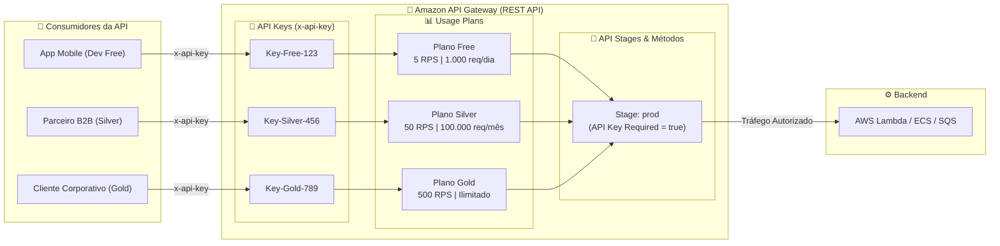
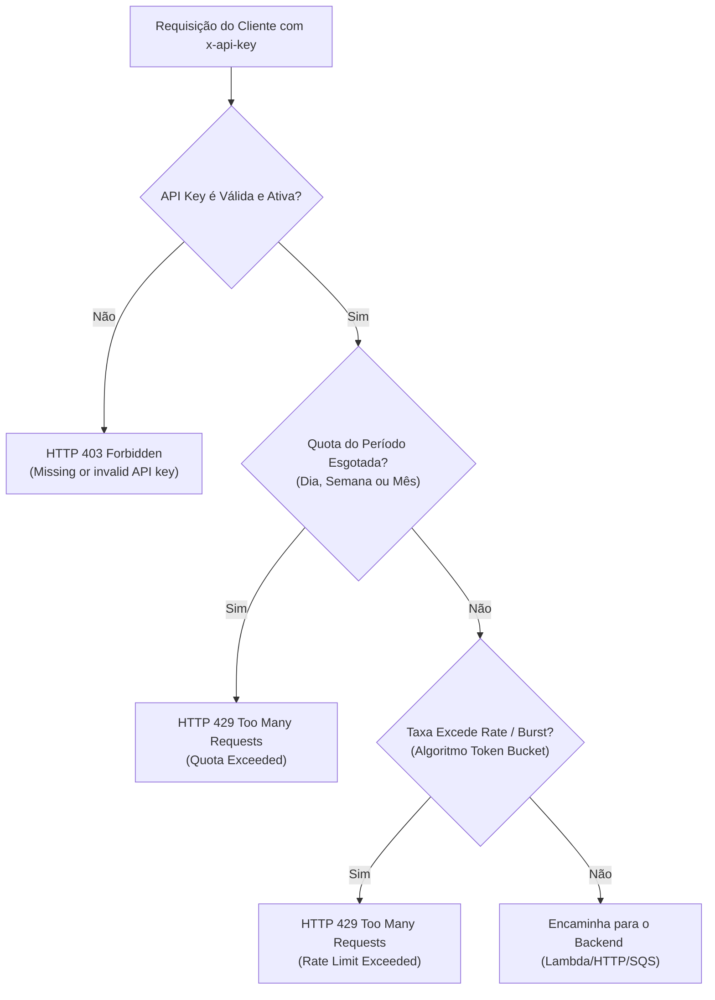

# 📊 Amazon API Gateway — Usage Plans (Planos de Uso) & API Keys

> **Categoria:** Governança, Segurança & Monetização de APIs  
> **Serviço AWS:** Amazon API Gateway (REST API)  
> **Status:** Concluído  

---

## 1. O que é um Usage Plan (Plano de Uso)?

No **Amazon API Gateway**, um **Usage Plan (Plano de Uso)** é o mecanismo nativo de governança e controle de tráfego que determina **quem** pode acessar suas APIs, em quais **estágios (Stages)** e sob quais **limites de taxa e volume**.

Ele permite que você crie contratos de consumo diferenciados para clientes, parceiros comerciais ou equipes internas, protegendo seus serviços de backend contra sobrecarga e viabilizando modelos de negócio baseados em níveis de serviço (*tiers* como Free, Silver, Gold e Enterprise).



---

## 2. A Tríade do Usage Plan: Como os Componentes se Conectam

Para implementar o controle por plano de uso no API Gateway, três componentes trabalham juntos:

| Componente | O que é? | Função Principal |
| :--- | :--- | :--- |
| **1. API Key** | Uma string alfanumérica única (gerada pela AWS ou importada). | **Identificar o cliente/consumidor** que está realizando a chamada através do cabeçalho HTTP `x-api-key`. |
| **2. Usage Plan** | O conjunto de regras de consumo (Throttling + Quota). | **Definir as restrições de uso** e associá-las a um ou mais *Stages* de APIs REST. |
| **3. Usage Plan Key** | A tabela/recurso de junção (*binding*). | **Vincular uma API Key específica a um Usage Plan específico**. |

> ⚠️ **Importante:** Em cada método da API REST (`GET /pedidos`, `POST /checkout`), você deve marcar explicitamente `API Key Required = true`. Sem essa flag, o API Gateway ignora a chave enviada e não aplica as regras do Usage Plan para aquela rota.

---

## 3. Analogia Didática: A Academia e seus Planos de Acesso

Pense no API Gateway com Usage Plans como a catraca de uma academia corporativa:

| Elemento da Academia | Equivalente no API Gateway | Papel Técnico |
| :--- | :--- | :--- |
| **Carteirinha com Código de Barras** | **API Key (`x-api-key`)** | Identifica quem é o aluno. Não prova sua identidade biométrica nem se a carteirinha foi emprestada, mas diz a qual conta ela pertence. |
| **Plano Básico vs. Black / VIP** | **Usage Plan** | O contrato de serviço: quantas vezes por mês o aluno pode ir e quantas aulas por hora pode agendar. |
| **Catraca Automática** | **Throttling (Token Bucket)** | Impede que 50 pessoas passem ao mesmo segundo na mesma catraca (evita picos e tumulto). |
| **Franquia de 12 visitas/mês** | **Quota** | Se o aluno do plano básico atingir 12 visitas no mês, a catraca trava e exibe *"Cota mensal esgotada"* (`HTTP 429`). |

---

## 4. Throttling vs. Quota: Entendendo a Diferença Fundamental

Um dos conceitos mais cobrados em arquitetura e certificações AWS é a diferença entre **Throttling** e **Quota**:



### Quadro Comparativo:

| Característica | Throttling (Taxa Instantânea) | Quota (Volume Temporal) |
| :--- | :--- | :--- |
| **Objetivo** | Proteger a infraestrutura contra **rajadas e picos momentâneos** (DDoS, loops de clientes). | Proteger contra **consumo excessivo de longo prazo** e suportar modelos de cobrança (*billing*). |
| **Janela de Tempo** | Milissegundos / Segundos (**RPS** — Requisições por Segundo). | **Dia, Semana ou Mês**. |
| **Parâmetros** | **Rate Limit** (taxa contínua) e **Burst Limit** (capacidade do balde). | **Limit** (número inteiro) + **Period** (`DAY`, `WEEK`, `MONTH`). |
| **Algoritmo** | *Token Bucket Algorithm*. | Contador acumulativo na janela temporal. |
| **Comportamento em Falha** | Retorna `HTTP 429 Too Many Requests`. O cliente pode tentar novamente em milissegundos (*exponential backoff*). | Retorna `HTTP 429 Too Many Requests`. O cliente fica bloqueado até o reset do período. |
| **Reset do Contador** | Instantâneo à medida que novos tokens são adicionados ao balde. | No início do próximo ciclo (ou reset manual via API/Console). |

---

## 5. Exemplo Prático de Tiers de Consumo (Monetização)

Empresas que vendem APIs utilizam Usage Plans para criar camadas (*tiers*) comerciais:

| Nível (*Tier*) | Rate Limit (RPS) | Burst Limit (Pico) | Quota por Mês | Preço Típico |
| :--- | :---: | :---: | :---: | :--- |
| **Developer / Free** | 5 RPS | 10 requisições | 5.000 req/mês | Gratuito |
| **Startup / Silver** | 50 RPS | 100 requisições | 500.000 req/mês | \$49 / mês |
| **Business / Gold** | 200 RPS | 400 requisições | 5.000.000 req/mês | \$299 / mês |
| **Enterprise / Custom** | 1.000 RPS | 2.000 requisições | Ilimitado | Negociado |

---

## 6. Implementação Prática com Terraform (IaC)

Abaixo está o código completo em HCL para provisionar uma REST API com **API Key obrigatória**, um **Usage Plan** com Throttling e Quota, e o vínculo entre eles:

```hcl
# 1. Definição da API Gateway REST API
resource "aws_api_gateway_rest_api" "api" {
  name        = "ecommerce-public-api"
  description = "API pública com monetização e governança via Usage Plans"
}

# 2. Recurso (/produtos)
resource "aws_api_gateway_resource" "produtos" {
  rest_api_id = aws_api_gateway_rest_api.api.id
  parent_id   = aws_api_gateway_rest_api.api.root_resource_id
  path_part   = "produtos"
}

# 3. Método GET /produtos com API Key Obrigatória
resource "aws_api_gateway_method" "get_produtos" {
  rest_api_id      = aws_api_gateway_rest_api.api.id
  resource_id      = aws_api_gateway_resource.produtos.id
  http_method      = "GET"
  authorization    = "NONE"
  api_key_required = true # <-- Habilita a checagem obrigatória da API Key!
}

# 4. Integração Mock (para exemplo de retorno rápido)
resource "aws_api_gateway_integration" "mock" {
  rest_api_id = aws_api_gateway_rest_api.api.id
  resource_id = aws_api_gateway_resource.produtos.id
  http_method = aws_api_gateway_method.get_produtos.http_method
  type        = "MOCK"

  request_templates = {
    "application/json" = "{\"statusCode\": 200}"
  }
}

# 5. Method Response
resource "aws_api_gateway_method_response" "response_200" {
  rest_api_id = aws_api_gateway_rest_api.api.id
  resource_id = aws_api_gateway_resource.produtos.id
  http_method = aws_api_gateway_method.get_produtos.http_method
  status_code = "200"
}

# 6. Deployment e Stage (prod)
resource "aws_api_gateway_deployment" "deployment" {
  rest_api_id = aws_api_gateway_rest_api.api.id

  depends_on = [
    aws_api_gateway_integration.mock
  ]

  lifecycle {
    create_before_destroy = true
  }
}

resource "aws_api_gateway_stage" "prod" {
  deployment_id = aws_api_gateway_deployment.deployment.id
  rest_api_id   = aws_api_gateway_rest_api.api.id
  stage_name    = "prod"
}

# 7. Definição do Usage Plan (Tier Prata / Silver)
resource "aws_api_gateway_usage_plan" "silver_plan" {
  name        = "Silver-Tier-Plan"
  description = "Plano intermediário: 50 RPS contínuos e 100k requisições/mês"

  api_stages {
    api_id = aws_api_gateway_rest_api.api.id
    stage  = aws_api_gateway_stage.prod.stage_name
  }

  # Throttling a nível de plano
  throttle_settings {
    rate_limit  = 50
    burst_limit = 100
  }

  # Quota mensal
  quota_settings {
    limit  = 100000
    period = "MONTH"
    offset = 0
  }
}

# 8. Criação da API Key para o Cliente
resource "aws_api_gateway_api_key" "cliente_parceiro" {
  name        = "ApiKey-Cliente-EmpresaXPTO"
  description = "Chave atribuída ao parceiro Empresa XPTO"
  enabled     = true
}

# 9. Associação (Binding) da API Key ao Usage Plan
resource "aws_api_gateway_usage_plan_key" "silver_binding" {
  key_id        = aws_api_gateway_api_key.cliente_parceiro.id
  key_type      = "API_KEY"
  usage_plan_id = aws_api_gateway_usage_plan.silver_plan.id
}
```

---

## 7. Como o Cliente Consome a API

Quando o cliente faz a requisição, ele **deve** incluir a API Key no cabeçalho `x-api-key`:

```bash
curl -X GET "https://abc123xyz.execute-api.us-east-1.amazonaws.com/prod/produtos" \
     -H "x-api-key: d41d8cd98f00b204e9800998ecf8427e" \
     -H "Accept: application/json"
```

### Possíveis Códigos de Resposta:
- **`200 OK`**: Chave válida, taxa e quota dentro do limite.
- **`403 Forbidden`**: Header `x-api-key` ausente, chave inexistente, inativa ou não vinculada ao plano do Stage requisitado.
- **`429 Too Many Requests`**:
  - Excedeu o *Rate/Burst limit* (Throttling instantâneo).
  - Excedeu a *Quota* configurada para o período (dia/semana/mês).

---

## 8. Segurança e Anti-Patterns: Cuidados Críticos de DevSecOps

> 🚨 **REGRA DE OURO DA AWS:** **API Key NÃO é mecanismo de autenticação ou autorização!**

1. **API Keys servem para Identificação e Medição (*Metering*), não Autenticação:**
   - As API Keys são estáticas e podem ser facilmente extraídas se usadas diretamente no frontend (React, apps mobile, extensões).
   - Elas **não** provam a identidade segura de um usuário. Para autenticação e autorização robustas, utilize:
     - **Amazon Cognito User Pools** (JWT).
     - **Lambda Authorizers** (OAuth2, validação de tokens externos, escopos granulares).
     - **AWS IAM** (chaves de acesso SigV4 para serviços internos AWS).
2. **REST API vs. HTTP API:**
   - O recurso nativo de **Usage Plans e API Keys só existe em REST APIs**.
   - As **HTTP APIs (v2)** suportam Throttling global e por rota, mas **não** possuem suporte nativo a API Keys e Usage Plans com cotas por cliente. Se seu caso de uso exigir monetização ou chaves por cliente, você deve utilizar REST API.
3. **Economia de Custos (FinOps):**
   - Quando uma requisição é bloqueada pelo Usage Plan (`429` ou `403`), o API Gateway **não invoca a função Lambda** ou o backend.
   - Isso protege seu backend de quedas por sobrecarga e **economiza 100% dos custos computacionais** de backend durante ataques ou clientes em loop.
4. **Customização de Throttling por Método (*Method-Level Throttling*):**
   - No mesmo Usage Plan, você pode definir regras de throttling específicas para métodos mais pesados (ex.: limitar `POST /relatorios-pesados` a 2 RPS, enquanto `GET /produtos` opera a 50 RPS).
