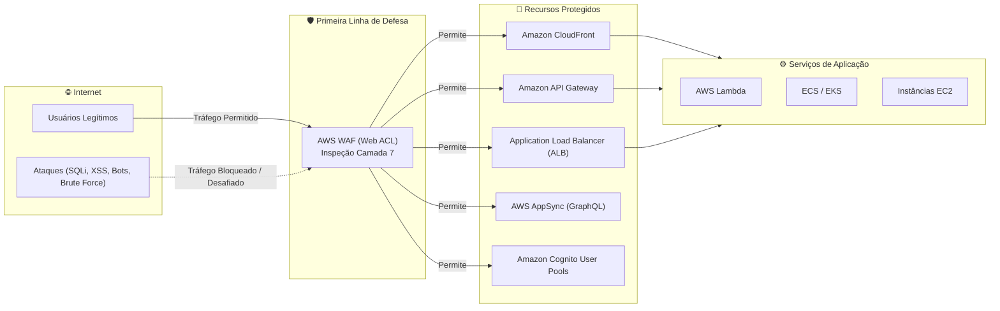
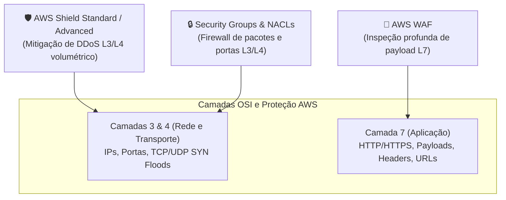

# 🛡️ AWS WAF — Web Application Firewall

> **Categoria:** Segurança, Borda & Proteção de Aplicações (Camada 7)  
> **Sessão:** Arquitetura Escalável & Resiliente na AWS  
> **Status:** Concluído

---

## 1. O que é o AWS WAF?

O **AWS WAF** (*Web Application Firewall*) é um firewall de camada de aplicação (**Camada 7** do modelo OSI) projetado para monitorar, filtrar e bloquear requisições HTTP e HTTPS maliciosas antes que elas atinjam seus recursos de backend.

Diferente de firewalls tradicionais de rede (como Security Groups, Network ACLs ou AWS Network Firewall, que operam nas Camadas 3 e 4 inspecionando IPs e portas), o AWS WAF inspeciona o **conteúdo da requisição web**: cabeçalhos (*headers*), cookies, corpo (*body*), método HTTP, strings de consulta (*query parameters*) e caminhos de URI.



---

## 2. Analogia Didática: O Segurança Especialista na Entrada do Evento

| Elemento do Evento | Equivalente AWS | Função no Sistema |
| :--- | :--- | :--- |
| **Portão Principal / Catraca Externa** | **AWS WAF** | Analisa a postura, itens na mochila e comportamento de quem quer entrar antes de passar pela porta. |
| **Lista de Proibidos (Revista Fina)** | **Regras de Bloqueio (SQLi / XSS)** | Identifica armas e materiais perigosos disfarçados no payload. |
| **Controle de Fluxo por Pessoa** | **Rate-Based Rules** | Impede que uma mesma pessoa tente passar pela catraca 1.000 vezes por minuto (força bruta / DoS L7). |
| **Guarda Local da Sala / Crachá** | **Security Group & IAM** | Garante que portas internas estejam trancadas e acessíveis apenas a quem tem permissão. |

---

## 3. Conceitos Fundamentais do AWS WAF

### 3.1 Web ACL (Web Access Control List)
A **Web ACL** é a entidade central que você anexa ao recurso protegido (CloudFront, ALB, API Gateway). Ela contém:
- Uma coleção de regras ordenadas por prioridade.
- Uma **ação padrão** (*Default Action*): `Allow` (whitelist approach) ou `Block` (blacklist approach).
- Métricas e configurações de log (*Amazon CloudWatch*, *Amazon S3* ou *Amazon Kinesis Data Firehose*).

### 3.2 Regras (Rules) e Grupos de Regras (Rule Groups)
- **Regras Gerenciadas pela AWS (AWS Managed Rules - AMR):** Conjuntos de regras pré-configurados e mantidos por especialistas em segurança da AWS (ex.: proteção contra OWASP Top 10, IP Reputation List, Known Bad Inputs, Bot Control, Account Takeover Prevention).
- **Regras Personalizadas (Custom Rules):** Criadas sob medida com condições booleanas (AND, OR, NOT) inspecionando partes específicas da requisição (ex.: bloquear requisições com header `X-Custom-Auth` ausente).
- **Regras Baseadas em Taxa (Rate-Based Rules):** Contam requisições por IP (ou por chave combinada de IP + Header) em janelas de 1, 2 ou 5 minutos. Se o limite for excedido, aciona ação temporária.

### 3.3 Ações de uma Regra
Para cada requisição avaliada, uma regra pode aplicar uma das seguintes ações:
1. **Allow:** Permite a passagem imediata para o backend.
2. **Block:** Rejeita a requisição, retornando HTTP `403 Forbidden` com página/código customizável.
3. **Count:** Não bloqueia; apenas incrementa métricas e adiciona logs (essencial para testar regras novas em produção antes de ativar o bloqueio).
4. **CAPTCHA / Challenge:** Apresenta um desafio interativo (CAPTCHA) ou invisível (JavaScript Challenge/Silent) para verificar se o cliente é um navegador humano ou um bot automatizado.

---

## 4. O que o WAF Protege (Casos de Uso Críticos)

| Vetor de Ataque | Como o AWS WAF Mitiga | Regra Típica |
| :--- | :--- | :--- |
| **SQL Injection (SQLi)** | Inspeciona corpo, parâmetros de URL e headers procurando padrões de sintaxe SQL maliciosa. | `AWSManagedRulesSQLiRuleSet` |
| **Cross-Site Scripting (XSS)** | Detecta injeção de scripts maliciosos em HTML/JavaScript em formulários e requisições. | `AWSManagedRulesCommonRuleSet` |
| **OWASP Top 10** | Conjunto amplo cobrindo exploits conhecidos de servidores web (Apache, Nginx, PHP, Java). | `AWSManagedRulesKnownBadInputsRuleSet` |
| **Ataques de Força Bruta / Scraping** | Limita número de requisições por IP em janelas de tempo configuráveis. | Rate-based Rule (ex.: max 300 req / 5 min) |
| **Geo-Blocking** | Permite ou bloqueia tráfego originado em países ou regiões geográficas específicas. | Geo Match Condition (`CountryCode in ['XX', ...]`) |
| **Bots Maliciosos & Scrapers** | Analisa assinaturas de User-Agent, scrapers conhecidos, crawlers não autorizados e proxies suspeitos. | `AWSManagedRulesBotControlRuleSet` |
| **Account Takeover (ATO)** | Protege endpoints de login contra preenchimento de credenciais (*credential stuffing*) e testes de senhas. | `AWSManagedRulesATPRuleSet` |

---

## 5. Comparativo: AWS WAF vs. AWS Shield vs. Security Groups



| Característica | Security Groups | AWS Shield (Standard/Advanced) | AWS WAF |
| :--- | :--- | :--- | :--- |
| **Camada OSI** | Camadas 3 e 4 | Camadas 3 e 4 (Advanced apoia L7) | **Camada 7 (Aplicação)** |
| **Foco Principal** | Controle de acesso a portas e IPs em instâncias/interfaces | Mitigação de DDoS volumétrico em grande escala | Bloqueio de exploits web, vulnerabilidades e bots |
| **Inspeção de Payload?** | ❌ Não (apenas IP de origem/porta) | ❌ Não (analisa tráfego volumétrico) | ✅ **Sim** (Headers, Cookies, Query, Body, JSON) |
| **Custo** | Gratuito | Standard gratuito / Advanced pago ($3.000/mês + uso) | Cobrado por Web ACL ($5/mês) + Regra ($1/mês) + Requisição |

---

## 6. Exemplo Prático em Terraform: Web ACL com Regras Gerenciadas e Rate Limit

```hcl
resource "aws_wafv2_web_acl" "api_protection" {
  name        = "waf-api-gateway-protection"
  description = "Web ACL para protecao do API Gateway contra OWASP e forca bruta"
  scope       = "REGIONAL" # Use "CLOUDFRONT" se for associar a uma distribuicao CloudFront (us-east-1)

  default_action {
    allow {} # Ação padrão: permite tráfego que não violar nenhuma regra
  }

  visibility_config {
    cloudwatch_metrics_enabled = true
    metric_name                = "WAFDefaultMetric"
    sampled_requests_enabled   = true
  }

  # 1. Regra Gerenciada: Conjunto Básico Comum da AWS (OWASP Top 10)
  rule {
    name     = "AWS-AWSManagedRulesCommonRuleSet"
    priority = 10

    override_action {
      none {}
    }

    statement {
      managed_rule_group_statement {
        name        = "AWSManagedRulesCommonRuleSet"
        vendor_name = "AWS"
      }
    }

    visibility_config {
      cloudwatch_metrics_enabled = true
      metric_name                = "AWSManagedRulesCommon"
      sampled_requests_enabled   = true
    }
  }

  # 2. Regra Gerenciada: Prevenção contra SQL Injection
  rule {
    name     = "AWS-AWSManagedRulesSQLiRuleSet"
    priority = 20

    override_action {
      none {}
    }

    statement {
      managed_rule_group_statement {
        name        = "AWSManagedRulesSQLiRuleSet"
        vendor_name = "AWS"
      }
    }

    visibility_config {
      cloudwatch_metrics_enabled = true
      metric_name                = "AWSManagedRulesSQLi"
      sampled_requests_enabled   = true
    }
  }

  # 3. Regra Customizada: Rate Limiting por IP (Max 500 req a cada 5 minutos)
  rule {
    name     = "RateLimitPerIP"
    priority = 30

    action {
      block {} # Bloqueia ao exceder o limite
    }

    statement {
      rate_based_statement {
        limit              = 500
        aggregate_key_type = "IP"
      }
    }

    visibility_config {
      cloudwatch_metrics_enabled = true
      metric_name                = "RateLimitPerIPMetric"
      sampled_requests_enabled   = true
    }
  }
}

# Associação da Web ACL ao estágio do API Gateway
resource "aws_wafv2_web_acl_association" "apigw_assoc" {
  resource_arn = aws_api_gateway_stage.prod.arn
  web_acl_arn  = aws_wafv2_web_acl.api_protection.arn
}
```

---

## 7. Melhores Práticas & Arquitetura DevSecOps

1. **Deploy Inicial em Modo `Count`:**
   Ao introduzir regras de segurança em sistemas em produção, configure a ação da regra como `Count`. Monitore o CloudWatch por alguns dias para garantir que não há **falsos positivos** bloqueando clientes legítimos antes de alterar para `Block`.
2. **Posicionamento na Borda (*Edge Protection*):**
   Sempre que possível, associe a Web ACL à distribuição do **Amazon CloudFront** (`scope = "CLOUDFRONT"`). Isso bloqueia requisições maliciosas na borda global da AWS, evitando consumo de rede, NAT Gateway ou computação nos servidores de origem.
3. **Logs Centralizados e Análise de Segurança:**
   Habilite o envio de logs completos do WAF para o **Amazon Kinesis Data Firehose** ou **Amazon S3** e use o **Amazon Athena** para realizar consultas SQL analíticas sobre as tentativas de invasão e IPs bloqueados.
4. **Respostas Customizadas:**
   Ao bloquear requisições, configure respostas HTTP customizadas (ex.: código `429 Too Many Requests` para rate limits ou JSON amigável `{"error": "Access Denied"}`) para não vazar detalhes internos da stack.
